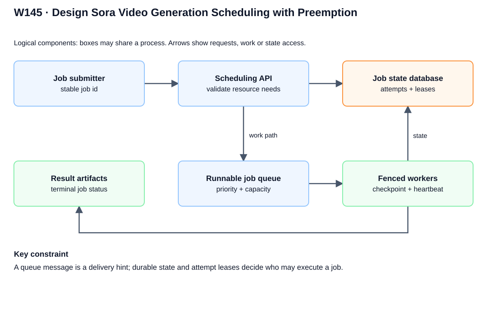

# W145. Design Sora Video Generation Scheduling with Preemption

**Priority group:** Second 100 — important

**Category:** LLM serving and scheduling

**Study position:** 145 of 547

[Group list](../NEXT_100.md) · [All categories](../ALL_CATEGORIES.md) · [Chapter guide](../README.md)

## Question

Design the job scheduler behind a Sora-style text-to-video product. A user types a prompt and waits for a short generated clip; each clip occupies a multi-GPU node for minutes, and at the daily peak there are more requests than GPUs.

Users are on one of three plans: Pro (highest), Plus, and Free. When the fleet is full, work from a higher plan must be able to take a node from a lower-priority job that is already running, and that job must later continue rather than be lost. Your design decides who runs, who waits, and who gets interrupted.

Scale and requirements

All numbers are assumptions you may adjust if you say why.
1. Fleet: 1,200 nodes of 8 GPUs each, all serving the same video model. A node runs one clip at a time.
2. Job: a 10-second 1080p clip. Generation is 50 iterative denoising steps of about 5 seconds each on one node, followed by about 50 seconds of decoding and encoding. Weights stay loaded on every node; starting or resuming a job on a node still takes about 3 seconds (receiving the job's inputs or its saved state and preparing the pipeline).
3. Demand: 2 clips per second for 20 hours of the day and 5 clips per second during a 4-hour peak, so 216,000 clips per day and 2.5 per second on average. Of all requests, 10% come from Pro, 30% from Plus and 60% from Free.
4. Start-time targets: a job has started when its first denoising step begins on a node. A Pro job starts within 15 seconds of submission, Plus within 2 minutes, and Free has no hard target but must eventually run.
5. Interrupted work: a preempted job resumes later from where it stopped, on any node, and the user sees one finished clip.
6. Bursts: during the peak, the total Pro rate can jump from 0.5 to 8 clips per second for one minute (for example after a feature launch). Plus and Free traffic stay at their peak rates.
What to design
1. The request path and job states, from submission to the delivered clip, including cancellation by the user.
2. The queues and the priority each queued job gets.
3. The preemption mechanism: how a running job is stopped, what is saved, and how it resumes.
4. Capacity estimates: fleet throughput, backlog at peak, and the cost of a preemption in GPU-seconds.
Example scenarios
1. The fleet is full of Free jobs and one Pro request arrives: it should start within its target, and the Free job it displaces finishes later without redoing its finished steps.
2. Peak traffic runs for 4 hours: paid requests keep their targets, and the Free backlog that builds up is cleared after the peak.
Follow-ups
Follow-up 1: priority signals beyond the plan

Besides how much the account pays, what other factors should raise or lower a job's priority, and how do you combine them into one ordering?

Follow-up 2: the preemption contract

Define the rules a running job is preempted under: who may preempt whom, when the job is told, how long it has before it must yield, what it must save, and which jobs are protected.

Follow-up 3: starvation

How do you make sure Free jobs are not starved when paid demand stays high for hours?

Follow-up 4: observability

Which metrics and alerts would you build to monitor preemption and scheduling health?

## Worked solution

<!-- architecture:W145:start -->
### Architecture and request flow

[Open the diagram at full size](../diagrams/W145_architecture.svg). This is a baseline component diagram for this question. The boxes describe responsibilities; they do not require a separate microservice for every box.

- **Request and state:** Job submitter — stable job id → Scheduling API — validate resource needs. That component consults or updates **Job state database — attempts + leases** under the required access and consistency rules.
- **Work and result:** the work path passes through **Runnable job queue — priority + capacity** and **Fenced workers — checkpoint + heartbeat**, producing **Result artifacts — terminal job status**. Bound waiting and retries where a slow dependency can stall this path.
- **Correctness point:** A queue message is a delivery hint; durable state and attempt leases decide who may execute a job.

When explaining the drawing, trace one normal request first, then a duplicate request, an unavailable dependency and recovery from saved state. If the question requires stricter guarantees or a different scope, state the change explicitly rather than treating this baseline as the only possible design.
<!-- architecture:W145:end -->

### Capacity first: the nominal fleet handles the day, not the peak

A fresh clip occupies one 8-GPU node for $3+50(5)+50=303$ seconds. Throughput without preemption/overhead is $1200/303=3.9604$ clips/s, or about 342,178/day. Demand is $2(20\cdot3600)+5(4\cdot3600)=216,000$/day. The 4-hour peak adds fluid backlog $(5-3.9604)14400\approx14,970$ clips, ignoring startup transients and failures; afterward spare rate is $3.9604-2=1.9604$/s, clearing it in about 7,636s = **2.12 hours**. Actual headroom/checkpoint policy reduces capacity, so use these as optimistic bounds.

At peak paid traffic is $.1(5)+.3(5)=2$/s, consuming roughly $2(303)=606$ nodes, leaving about 594 for Free. Thus paid work can remain prompt while Free absorbs peak backlog. Average paid work is 25% of nominal capacity; strict paid priority alone still needs a starvation policy and overload limits if traffic exceeds these assumptions.

### Request/state and queue contracts

`POST /video-jobs` accepts prompt/assets/configuration with a client idempotency key; returns a durable job id and status URL. `GET /jobs/{id}` reports queued/running/checkpointing/suspended/resuming/encoding/completed/failed/canceled, progress and queue estimate. `POST /jobs/{id}/cancel` sets a cancel intent checked by queued work and workers. Completed output is one immutable clip manifest; a compare-and-swap terminal commit prevents duplicate publication.

Persist `Job(id,tenant,plan,submit_time,status,priority,model_version,seed,deadline,checkpoint_ref,step,attempt,lease_epoch,result_ref)` and `Node(id,state,current_job,lease,heartbeat)`. Queue messages contain job ids; the DB is authoritative. Use whole-node gang allocation, weighted fair queues with per-account concurrency/token quotas, oldest-deadline-first among urgent paid jobs and FIFO/aging within ordinary classes. Resume jobs receive their original age plus limited resume credit so repeated eviction does not reset them forever. Resource fit, estimated remaining time, overdue age and bounded user priority can refine order, but cannot let one user flood all urgent slots.

### A preemption contract with a measurable bound

Pro may preempt Plus/Free; Plus may preempt Free; same-tier work is not preempted just to reshuffle. Choose a lower-tier victim with a recent checkpoint, long remaining work, few previous evictions and low checkpoint cost. Apply a per-job cooldown/eviction cap; near-completion protection is allowed only when urgent-start capacity is available. Every command carries a fencing epoch. Worker yields at a safe distributed denoising boundary, saves state atomically, acknowledges durable checkpoint, then releases **all eight GPUs**. The new job starts only after node cleanup/setup, not merely when the old worker receives a signal.

Checkpoint includes current latent/video tensors, completed denoising step and scheduler state, RNG states for all devices, prompt/conditioning/negative prompt, model/configuration hashes, precision/topology compatibility, decoder state if needed and artifact checksums. It must support resuming on another node; weights remain resident but exact model versions must match. Upload under a temporary key, verify checksum, publish a committed manifest, then update Job to suspended. On crash resume the last verified checkpoint, replaying only uncommitted work. A stale worker cannot publish because its epoch no longer matches.

Assume measured checkpoint commit is 2s and boundaries are at most 5s apart. Reclaim+new setup is then at most $5+2+3=10$s plus dispatch/network, leaving 5s for the Pro target. A pause costs 2s checkpoint + 3s eventual resume =5 node-seconds =**40 GPU-seconds** of incremental overhead, plus any uncheckpointed lost work (at most 5 node-seconds=40 GPU-seconds if forced) and transfer overhead if not included. The urgent job's own 3s setup is normal job cost, not all preemption overhead. Avoid killing mid-collective; force kill only on broken workers with bounded lost progress.

The 50s encoding phase is a genuine scheduling problem: if it is nonpreemptible and all nodes are encoding, Pro cannot start within 15s on a full fleet. A valid design must either make decode/encode state checkpointable at a <5s safe boundary, or reserve enough idle/warm urgent capacity. The proposed main design **requires and benchmarks checkpointable encoding as well as denoising**; if the renderer cannot provide it, weaken the guarantee or pay a measured reserve cost. Do not conceal this missing model capability behind a queue policy.

### Burst, starvation and failure walkthroughs

During the one-minute burst, Pro rises from .5 to 8/s: **450 extra jobs** beyond normal (7.5·60). Normal peak paid occupancy is about606 nodes; before these new jobs complete, extra occupancy is approximately450, totaling1056, below1200. Even allowing setup/checkpoint headroom this is feasible under the bounded-yield contract. Up to about80 node reclamations can be in flight over a 10s reclaim interval at 8 Pro/s; the controller/storage must handle that fanout. A repeated or longer burst can exceed the fleet: enforce an admission/burst quota or provision capacity instead of promising impossible starts.

If the fleet is full of Free and one Pro arrives, select an eligible victim, checkpoint within the bound, mark it suspended, load the Pro inputs and begin first denoising by 15s; later resume the Free at its saved step on any compatible node and publish its single final clip. At normal 4-hour peak, prioritize paid deadlines and let Free accumulate the estimated backlog; use the off-peak surplus to drain it. Reserve a small minimum Free service share when feasible and age old Free work, with admission limits on paid demand. If paid load alone permanently consumes all capacity, both unconditional paid SLOs and eventual Free completion cannot be guaranteed without more capacity or shedding accepted load.

Persist scheduler decisions/leases in a replicated DB; on leader loss a new scheduler reconciles node heartbeats and checkpoint manifests rather than relaunching everything. Cancel fences attempts, stops on a safe boundary and garbage-collects partial assets; no later callback can change canceled to completed. Monitor start-time percentiles by plan, fraction meeting targets, oldest Free age, backlog drain forecast, preemptions/job, checkpoint latency/bytes/failures, lost/replayed steps, encoding nonpreemptible time, resume success, node/GPU utilization and duplicate publication. Alert on deadline risk before it becomes a miss, and test the burst and all-encoding cases in load simulation.

### Further study

- [F167: Design preemptible long-running generation jobs.](../17_distributed_systems_depth.md#f167)
- [F039: Design a fair GPU job scheduler.](../04_serving_and_training_systems.md#f039)
