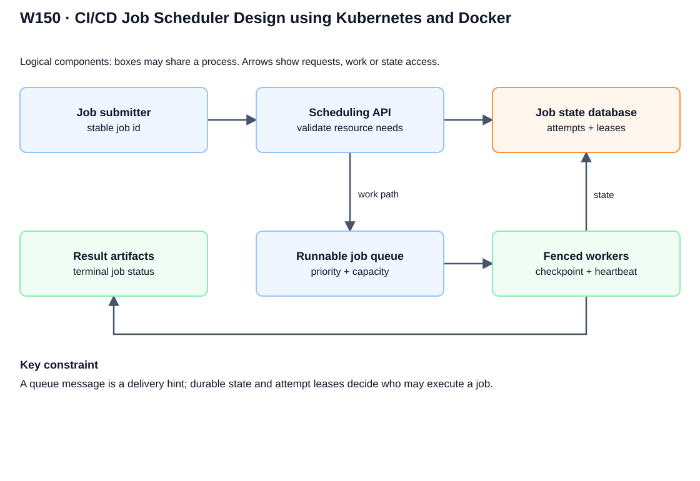

# W150. CI/CD Job Scheduler Design using Kubernetes and Docker

**Priority group:** Second 100 — important

**Category:** ML infrastructure and distributed training

**Study position:** 150 of 547

[Group list](../NEXT_100.md) · [All categories](../ALL_CATEGORIES.md) · [Chapter guide](../README.md)

## Question

Design a CI/CD job scheduler: a multi-tenant service that runs build, test and deploy pipelines described in YAML, each stage in its own container on Kubernetes. Users push code, the service starts the pipeline, streams logs to a dashboard, passes build outputs from one stage to the next, and recovers when a stage or a scheduler node fails.

### Requirements

1. Functional: accept declarative pipeline definitions (YAML); run each stage in an isolated container; schedule, queue and limit concurrency; pass artifacts between stages; stream and store logs; report status per pipeline run, stage and attempt.
2. Retry policy: a failed stage is retried on its own (completed stages are not rerun), at most 3 attempts per stage with exponential backoff; the run fails when a stage exhausts its attempts, and later stages are skipped.
3. Multi-tenancy: tenants must not read each other's code, secrets, logs or artifacts, and one tenant must not starve the others.
4. Scale to design for: 50,000 pipeline runs per day with a peak of 2,000 concurrent stage executions, about 500 tenants, 5 stages per run on average, and 10 MB of logs and 200 MB of artifacts per run.
5. Targets: a stage starts within 30 seconds of becoming runnable when capacity exists (10 seconds with a warm image); logs appear in the dashboard within 5 seconds; logs are kept 30 days and artifacts 14 days; the scheduler survives the loss of any single node without losing or double-running a stage.
Example

A code push triggers this pipeline:

YAML
pipeline:
stages:
- name: build
image: node:18
script:
- npm install
- npm run build
- name: test
image: node:18
script:
- npm test
- name: deploy
image: gcr.io/deploy-tool:latest
script:
- deploy-to-prod

Stages run in the listed order unless a stage has an optional needs: list naming the stages it waits for (for example needs: [build] on both a lint and a test stage lets them run in parallel after build). Here no stage has needs:, so each waits for the one before it.

Expected behavior: the scheduler starts a pod for build; when it succeeds, its output is stored as an artifact and the test pod starts and receives that artifact; when test succeeds, the deploy pod starts. Logs of every pod stream to the dashboard. If test fails, only test is retried (up to 3 attempts, with backoff); if all attempts fail, the run is marked failed and deploy never starts.

What to cover
1. Scale estimates: runs per second, concurrent pods, log and artifact storage per day.
2. API: submit a pipeline, get run status, stream logs, cancel a run.
3. Data model: pipeline, run, stage, attempt, and the states of each.
4. Scheduler design: the state machine of a stage, how runnable stages are found, and how needs: dependencies (stages that may run in parallel) are handled.
5. Deep dive A: the job queue and fair scheduling across tenants (quotas, priorities, preventing starvation).
6. Deep dive B: failure recovery of the scheduler itself (leader election, persisted state, idempotent pod creation, orphaned pods).
7. Deep dive C: artifact passing between stages and log collection.
8. Security, autoscaling, and trade-offs.

## Worked solution

<!-- architecture:W150:start -->
### Architecture and request flow

[Open the diagram at full size](../diagrams/W150_architecture.svg). This is a baseline component diagram for this question. The boxes describe responsibilities; they do not require a separate microservice for every box.

- **Request and state:** Job submitter — stable job id → Scheduling API — validate resource needs. That component consults or updates **Job state database — attempts + leases** under the required access and consistency rules.
- **Work and result:** the work path passes through **Runnable job queue — priority + capacity** and **Fenced workers — checkpoint + heartbeat**, producing **Result artifacts — terminal job status**. Bound waiting and retries where a slow dependency can stall this path.
- **Correctness point:** A queue message is a delivery hint; durable state and attempt leases decide who may execute a job.

When explaining the drawing, trace one normal request first, then a duplicate request, an unavailable dependency and recovery from saved state. If the question requires stricter guarantees or a different scope, state the change explicitly rather than treating this baseline as the only possible design.
<!-- architecture:W150:end -->

### Quantify and version the pipeline contract

50,000 runs/day is .579 runs/s; five stages/run gives 250,000 stage executions/day =2.894/s before retries. Peak concurrency is 2,000 stage pods, not inferable from average arrival alone. Logs are $50000(10\mathrm{MB})=500$GB/day; 30 days is15TB raw. Artifacts are $50000(200\mathrm{MB})=10$TB/day; 14 days is140TB raw. Three complete replicas would require45TB logs and420TB artifacts before metadata/overhead. Size stream ingest for bursts and index only useful log fields rather than tripling full-text indexing cost.

Validate YAML into an immutable DAG: unique stage names, allowed image/script/resource syntax, known dependencies, no cycles, bounded stage count/resources, authorized secret references and deploy environments. With no `needs`, depend on the preceding stage; an explicit empty needs list means a root. A source revision, pipeline hash, image digests and configuration/secret-reference versions identify each run. The sample `latest` and mutable node tags should be resolved to immutable digests at run creation for reproducibility.

### APIs, state and dependencies

`POST /pipelines` registers a version; `POST /runs` with pipeline version, source SHA and idempotency key submits; `GET /runs/{id}` returns run/stage/attempt state; `GET /runs/{id}/logs?stage=&attempt=&after=` streams SSE/cursor chunks; `POST /runs/{id}/cancel` cancels. Deduplicate signed code-push webhooks by delivery id and `(repo,commit,pipeline_version,trigger)` according to rerun policy.

Tables: `Pipeline(id,tenant,version,dag)`, `Run(id,tenant,pipeline_version,source_sha,status,cancel_epoch)`, `StageRun(id,run,stage,status,unmet_deps,next_attempt_at)`, `Dependency(parent,child)`, `Attempt(id,stage,number UNIQUE,status,pod_name,pod_uid,lease_epoch,start,end,exit_code)`, `Artifact(id,attempt,hash,size,storage_ref,committed)` and outbox/events. Run states are pending/running/succeeded/failed/canceled; stages wait_dependencies → runnable → launching → running → succeeded, retry_wait, failed, skipped or canceled. Attempts record actual infrastructure/application outcomes and never overwrite previous failures.

On success, atomically mark the stage and release each outgoing edge **once**, or query whether every parent succeeded; C with parents A,B cannot run after A alone. For a failed attempt1 or2, persist retry_wait with delay $b2^{attempt-1}$ plus bounded jitter; then enqueue only that stage's next attempt. At attempt3 failure, mark the run failed and later/dependent not-started stages skipped; running parallel siblings are canceled or allowed to finish under an explicit policy (choose cancel to save cost). Completed stages/artifacts stay reusable. Separate deliberate user rerun from automatic retries.

### Fair durable scheduling and recovery

The diagram's job DB and runnable queue map to StageRun/Attempt; workers are Kubernetes pods, and checkpoints are **completed stage artifacts**, not ML tensor checkpoints. Use per-tenant queues with weighted deficit round-robin, concurrency/resource quotas and bounded aging; enforce a global 2,000-pod ceiling and per-run parallelism. Estimate CPU/memory demand, use namespace ResourceQuotas and node pools, and autoscale on runnable queue age plus available resources. A large tenant cannot occupy all scheduling slots by submitting more messages. Queue messages may duplicate; claim a stage using state/version checks before creating an attempt.

Multiple controllers shard reconciliation, with leader election/leases for each shard and fencing epochs on DB writes. In a transaction create a unique Attempt and desired pod name `stage-{stage_id}-attempt-{n}`, then reconcile/create that same Kubernetes object. A timeout on pod creation is resolved by GET of the deterministic name, never by a new name/attempt. Scheduler-node loss does not kill existing pods or create new attempts; the replacement reads DB and Kubernetes labels/UIDs to resume observation. Reconcile orphaned pods: adopt only if tenant/run/attempt match, otherwise quarantine/delete by policy. Watch streams are accelerators, periodic resync repairs missed events.

Never infer that an expired scheduler lease means a pod stopped. For failed/lost execution nodes, establish pod deletion/fencing before another attempt is permitted; partitions can otherwise leave an old process alive. Kubernetes object identity prevents duplicate scheduler launches, but it cannot guarantee exactly-once external deploy effects under arbitrary worker partitions. Deploy scripts need stable run/stage operation keys and a deployment controller with idempotent reconciliation/fencing. This limitation must be explicit: the single-**scheduler**-node-loss requirement is satisfied by deterministic adoption; arbitrary external effects require that additional contract.

### Artifacts and logs

A successful stage uploads objects under attempt-scoped temporary paths, verifies hashes, then commits a manifest atomically; downstream stages receive read-only authorized references to that selected successful manifest. Failure before commit exposes no partial artifact. Content-addressed blobs can deduplicate within a tenant, with retention/reference counts so cleanup does not remove a live dependency. Keep logs30 days and artifacts14 days with explicit exceptions for legally/operationally pinned runs.

Pod stdout/stderr collectors attach tenant/run/stage/attempt/sequence/time, ship to a durable log stream and object chunks, and fan out authorized tail events to dashboards within5s. Clients resume by sequence cursor and deduplicate replay. Redact secrets at source and collection, cap output/backpressure noisy jobs and report log loss instead of pretending logs are complete. Pod deletion waits for final log/artifact handoff within a bounded cleanup period.

### Security, SLOs and safe operation

Run untrusted builds in isolated namespaces/pods with restricted service accounts, network policies, resource limits, nonroot/seccomp, isolated workspaces and no host Docker socket. Stronger tenant boundaries may need dedicated nodes or sandboxed runtimes/VMs. Fetch code using scoped ephemeral credentials; inject secrets only to authorized stages; restrict deploy credentials to protected environments with the organization's approval policy. Authorization must cover logs/artifact URLs, not just submit endpoints.

Warm image caches and preprovisioned nodes aim for start≤10s; capacity-present cold starts target≤30s. Measure from runnable timestamp to actual container execution, including scheduler/image-pull time; capacity absence is a separate queue SLI, not erased from user wait reports. Monitor queue age/fairness, start p95/p99, retry exhaustion, duplicate active attempts, orphan recovery, log end-to-end lag, artifact integrity and tenant isolation. Test controller crash before/after pod creation, duplicate completion events, failed test attempt recovery and lost log transport. The sample build succeeds once; only test is retried up to three times, and deploy never runs if test exhausts its budget.

### Further study

- [F035: Compare data, tensor and pipeline parallel training.](../04_serving_and_training_systems.md#f035)
- [F039: Design a fair GPU job scheduler.](../04_serving_and_training_systems.md#f039)
- [F163: Handle dependency-aware job scheduling.](../17_distributed_systems_depth.md#f163)
