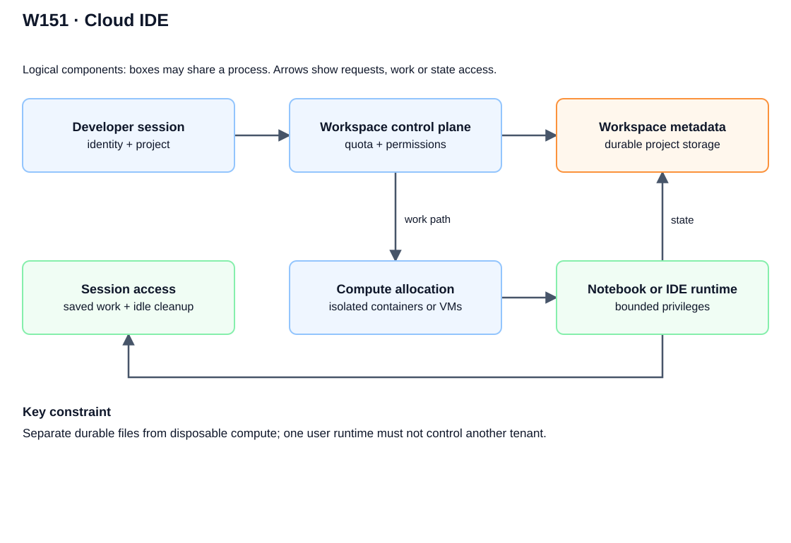

# W151. Cloud IDE

**Priority group:** Second 100 — important

**Category:** ML infrastructure and distributed training

**Study position:** 151 of 547

[Group list](../NEXT_100.md) · [All categories](../ALL_CATEGORIES.md) · [Chapter guide](../README.md)

## Question

Problem Description
Design a Cloud IDE

Design a cloud-based IDE where users can write code, manage files, and run terminal commands entirely in the browser. The core challenges are VM lifecycle management, real-time terminal output streaming, and strong per-user isolation at scale.

Functional Requirements
1. Users can create, read, update, and delete files and directories.
2. Users can run commands and receive stdout and stderr interactively.
3. Users can send terminal input, resize the terminal, and stop running processes.
4. Users can install packages during an active session.
5. Users can share a workspace using owner, viewer, and editor permissions.
6. Source files and workspace metadata survive sandbox termination.
7. Real-time collaborative text editing is out of scope.
Non-Functional Requirements
Requirement	Target
Concurrent users	100,000
Sandbox allocation	2 vCPU and 4 GB RAM
Startup latency	Under 5 seconds
Terminal-output latency	Under 100 ms
Availability	99.9%
Maximum interactive session	12 hours
Security	Strong tenant isolation

Use these numbers for capacity estimates.

Clarifying Questions

Ask these questions before drawing the architecture:
1. Should source files survive sandbox termination?
2. Should installed packages survive between sessions?
3. Are users allowed to access the public internet from a sandbox?
4. Do we need containers, microVMs, dedicated VMs, or dedicated hosts?
5. Are long-running background jobs in scope?
6. What terminal replay behavior is expected after reconnecting?
7. Is workspace sharing read-only, editable, or collaborative in real time?
Follow-up: SSH access to development hosts

Change the access path: users connect to a provisioned development host over SSH instead of using the browser, and a task scheduler runs background tasks across the host fleet. What changes in allocation, access control and scheduling, and what stays the same?

## Worked solution

<!-- architecture:W151:start -->
### Architecture and request flow

[Open the diagram at full size](../diagrams/W151_architecture.svg). This is a baseline component diagram for this question. The boxes describe responsibilities; they do not require a separate microservice for every box.

- **Request and state:** Developer session — identity + project → Workspace control plane — quota + permissions. That component consults or updates **Workspace metadata — durable project storage** under the required access and consistency rules.
- **Work and result:** the work path passes through **Compute allocation — isolated containers or VMs** and **Notebook or IDE runtime — bounded privileges**, producing **Session access — saved work + idle cleanup**. Bound waiting and retries where a slow dependency can stall this path.
- **Correctness point:** Separate durable files from disposable compute; one user runtime must not control another tenant.

When explaining the drawing, trace one normal request first, then a duplicate request, an unavailable dependency and recovery from saved state. If the question requires stricter guarantees or a different scope, state the change explicitly rather than treating this baseline as the only possible design.
<!-- architecture:W151:end -->

### Solution outline

1. Separate the control plane (users, projects, permissions, quotas and desired jobs/environments) from isolated execution agents. Expose stable provider adapters instead of embedding one vendor’s API throughout the service.
2. Provision versioned images/environments, attach authorized datasets/secrets and durable workspace storage, and track lifecycle states through reconciliation. Notebook or code execution needs sandbox boundaries and resource/time limits.
3. For experiments, store immutable configurations, code/data/model versions, runs, metrics and artifacts; instrument repeatable reset/seed behavior for simulators or embodied tasks.
4. Collect logs and heartbeats, reap abandoned resources safely and account for cost. Define session recovery and artifact durability independently from VM/container lifetime.

### Understand why the approach works

#### Follow tensor ownership and the resource bottleneck

For every major tensor, state who owns it before and after each collective. Data parallelism divides examples; tensor parallelism divides operations/weights; pipeline parallelism divides layers. Their communication and memory effects differ, so a diagram saying “use more GPUs” is incomplete.

For $C=AB$, $A\in\mathbb R^{m\times k}$ and $B\in\mathbb R^{k\times n}$, a row partition gives

$$
C_r=A_rB,\qquad C=\operatorname{ConcatRows}(C_0,\ldots,C_{p-1}).
$$

Concatenating output shards is different from summing partial products. Backward communication depends on which variables were replicated and where multiple contributions to the same derivative must be added.

Estimate the bottleneck with a roofline bound:

$$
\text{attainable FLOP/s}\leq
\min\!\left(F_{\rm peak},\;\text{bandwidth}\times\frac{\text{FLOPs}}{\text{bytes moved}}\right).
$$

Then add synchronization, imbalance, launch and checkpoint overhead rather than treating the ideal bound as achieved speed.

For a platform/scheduler, distinguish desired state, observed state and durable job completion. Launching a container or receiving a provider response does not prove the computation succeeded. Checkpoint application state, fence stale owners, publish only complete artifacts and monitor both utilization and tenant wait time. A design that maximizes utilization by starving a large job violates a different important service objective.

### Work a small example

Stopping a notebook VM must not delete its only copy of a completed experiment artifact. A provider API timeout leaves provisioning status to reconcile, not proof that no VM was created.

### Edge cases and common mistakes

Running untrusted user code in the web server process or assuming an ephemeral VM disk is durable experiment storage.

### Check your reasoning on related cases

**Design a fair GPU job scheduler.** An eight-GPU job requiring one fast interconnect group cannot be satisfied by eight isolated single-GPU slots with inadequate network bandwidth.

How do you prevent starvation? Aging priorities, guaranteed shares or reserved capacity, with explicit tradeoffs.

**Design an online model rollout with rollback.** Rolling back weights alone fails if the new feature schema is incompatible with the old model.

What is shadow deployment good for? Observing behavior and operational cost without letting the new model drive user decisions.

**Prepare a research experiment with limited compute.** Testing a new loss on a small task with known failure modes can be more informative than one expensive full-model run with many changes.

What if a small-scale result fails to transfer? Identify which scaling assumptions changed and test them explicitly.

### Further study

- [F039: Design a fair GPU job scheduler.](../04_serving_and_training_systems.md#f039)
- [F087: Design an online model rollout with rollback.](../09_ml_system_design.md#f087)
- [F198: Prepare a research experiment with limited compute.](../20_research_and_behavioral_depth.md#f198)

### Explain it back

Close the answer. State the main invariant or equation, work the example with changed inputs, and explain which assumption would make your solution fail. For a design, walk through a retry or partial failure; for a derivative, check a shape and a finite-difference case.
