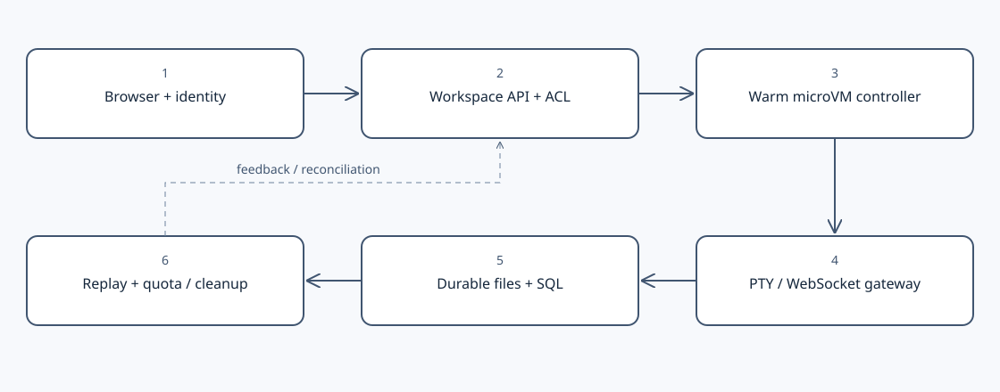

# W151. Cloud IDE

**Priority group:** Second 100 — important

**Category:** ML infrastructure and distributed training

**Study position:** 151 of 547

[Group list](../NEXT_100.md) · [All categories](../ALL_CATEGORIES.md) · [Chapter guide](../README.md)

## Question

Problem Description
Design a Cloud IDE

Design a cloud-based IDE where users can write code, manage files, and run terminal commands entirely in the browser. The core challenges are VM lifecycle management, real-time terminal output streaming, and strong per-user isolation at scale.

Functional Requirements
1. Users can create, read, update, and delete files and directories.
2. Users can run commands and receive stdout and stderr interactively.
3. Users can send terminal input, resize the terminal, and stop running processes.
4. Users can install packages during an active session.
5. Users can share a workspace using owner, viewer, and editor permissions.
6. Source files and workspace metadata survive sandbox termination.
7. Real-time collaborative text editing is out of scope.
Non-Functional Requirements
Requirement	Target
Concurrent users	100,000
Sandbox allocation	2 vCPU and 4 GB RAM
Startup latency	Under 5 seconds
Terminal-output latency	Under 100 ms
Availability	99.9%
Maximum interactive session	12 hours
Security	Strong tenant isolation

Use these numbers for capacity estimates.

Clarifying Questions

Ask these questions before drawing the architecture:
1. Should source files survive sandbox termination?
2. Should installed packages survive between sessions?
3. Are users allowed to access the public internet from a sandbox?
4. Do we need containers, microVMs, dedicated VMs, or dedicated hosts?
5. Are long-running background jobs in scope?
6. What terminal replay behavior is expected after reconnecting?
7. Is workspace sharing read-only, editable, or collaborative in real time?
Follow-up: SSH access to development hosts

Change the access path: users connect to a provisioned development host over SSH instead of using the browser, and a task scheduler runs background tasks across the host fleet. What changes in allocation, access control and scheduling, and what stays the same?

## Worked solution

### Scope and capacity

Before drawing, ask whether packages persist, whether outbound internet is allowed, what isolation is acceptable, whether background jobs survive disconnect, and how much terminal history must replay. Files already must persist and sharing is owner/viewer/editor without concurrent text collaboration. For this design assume packages in a durable home directory persist, OS package installs are session-local, outbound traffic uses a controlled proxy, background work ends with the 12-hour session, and reconnect replays the last 10 MB. These are product choices, not facts supplied by the question.

If all 100,000 connected users have a sandbox, reserve 200,000 vCPU and 400,000 GB RAM. At 70% usable packing, provision about 286,000 vCPU and 571,000 GB. Assuming average terminal output of 2 KB/s, gateways carry 200 MB/s before protocol overhead; cap high-output terminals and batch frames briefly. Assume 1 GB of source files per workspace: 100 TB durable logical storage before replicas. Connected viewers need no sandbox, so actual runtime demand may be lower; measure it separately.

### Components and contracts

The browser talks to an authenticated API and a WebSocket terminal gateway. A workspace controller reads a transactional database, allocates a microVM from a warm pool, mounts a tenant-scoped durable filesystem, and publishes a runtime endpoint only after health checks. The database stores Workspace(id, owner, desired_state, observed_state, generation, image_digest, volume_id), Membership(workspace,user,role), Runtime(workspace,generation,host,lease_expiry), and Operation(idempotency_key,status,result). Enforce one current runtime generation per workspace. The diagram below follows this control path; terminal bytes bypass the database through the gateway, while files go to durable storage.

`POST /workspaces`, `POST /workspaces/{id}:start|stop`, and `GET /operations/{id}` use an idempotency key and return visible STARTING/RUNNING/STOPPING/STOPPED states. File CRUD APIs accept normalized relative paths; writes use ETags and atomic rename so two editors cannot silently overwrite each other. Viewers read files and terminal output, editors modify files and execute commands, and only owners manage access. Recheck permissions when sessions reconnect and revoke live access when membership changes.

The gateway opens a PTY inside the microVM. Frames carry terminal_id, connection sequence, type (input/output/resize/signal), and payload. Input acknowledgments distinguish accepted bytes from uncertain delivery; do not blindly replay unacknowledged destructive shell input. Output has monotonically increasing offsets, bounded replay, and an explicit gap marker after eviction. Resize sets PTY dimensions; interrupt sends SIGINT, with an explicit force-stop action if needed. A PTY merges stdout/stderr as a real terminal does; separate streams require a non-PTY execution API.

### Lifecycle, isolation and failures

A warm microVM, cached image and pre-attached filesystem make under-five-second startup plausible; a large uncached environment needs an explicitly separate cold-start experience. A possible measured budget is 0.3 s auth/allocation, 1 s boot, 1 s mount, 1 s agent/PTY readiness and 1.7 s headroom. Keep gateway placement regional to target under-100-ms output. Neither budget is proven without load tests.

Run untrusted code behind hardware virtualization, with CPU/memory/disk/process limits, no host mounts or metadata credentials, short-lived scoped secrets, network policy and image scanning. Suspend/reap idle runtimes and enforce the 12-hour deadline. Controllers use leases and generations: if start times out after allocation, retry returns the same operation and reconciles the tagged VM instead of allocating another. Node loss preserves acknowledged durable writes but loses running processes and memory. During storage outage fail writes visibly rather than acknowledge them to ephemeral disk. Multi-zone APIs, database failover, volume replication and capacity reserves support 99.9% availability; record startup percentiles, output lag, denied access, orphans and per-tenant spend.

For example, two editors saving version 7 race: the first creates version 8 and the second receives a conflict. An old runtime from generation 4 cannot mount read-write after generation 5 takes over; fencing must be enforced by storage, not just metadata.

### SSH and background-task follow-up

Replace WebSockets/PTYS with an SSH bastion and short-lived identity-bound SSH certificates, host-key verification and audited connections. Never give a development user unrestricted host-level administration on shared machines. Allocate a persistent development host or per-user microVM and attach the same durable workspace. A scheduler now owns background jobs, resource reservations, queue state, cancellation and checkpoints independently of SSH disconnection; cgroups prevent interactive shells and jobs from starving each other. Identity, ACLs, image versions, durable files, quotas, lifecycle reconciliation, fencing and billing remain necessary. The 12-hour interactive timeout need not kill scheduler-owned jobs if that is the revised contract.

<!-- architecture:W151:start -->

Read the numbered path as Browser + identity → Workspace API + ACL → Warm microVM controller → PTY / WebSocket gateway → Durable files + SQL → Replay + quota / cleanup. The dashed return is the feedback or reconciliation path described in the solution; durable state and authorization remain authoritative when work is retried.
<!-- architecture:W151:end -->

### Runnable checks

[Batch behavior checks](../test_review_151_200.py) also validate this page's Python syntax and referenced diagrams. The architecture, capacity and metric reasoning is reviewed as a design; no production load, availability or model-quality result is claimed.

### Further study

- [F039: Design a fair GPU job scheduler.](../04_serving_and_training_systems.md#f039)
- [F087: Design an online model rollout with rollback.](../09_ml_system_design.md#f087)
- [F198: Prepare a research experiment with limited compute.](../20_research_and_behavioral_depth.md#f198)
