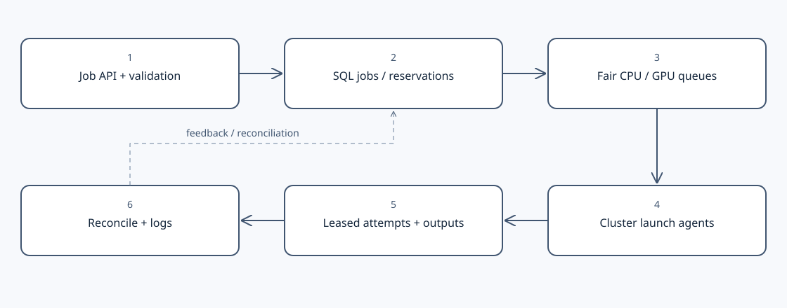

# W152. Compute Resource Scheduling for ML Jobs

**Priority group:** Second 100 — important

**Category:** ML infrastructure and distributed training

**Study position:** 152 of 547

[Group list](../NEXT_100.md) · [All categories](../ALL_CATEGORIES.md) · [Chapter guide](../README.md)

## Question

Design a scheduler that allocates CPU / GPU resources across multiple clusters for user-submitted ML jobs while keeping utilization high.

### Requirements

Users submit ML jobs with CPU, GPU, memory, runtime, image, and priority requirements.
Multiple clusters, each with different CPU/GPU inventory.
Start jobs when resources are available; keep utilization high.
Track job status: queued, running, succeeded, failed, canceled.
Handle retries, preemption, quota, and noisy-neighbor isolation.
Provide APIs for submission, status, cancellation, and logs.

## Worked solution

### Admission and state

A job is a resource reservation followed by a fenced execution attempt. `POST /jobs` accepts tenant-scoped idempotency_key, CPU, memory, GPU count/type/memory, topology, image digest, runtime limit and requested priority. Validate positive resources, permitted image/priority and whether any cluster can ever satisfy the request; reject impossible jobs, but queue temporarily unavailable ones. `GET /jobs/{id}`, `POST /jobs/{id}:cancel`, and `GET /jobs/{id}/logs?cursor=...` expose status, attempts and resumable logs.

Use SQL tables Job(id,tenant,key,spec,state,priority,created_at), Attempt(job,n,cluster,allocation,token,lease_expiry,state,checkpoint), Cluster(id,capabilities,healthy), Reservation(cluster,node,resources,attempt), and an outbox. Unique (tenant,key) prevents duplicate submission. Index runnable jobs by resource class/tenant/priority/time and leases by expiry. Status moves QUEUED → RUNNING → SUCCEEDED/FAILED or CANCELED; retryable attempt failure returns the job to QUEUED while retaining attempt history. Cancellation first disables future claims and fences the active attempt, then asks agents to stop.

### Placement and execution

The diagram's API and state database own intent; its queue wakes schedulers; workers launch isolated jobs and publish complete artifacts. Separate queues for GPU types and CPU-only work avoid one impossible GPU placement blocking CPU jobs. Among eligible tenants, allocate weighted dominant-resource fair shares with quotas, aging and administrator-approved priority. Within a tenant, prefer old high-priority jobs and resource-fitting backfill; reserve future capacity for large jobs so backfill cannot starve them. Score feasible clusters by data locality, GPU topology and residual fragmentation. Gang-reserve all ranks of distributed training in one placement decision; release on partial launch failure.

A cluster scheduler serializes reservations against its inventory in database transactions or uses a fenced single allocator per shard. Two schedulers cannot both spend the last GPU. Commit reservation plus dispatch-outbox before launch. Agents verify token and job state, launch with namespace/VM isolation and resource limits, and heartbeat. Completion commits only for the current token; publish a content-addressed output manifest before marking success. Queue redelivery is harmless because the reservation/attempt already exists. A launch RPC timeout is uncertain: reconcile by attempt ID instead of launching a second copy.

Preempt only jobs whose priority policy permits it; request checkpoint with a grace period, fence the attempt, reclaim confirmed resources, then requeue from the latest valid checkpoint. Non-checkpointable jobs may lose all work and should have higher disruption costs. Retry transient infrastructure failures with bounded backoff, but fail deterministic invalid-image or repeated OOM errors with a useful cause. Cluster loss makes its capacity unavailable and its leases suspect; fence old work before starting replacements. Storage-level or sink-level idempotency is required for external side effects.

### Concrete estimate and validation

Workload size is unspecified. As an illustrative plan, assume 10,000 jobs/day, mean runtime one hour, two GPUs for half the jobs. That is about 417 average simultaneous jobs and 417 GPU equivalents before headroom; CPU/memory demand must be summed separately. With 1,000 running attempts and 15-second heartbeats, ingest about 67 heartbeats/s. Provision for peak arrival and topology, not daily average alone.

Example: cluster A has four contiguous GPUs free, B has two. A four-GPU training job goes to A, while a CPU preparation job can start in B without waiting. If A's completion is delivered twice, only the first matching RUNNING→SUCCEEDED transition releases the reservation. Test these races, failed partial gang launch, cancellation during launch, expired leases and quota fairness with a deterministic event simulator. Monitor queue delay by tenant/resource type, feasible-job dispatch latency, utilization, fragmentation, preempted work lost, stale leases and retry rates; high utilization alone does not establish fairness.

<!-- architecture:W152:start -->

Read the numbered path as Job API + validation → SQL jobs / reservations → Fair CPU / GPU queues → Cluster launch agents → Leased attempts + outputs → Reconcile + logs. The dashed return is the feedback or reconciliation path described in the solution; durable state and authorization remain authoritative when work is retried.
<!-- architecture:W152:end -->

### Runnable checks

[Batch behavior checks](../test_review_151_200.py) also validate this page's Python syntax and referenced diagrams. The architecture, capacity and metric reasoning is reviewed as a design; no production load, availability or model-quality result is claimed.

### Further study

- [F035: Compare data, tensor and pipeline parallel training.](../04_serving_and_training_systems.md#f035)
- [F039: Design a fair GPU job scheduler.](../04_serving_and_training_systems.md#f039)
- [F163: Handle dependency-aware job scheduling.](../17_distributed_systems_depth.md#f163)
