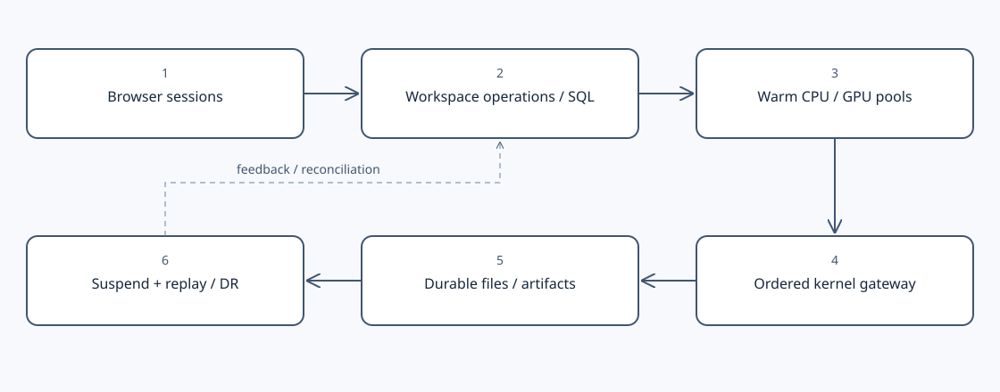

# W153. Design a Hosted ML Notebook Platform

**Priority group:** Second 100 — important

**Category:** ML infrastructure and distributed training

**Study position:** 153 of 547

[Group list](../NEXT_100.md) · [All categories](../ALL_CATEGORIES.md) · [Chapter guide](../README.md)

<span class="practice-page"></span>

## Question

Design a cloud platform where data scientists create isolated workspaces, edit notebooks, execute code interactively, persist files, suspend idle compute, and resume later. Workspaces may use CPU or GPU kernels and versioned custom environments.

Workload assumptions

```text
500,000 users may be connected concurrently through the web application.
```

Up to 50,000 workspaces execute code concurrently; the remainder are editing, viewing output, or idle.
A typical active runtime requests 2 vCPU and 8 GB RAM. Up to 5% of active runtimes request one GPU.
Typical suspended workspaces must become interactive within 5 seconds at p95. Large custom images and very large dependency environments may use a separately reported cold-resume service level.
Notebook files and committed artifacts must survive suspend, runtime loss, and regional service restarts.

### Requirements

1. Support idempotent create, delete, suspend, and resume operations with visible lifecycle status.
2. Stream execution requests, output, errors, interrupts, and heartbeats over reconnectable bidirectional sessions.
3. Isolate untrusted code, enforce CPU, memory, GPU, network, storage, and time quotas, and prevent access to host or cloud metadata credentials.
4. Persist notebooks separately from disposable compute. Define which in-memory kernel state, if any, survives suspension.
5. Support standard kernels, signed custom images, dependency metadata, and GPU-backed environments.
6. Minimize idle cost while meeting the normal p95 resume target. Cover warm pools, image distribution, storage mounts, snapshots, admission control, and capacity reservations.
7. Handle duplicate commands, runtime and node failure, control-plane retry, orphan cleanup, storage outage, capacity exhaustion, and regional disaster recovery.
8. Provide audit logs, tenant quotas, abuse detection, observability, and cost attribution.
Scenarios
A resume request is retried after the client times out. Exactly one runtime becomes active, and both requests return the same operation state.
A runtime node dies during cell execution. Durable files remain intact, the user sees the execution failure, and the workspace can start on another node.
A popular 12 GB custom image is requested by thousands of users at the start of a class. Explain how the system avoids a registry and network stampede.
Follow-ups
1. Add collaborative editing while keeping kernel execution ordered and access-controlled.
2. Add enterprise workspaces attached to customer networks with stronger tenant isolation.
3. Describe a multi-region layout and estimate capacity and major cost drivers.
Deliverable

Present estimates, APIs, metadata and state models, architecture, lifecycle flows, the fast-resume path, scheduling and isolation choices, failure recovery, security, observability, and trade-offs.

## Worked solution

### Capacity and durability contract

500,000 web connections do not imply 500,000 kernels. At the supplied maximum of 50,000 active runtimes, reserve 100,000 vCPU, 400,000 GB RAM and up to 2,500 GPUs. At an assumed 70% CPU/memory occupancy target, installed capacity is roughly 143,000 vCPU and 571,000 GB RAM; GPU headroom needs a separate reservation policy. Assuming a gateway supports 10,000 mostly idle connections, use at least 50 gateways plus failure headroom; benchmark active-output fanout separately. At an assumed 1 KB/s per active runtime, output is 50 MB/s, whereas a 1 MB/s malicious print loop needs throttling.

Notebooks, saved files and committed artifacts are durable. Ordinary suspend discards kernel memory and running cells; users see that variables need recomputation. Optional tested snapshots may preserve compatible CPU runtimes, but GPU processes, drivers, external sockets and credentials complicate restoration. Never promise memory persistence merely because files survive.

### API, state and architecture

`POST /workspaces`, `POST /workspaces/{id}:resume|suspend`, `DELETE /workspaces/{id}` return operation IDs; `GET /operations/{id}` and workspace reads expose desired and observed state. Store Workspace(id,tenant,volume,image_digest,environment_manifest,generation,state), Operation(tenant,key,payload_hash,result), Runtime(workspace,generation,node,lease,endpoint), ACL and AuditEvent in transactional storage. Unique (tenant,key) returns the original operation on retry and rejects key reuse with a different body. Lock the workspace row before changing generation. States are CREATING, SUSPENDED, RESUMING, RUNNING, SUSPENDING, DELETING, DELETED and explicit ERROR details. A stale controller cannot publish a runtime for a superseded generation.

Browser sessions authenticate through regional gateways. Controllers and schedulers allocate isolated CPU/GPU runtimes; shared durable storage holds notebooks and object storage holds large versioned artifacts. In the drawing, control-plane metadata is separate from compute and persisted files. The execution gateway is a data path, not the allocator. Signed kernel images reference immutable dependency manifests. Run images without privileged mode; block host/cloud metadata access, restrict network egress, scope secrets, and enforce CPU, RAM, GPU, storage, process and wall-time quotas. Enterprise tenants may use dedicated nodes/microVMs, customer-network attachments, isolated routing and customer-managed keys at higher cost.

### Fast resume and ordered execution

Keep clean warm runtimes per region/environment/GPU class, prefetch popular layers to node caches, and reserve capacity for announced classes. An illustrative five-second budget is 0.2 s auth/state, 0.5 s scheduling, 1 s warm-runtime activation, 1 s mount, 1 s kernel health and 1.3 s headroom. Control-plane admission must prevent accepting more fast-resume promises than warm capacity can cover. Report warm and large-environment cold-resume percentiles separately. Pools cost idle money; tune them to forecasted arrival rate, not total registered users.

For a 12 GB image requested by 1,000 users, naive pulling transfers 12 TB. Mirror by region, cache immutable layers once per host, coalesce simultaneous pulls, prewarm nodes before class, rate-limit registry fetches and spread launches. At an assumed 10 Gbit/s, even one uncached 12 GB pull takes at least 9.6 seconds, so it cannot satisfy the ordinary path.

A bidirectional session carries workspace generation, execution_id, cell_id, ordered input sequence, output offset, errors, interrupt and heartbeat. One kernel sequencer serializes executions. Deduplicate execution_id before enqueueing; reconnect replays bounded output from the last offset, marking gaps explicitly. A server crash after cell side effects but before completion acknowledgment leaves an UNKNOWN execution outcome: do not automatically rerun arbitrary code. Interrupt targets the active execution, and a hard restart fences the old kernel.

### Failure recovery and extensions

A repeated resume returns the same operation and the unique current generation; allocation is tagged by operation ID so timeout reconciliation finds an already-created runtime. If a node dies during a cell, report lost execution and kernel state, preserve acknowledged files, revoke its storage lease and start a new generation elsewhere. Durable outbox records reconcile missed launch messages. A sweeper terminates orphan runtimes only after validating generation and lease. Storage outage prevents successful save acknowledgments and may require read-only mode. Capacity exhaustion returns queued state/retry guidance with quotas instead of overpromising readiness.

Run multi-zone control planes and home each workspace in one region. Replicate metadata and artifacts for regional recovery with explicit RPO/RTO: assume asynchronous cross-region replication, so only replicated versions survive region loss; RPO zero requires a slower synchronous multi-region commit path. Promotion fences the former region's write authority. Three equal regions carrying the peak need roughly 16,667 runtimes each normally; absorbing one region's load requires 25,000 capacity per surviving region, 50% spare relative to normal, if full failover is promised. Compute/GPU hours, warm pools, storage replication, image traffic and output egress dominate cost.

For collaborative editing add a document CRDT/OT service and durable edit log; edits can merge concurrently, but kernel execution still uses the authorized sequencer and snapshots the cell text/version actually executed. Monitor resume stages, output lag, failed saves, active/idle spend, lease conflicts, image-cache hit rate, abusive traffic and cost per tenant. Exercise duplicate resume, runtime death, registry stampede and regional fencing in fault tests before claiming the SLOs.

<!-- architecture:W153:start -->


Read the numbered path as Browser sessions → Workspace operations / SQL → Warm CPU / GPU pools → Ordered kernel gateway → Durable files / artifacts → Suspend + replay / DR. The dashed return is the feedback or reconciliation path described in the solution; durable state and authorization remain authoritative when work is retried.
<!-- architecture:W153:end -->

### Runnable checks

[Batch behavior checks](../test_review_151_200.py) also validate this page's Python syntax and referenced diagrams. The architecture, capacity and metric reasoning is reviewed as a design; no production load, availability or model-quality result is claimed.

### Further study

- [F039: Design a fair GPU job scheduler.](../04_serving_and_training_systems.md#f039)
- [F087: Design an online model rollout with rollback.](../09_ml_system_design.md#f087)
- [F198: Prepare a research experiment with limited compute.](../20_research_and_behavioral_depth.md#f198)
