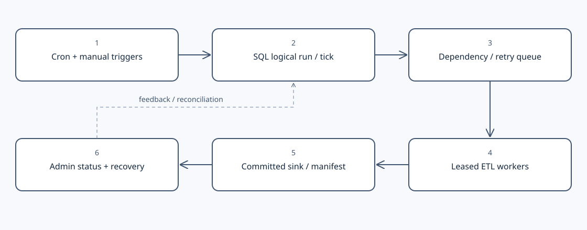

# W154. Design a Job Scheduler / ETL Pipeline

**Priority group:** Second 100 — important

**Category:** ML infrastructure and distributed training

**Study position:** 154 of 547

[Group list](../NEXT_100.md) · [All categories](../ALL_CATEGORIES.md) · [Chapter guide](../README.md)

## Question

Design a system that schedules and executes long-running ETL jobs reliably, with retry and dependency semantics.

Functional

Register a job with a cron-like schedule and dependencies on other jobs.
Execute on time, exactly once per scheduled tick (or at-least-once with downstream idempotency).
Track job status (pending / running / succeeded / failed / retrying).
Provide a job-level retry policy and an admin UI/API for inspection and manual triggers.

Non-functional

10K active job definitions.
Per-tick fan-out can spike to thousands of concurrent runs.
A run may last seconds to many hours.
Survive worker crashes mid-run.

## Worked solution

### Define a tick before executing it

Store a versioned JobDefinition(id, cron, timezone, dependencies, retry_policy, enabled) and create Run(job_id,scheduled_time,definition_version,state). A unique (job_id,scheduled_time) creates one logical scheduled run even if multiple timer instances scan the same minute. Specify DST behavior, missed-tick catch-up limits and overlapping-run policy; assume UTC schedules, bounded catch-up and no overlap for the same job. Manual triggers get distinct trigger IDs so they cannot collide with scheduled runs.

`POST /jobs`, `PATCH /jobs/{id}` with version preconditions, `POST /jobs/{id}:trigger`, `GET /runs/{id}` and `POST /runs/{id}:cancel` support the admin UI. Reject dependency cycles at registration. Dependencies refer to an exact logical interval/version: “daily aggregate for Tuesday” waits for Tuesday's upstream partitions, not whichever upstream happened to finish last.

### Durable scheduler and workers

The diagram's state database is authoritative; the runnable queue carries run_id and attempt token, and workers write artifacts. Extend the records with Dependency(run,upstream_run), Attempt(run,n,token,lease_expiry,error,output_ref), and Outbox(event_id,payload,published). Index next scheduled time, runnable/retry time and expired leases. A transaction creates due runs and outbox entries. Independent timer instances lock batches or use insert-on-conflict; a queue outage cannot lose accepted runs because the outbox republishes later.

A run moves PENDING → READY → RUNNING → SUCCEEDED, or RETRYING → READY; exhausted retries give FAILED and downstream runs become dependency-failed rather than waiting forever. Only all-successful predecessors release a run. Completion locks the current run, verifies active attempt/lease, commits output manifest and success once, and releases downstream dependencies in that transaction or through an idempotent completion event. Never decrement an unmet-dependency counter twice on duplicate completion.

Workers claim READY by compare-and-swap, heartbeat renewable leases and enforce runtime/resource limits. Crash recovery fences the old attempt and schedules a bounded retry with exponential backoff and jitter. Logs and checkpoints persist outside worker disks. Worker termination can leave external effects already applied: the practical execution contract is at least once. For a database sink use a run_id uniqueness constraint and transaction; for object output write attempt-scoped files then conditionally publish one manifest. An email or third-party endpoint without idempotency cannot be made exactly once by queue acknowledgments.

### Scale, recovery and example

Ten thousand definitions checked every minute means about 167 definitions/s on average if evenly spread, but midnight can produce thousands together. Assume 5,000 simultaneous runs with 30-second heartbeats: about 167 heartbeat updates/s. Dispatch in batches, partition runnable queues by resource class and apply tenant concurrency limits. Long-running jobs belong in durable workers, not scheduler request threads. Polling interval and worker capacity bound scheduling delay; monitor scheduled-to-start lag rather than claiming immediate starts.

Suppose extract(Tuesday) fails after writing its output. Retry uses the same logical sink key, commits the existing complete result once, and only then releases transform(Tuesday). Duplicate success events cannot start transform twice. A scheduler crash between database commit and queue publish is recovered by the outbox. A worker returning success after cancellation is rejected by token and run state. The UI shows each attempt, failure class, next retry time, blocked upstream and output references. Validate these crash points, DST policy and a thousand-run fan-out; monitor lease expiry, backlog age, retry storms and incomplete artifacts.

<!-- architecture:W154:start -->

Read the numbered path as Cron + manual triggers → SQL logical run / tick → Dependency / retry queue → Leased ETL workers → Committed sink / manifest → Admin status + recovery. The dashed return is the feedback or reconciliation path described in the solution; durable state and authorization remain authoritative when work is retried.
<!-- architecture:W154:end -->

### Runnable checks

[Batch behavior checks](../test_review_151_200.py) also validate this page's Python syntax and referenced diagrams. The architecture, capacity and metric reasoning is reviewed as a design; no production load, availability or model-quality result is claimed.

### Further study

- [F035: Compare data, tensor and pipeline parallel training.](../04_serving_and_training_systems.md#f035)
- [F039: Design a fair GPU job scheduler.](../04_serving_and_training_systems.md#f039)
- [F163: Handle dependency-aware job scheduling.](../17_distributed_systems_depth.md#f163)
