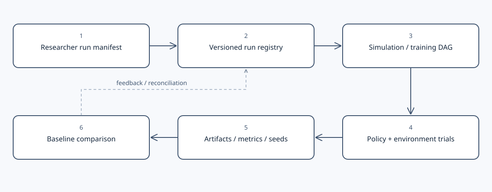

# W155. Design a Lab-Wide Experiment Platform for Embodied AI

**Priority group:** Second 100 — important

**Category:** ML infrastructure and distributed training

**Study position:** 155 of 547

[Group list](../NEXT_100.md) · [All categories](../ALL_CATEGORIES.md) · [Chapter guide](../README.md)

## Question

Design a lab-wide experiment management platform for an embodied AI (robotics) team. Researchers improve robot policies by running experiments that combine real robot logs, simulation scenarios, model training, evaluation jobs and comparison with earlier baseline policies. The platform must make each experiment trackable, comparable and reproducible.

A concrete motivating case: a manipulation policy often fails to pick up transparent objects, especially in poor lighting. A researcher wants to turn that observed failure into a measured improvement.

What the platform must support
1. Select the relevant real-world failure logs.
2. Generate targeted simulation scenarios around the failure.
3. Train or fine-tune candidate policies from a baseline checkpoint.
4. Run evaluation jobs on both a targeted suite and a broad regression suite.
5. Compare candidate policies against the baseline policy.
6. Track all artifacts, configs, metrics, logs and failures.
7. Reproduce any experiment later from a single run ID.
Your design should cover
1. Core objects and APIs. The central object of the system, what is stored for each experiment run, and how configs, data versions, model versions and evaluation suites are represented.
2. Architecture. The major components, how researchers submit experiments, how data selection, simulation, training, evaluation and reporting are orchestrated, and how metadata is separated from large artifacts.
3. Evaluation system. How evaluation jobs run, how the environment, the model server and the scoring (judging) logic interact, and which metrics you compute for the transparent-object case.
4. Reproducibility. What another researcher does with a run ID to reproduce the experiment, and which versions and artifacts must be pinned.
5. Failure handling. Common failures in training and evaluation jobs, and how the platform detects, reports, retries and recovers from them.
6. Scale and extensibility. How the platform serves many researchers, experiments and policies, and how new robot tasks, simulators, evaluation suites or metrics are added later.
Deliverable

A high-level design answer: components and their responsibilities, the data model, the workflow and the evaluation infrastructure, with the key trade-offs. No production code is required.

## Worked solution

### The run is the reproducibility boundary

The central object is an immutable experiment specification plus an append-only execution history, identified by run_id. Store Run(id,owner,parent_baseline,spec_digest,state), DatasetManifest(log IDs/content hashes/selection query and snapshot), ScenarioSet(generator_version,seeds,parameter grid), ModelVersion(checkpoint hash,training run), EvaluationSuite(id,version,scenario IDs,scorer version), StageAttempt(state,resources,error,artifact refs), Metric(name,value,unit,slice,sample_count), and artifact manifests. Metadata belongs in SQL; videos, sensor logs, checkpoints and rollouts belong in object storage. Human-readable names may move, but a run pins immutable versions.

`POST /runs` accepts an idempotency key and a specification; `GET /runs/{id}` returns lineage and attempts, `POST /runs/{id}:reproduce` creates a linked run from the same immutable manifest, and `GET /comparisons?baseline=...&candidate=...` returns matched evaluation results. Permissions protect robot logs and deployment credentials. The diagram's registry holds these versions; its task queue schedules controlled trials; its artifacts include failures, not just successful summaries.

### Transparent-object workflow

A researcher selects real failure logs tagged as failed grasps, transparent objects and low illumination, then manually audits a sample so the selection does not merely encode a mistaken detector. Freeze the log manifest; separate held-out object instances, rooms and dates before scenario generation. Generate simulation variations in lighting intensity/direction, transparent materials, background clutter, pose and sensor noise, retaining seeds and generator parameters. Validate sim realism against real sensor statistics rather than assuming transparent rendering matches physical depth-camera failure.

Orchestrate a DAG: select logs → generate scenarios → train/fine-tune baseline checkpoint → targeted evaluation plus broad regression evaluation → comparison report. Each stage consumes immutable input refs and emits an atomic output manifest. CPU workers prepare data, GPUs train/serve policies, simulator workers execute trials, and a reservation service serializes access to real robots with safety approval. Plugins define task reset/step/observation/action schemas and versioned scorers; a new simulator or metric implements that contract rather than changing every orchestration stage.

### Evaluation infrastructure and evidence

An evaluator resets a pinned simulator/environment with a seed, obtains observations, calls a versioned policy server with a latency limit, applies actions, records trajectories and lets a separate scorer evaluate the complete episode. Score transparent-object pickup success, retained grasp after lift, attempts per success, time-to-completion, collision/contact violations and inference latency. Slice by illumination, material/object type and clutter. Distinguish policy failure, invalid environment reset and infrastructure timeout; never silently count only completed trials.

Use paired baseline/candidate episodes with the same scenario seeds and report paired differences and confidence intervals, with enough trials for the smallest worthwhile improvement. For illustration only, 70/100 versus 80/100 successes is a 10-point observed gain; it is not automatically statistically reliable, especially if trials share objects. Cluster uncertainty by object/scenario where appropriate. Require no unacceptable broad-suite regression and follow simulator gains with guarded real-robot trials. Holdout suites must not become training data after repeated comparison.

### Recovery, scale and limits

Retry infrastructure failures with bounded backoff and attempt-scoped outputs; checkpoint training state including optimizer, RNG and sampler position. Deterministic configuration failures stop with a diagnostic. A controller claims stage leases, fences stale completions and resumes a run from committed stages; duplicate submission returns the same run. Real robot motion must stop safely when control is lost, and a retried physical trial requires verified reset rather than replaying commands blindly.

Another researcher fetches the run manifest, verifies artifact hashes, restores image/code/dependencies/checkpoint/data/scenario/scorer versions and seeds, then reruns the DAG. Record GPU/driver, robot firmware, calibration, simulator physics and hardware setup; physical and floating-point nondeterminism mean reproducibility is a distributional tolerance, not necessarily byte equality. Store observed variation across seeds.

Scale is unspecified. Assuming 100 researchers each launch 10 experiments/day with 200 simulated trials, that is 200,000 episodes/day. At 60 simulator-seconds each, about 139 continuously busy simulator slots are needed before peak/headroom; accelerated simulation changes that. Apply per-team quotas, fair queues, artifact deduplication, retention tiers and data locality. Monitor queue time, invalid-trial fraction, missing lineage, simulator divergence, GPU utilization and cost per valid evaluation. The key trade-off is targeted iteration speed versus unbiased broad and real-world evidence.

<!-- architecture:W155:start -->

Read the numbered path as Researcher run manifest → Versioned run registry → Simulation / training DAG → Policy + environment trials → Artifacts / metrics / seeds → Baseline comparison. The dashed return is the feedback or reconciliation path described in the solution; durable state and authorization remain authoritative when work is retried.
<!-- architecture:W155:end -->

### Runnable checks

[Batch behavior checks](../test_review_151_200.py) also validate this page's Python syntax and referenced diagrams. The architecture, capacity and metric reasoning is reviewed as a design; no production load, availability or model-quality result is claimed.

### Further study

- [F039: Design a fair GPU job scheduler.](../04_serving_and_training_systems.md#f039)
- [F087: Design an online model rollout with rollback.](../09_ml_system_design.md#f087)
- [F198: Prepare a research experiment with limited compute.](../20_research_and_behavioral_depth.md#f198)
