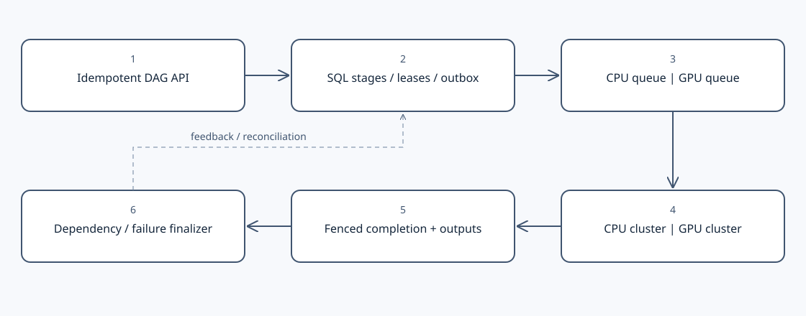

# W156. Design a Multistage CPU and GPU Job Scheduler

**Priority group:** Second 100 — important

**Category:** ML infrastructure and distributed training

**Study position:** 156 of 547

[Group list](../NEXT_100.md) · [All categories](../ALL_CATEGORIES.md) · [Chapter guide](../README.md)

## Question

### Description

Design a durable job scheduling system for workflows made of multiple dependent stages. Each stage declares CPU, memory, and optional GPU needs; the scheduler must place CPU-heavy stages on a CPU cluster and GPU-heavy stages on a GPU cluster. Use a database to preserve workflow state and a queue to make runnable work available without losing dependency or retry information.

### What to implement

Present the APIs, data model, components, scheduling loop, and state transitions for the system.

POST /v1/jobs: accept a client-generated idempotency key and a directed acyclic graph of stages. Each stage includes an identifier, dependency identifiers, a resource request, and a retry-safe execution payload.
GET /v1/jobs/{job_id}: return the job state and the state, attempt count, and output reference of every stage.
POST /v1/jobs/{job_id}:cancel: prevent undispatched stages from starting and request cancellation of running stages.
Input

A job contains at most 20 stages. The dependency graph must be acyclic. A stage requests 1–32 CPU cores, 1–256 GiB of memory, and either 0 GPUs for CPU work or 1–8 GPUs for GPU work. Stage payloads and results live in object storage; API and queue messages carry references rather than large blobs.

### Output

The submission API returns a stable job_id. Status reads expose one terminal job state—SUCCEEDED, FAILED, or CANCELED—only after all relevant stage transitions have been durably recorded. The design response should include capacity estimates, API behavior, database records and indexes, queue message fields, CPU/GPU routing, dependency release, retries, cancellation, reconciliation, and observability.

### Rules

1. A stage becomes READY only after every dependency is SUCCEEDED. Independent ready stages may execute concurrently; no ordering is required beyond dependency edges.
2. The database is the source of truth for job, stage, dependency, attempt, and lease state. Queue delivery is at least once, so workers and completion handling must be idempotent.
3. Plan for 50,000 submitted jobs per day, an average of 8 stages per job, bursts of 200 job submissions per second, and up to 200,000 active jobs. Of all stages, 20% require GPUs.
4. Target p95 submission latency below 200 ms, p95 dispatch of a resource-feasible READY stage below 5 seconds, and 99.9% monthly control-plane availability.
5. Workers heartbeat every 30 seconds and hold renewable 2-minute leases. With a lease granted at t = 0, renewals are scheduled at t = 30, 60, and 90 seconds; a renewal at the t = 120 expiry boundary is too late. A stage receives at most 3 total attempts.
6. After a stage exhausts its third attempt, the job enters nonterminal FAILING. The system must fence and request cancellation of every other live attempt, durably mark all remaining nonterminal stages so they cannot run, and expose FAILED only after every stage transition and lease revocation is durable. Completion is accepted only while the job is active, so work from a FAILING or terminal job cannot release dependencies or overwrite state.
7. Duplicate submissions with the same client idempotency key return the same job. Duplicate queue deliveries, late completions, and completion after cancellation must not corrupt terminal state or release a dependent stage twice.
8. A CPU- or GPU-cluster outage must not lose accepted work. Work for the healthy cluster should continue, while resource-feasible work for the unavailable cluster remains pending and is dispatched after recovery.

### Examples

Example 1: Mixed preprocessing and training

decode(CPU) -&gt; {augment(CPU), train(GPU)} -&gt; evaluate(CPU)

After decode succeeds, augment is offered to the CPU cluster and train to the GPU cluster concurrently. evaluate remains blocked until both predecessors succeed, illustrating dependency ordering without imposing a total job order.

Example 2: Worker loss and duplicate delivery

A GPU worker starts train attempt 1, stops heartbeating, and its lease expires. The scheduler makes attempt 2 eligible; later, the queue redelivers the attempt-1 message and the original worker reports success.

The stale delivery and late completion must be rejected using the recorded attempt and lease token. Only the current attempt may commit a terminal transition, so downstream stages are released at most once.

### Constraints

The design must use a queue and a transactional database, and must route work to distinct CPU and GPU execution clusters.
Scheduler and API instances may fail and restart at any point.
Queue delivery can be duplicated, delayed, or reordered.
GPU capacity is scarcer than CPU capacity; avoid head-of-line blocking between resource classes.
Prefer standard managed primitives, but explain consistency boundaries and recovery rather than relying on product names.
Follow-up 1: Survive a resource-cluster outage

Explain state transitions, backpressure, alerts, and recovery when the GPU cluster is unavailable for 30 minutes while CPU work continues.

Follow-up 2: Add fair scheduling

Extend the design so a single tenant with a large backlog cannot monopolize GPU capacity, while retaining the dispatch-latency target for other tenants.

## Worked solution

### Submission and durable records

`POST /v1/jobs` takes tenant, client idempotency key and the DAG. Validate unique stage IDs, dependencies that exist, acyclicity with an O(V+E) topological pass, at most 20 stages, 1–32 CPU cores, 1–256 GiB RAM and 0–8 GPUs. A GPU stage has at least one GPU; CPU stages have zero. Payloads and results are object references. Unique (tenant,key) returns the same job_id; store a request hash and reject a different body under the same key. Return after a database transaction, without waiting for placement, to target p95 below 200 ms.

Use Job(id,tenant,key,hash,state,version), Stage(job,id,state,cpu,ram,gpu,payload_ref,attempt_count,next_ready_at,output_ref), Edge(job,parent,child), Attempt(job,stage,n,token,cluster,lease_expiry,state), and Outbox(id,queue,payload,published). Keys include (job,stage), (job,stage,n), and (job,parent,child). Index Stage(state,resource_class,next_ready_at,tenant), Attempt(lease_expiry,state), and Edge(parent). Job, stage, attempt and lease authority remains in SQL; a queue message is only a wakeup.

### Scheduling and completion transactions

The diagram's runnable queue is concretely split into CPU and GPU queues leading to distinct execution clusters. An outbox publisher sends {event_id, job_id, stage_id, resource_class, expected_stage_version}; never send large payloads. A scheduler checks healthy inventory, tenant budget and job ACTIVE state, locks the stage and job in a fixed order, and atomically changes READY→RUNNING, increments attempt_count and grants a unique token with a two-minute lease. It then launches the resource-reserved attempt; if launch acknowledgment is lost, agents reconcile by attempt ID. Duplicate or reordered queue messages cannot create another attempt while a valid attempt exists.

Workers heartbeat at 30, 60 and 90 seconds after a t=0 grant. Renewal requires database time strictly before expiry and a matching current token; t=120 is too late. On completion, lock job then stage, require ACTIVE job, current token, unexpired lease and RUNNING stage, verify a durable output manifest, and change to SUCCEEDED once. In the same transaction, mark a child READY only if every parent is SUCCEEDED, inserting one uniquely keyed ready event. This all-parent check avoids duplicate decrements. Independent ready stages execute concurrently.

Lease expiry or retryable failure fences that token. If fewer than three total attempts have run, set RETRY_WAIT with backoff, then READY. A deterministic failure may exhaust policy early. The third unsuccessful attempt initiates a job-level ACTIVE→FAILING transition under the job lock. Revoke every live attempt token, mark blocked/ready/retry stages SKIPPED_FAILED, request worker cancellation and durably mark affected running stages failed/canceled. Expose FAILED only after all required stage and lease records are terminal/revoked. Physical worker termination may follow; fenced workers cannot commit outputs or external effects without sink-side token/idempotency checks. Any late success while FAILING is rejected and cannot release dependencies.

`POST /v1/jobs/{id}:cancel` similarly changes ACTIVE→CANCELING first, fences live attempts and marks undispatched stages CANCELED; expose CANCELED only when the durable finalization is complete. `GET /v1/jobs/{id}` returns per-stage state, attempt count and output refs from one consistent database snapshot. A single job lock makes cancellation, failure and completion order explicit: whichever acquires it first determines which transitions are legal. Do not let a later cancel overwrite SUCCEEDED or FAILED.

### Capacity, outage and fairness

50,000×8 = 400,000 stages/day, or 4.63/s average; 80,000 GPU stages/day and 320,000 CPU stages/day. A 200-job/s burst with eight stages is 1,600 stage inserts/s, and the 20-stage maximum gives 4,000/s. Up to 200,000 active jobs at mean eight stages means 1.6 million active stage records; size indexes and dependency transactions accordingly. Assuming 20,000 running attempts, 30-second heartbeats add about 667 updates/s. Compute fleet size still requires stage duration and resource distributions; daily stage count alone cannot determine GPU capacity. For example, 80,000 one-GPU stages/day averaging one hour need 3,333 average GPU slots before headroom.

For a 30-minute GPU outage, stop new GPU reservations, retain GPU READY/RETRY_WAIT work in SQL and bound queue redelivery. CPU-ready work continues. Mark uncertain GPU attempts for fenced recovery; do not spend all three attempts simply because the cluster is known down. Alert on cluster health and oldest GPU-ready age. After recovery reconcile actual workloads, expire/fence stale generations, and ramp dispatch with backpressure to avoid a retry storm. The under-five-second dispatch target applies to healthy, resource-feasible, quota-eligible work; an outage or capacity shortage must be reported as excluded waiting, not hidden latency.

Use weighted per-tenant GPU queues, concurrency caps, aging and capacity reservations. Fair scheduling cannot promise five seconds to every tenant under unbounded admitted load; admission limits and reserved shares make that target meaningful. Reconciliation scans READY stages lacking outbox events, stale attempts, orphan workers and nonterminal finalizers. Validate the given decode→{augment,train}→evaluate example, duplicated attempt-1 delivery after attempt-2 starts, t=120 renewal rejection, cancellation/completion races and crash during FAILING finalization. Monitor feasible dispatch percentiles, backlog by cluster/tenant, duplicate rejections, expired leases and outbox lag.

<!-- architecture:W156:start -->

Read the numbered path as Idempotent DAG API → SQL stages / leases / outbox → CPU queue | GPU queue → CPU cluster | GPU cluster → Fenced completion + outputs → Dependency / failure finalizer. The dashed return is the feedback or reconciliation path described in the solution; durable state and authorization remain authoritative when work is retried.
<!-- architecture:W156:end -->

### Runnable checks

[Batch behavior checks](../test_review_151_200.py) exercise Small explicitly labeled state model checks duplicate claim, expired renewal, stale/duplicate completion and inactive-job rejection.

### Further study

- [F035: Compare data, tensor and pipeline parallel training.](../04_serving_and_training_systems.md#f035)
- [F039: Design a fair GPU job scheduler.](../04_serving_and_training_systems.md#f039)
- [F163: Handle dependency-aware job scheduling.](../17_distributed_systems_depth.md#f163)
