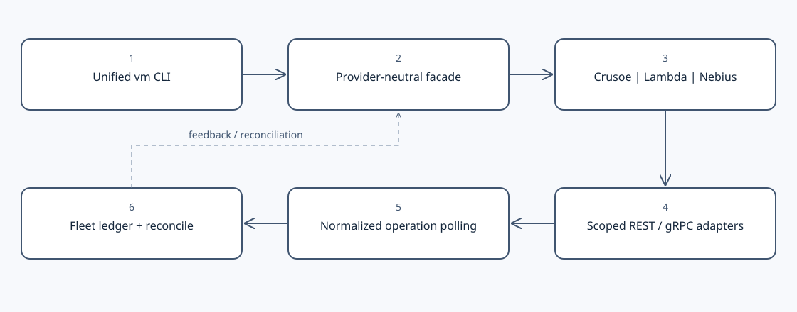

# W157. GPU Cloud VM Manager - Provider-Agnostic CLI and Fleet Manager

**Priority group:** Second 100 — important

**Category:** ML infrastructure and distributed training

**Study position:** 157 of 547

[Group list](../NEXT_100.md) · [All categories](../ALL_CATEGORIES.md) · [Chapter guide](../README.md)

<span class="practice-page"></span>

## Question

Problem: GPU Cloud VM Manager

Build a provider-agnostic command-line tool, vm, that manages GPU virtual machines across three cloud providers whose APIs differ in protocol, scoping and synchronicity, and then grow it into a small fleet manager.

Providers

You are given a repository with three mock servers, one per provider:

Provider	Protocol	Scoping	Operations	Reservations
Crusoe Cloud	REST	project-scoped	asynchronous; supports reboot / reset / restart	reservations
Lambda Cloud	REST, flat and simple	none	synchronous	reserved instances
Nebius AI Cloud	gRPC	parent-scoped	asynchronous	reservation policies
Layer 1: Unified CLI (about 30–40 minutes)

Implement these commands so that the caller never sees a provider-specific difference:

```python
# 1. List all instances across all providers, or filter by provider
```

vm list [--provider &lt;provider&gt;]

```python
# 2. Create a new instance
```

vm create --provider &lt;provider&gt; --gpu &lt;gpu_type&gt; --count &lt;count&gt; [--name &lt;name&gt;] [--region &lt;region&gt;]

```python
# 3. Get instance details
```

vm get --provider &lt;provider&gt; &lt;instance_id&gt;

```python
# 4. Stop an instance
```

vm stop --provider &lt;provider&gt; &lt;instance_id&gt;

### Requirements

1. One provider-neutral instance model (id, provider, name, GPU type, count, region, state) and one normalized state set, whatever each provider returns.
2. Asynchronous providers must look synchronous to the CLI: create and stop return once the operation has finished or a timeout is reached.
3. vm list without --provider aggregates all providers; a failing provider is reported, not fatal.
4. Invalid arguments and provider errors produce clear messages (for example not found, quota exceeded, provider unavailable).
Later layers: Fleet manager
5. Reservations — one reserve / release interface that maps onto each provider's reservation model.
6. Fleet operations — aggregate GPU usage per provider and GPU type, create N instances within each provider's capacity, and reconcile the running fleet against a desired specification.
Deliverable

Working code against the mock servers for Layer 1, a design that extends to the later layers without changing the CLI, and a short explanation of the trade-offs you made (for example, a synchronous facade over asynchronous APIs, partial results versus failing fast).

## Worked solution

### What can and cannot be implemented from this prompt

The three mock servers, their REST routes/JSON schemas, Nebius protobuf definitions, authentication and project/parent values are not included here. Therefore no honest answer can claim working integration against those servers. The implementation below is a working provider-neutral CLI core with an explicitly chosen demonstration transport contract. Real adapters must map the supplied repository's actual routes and generated gRPC stubs to that contract. Do not invent endpoint names and present them as the exercise's API.

Use one Instance record with id, provider, name, gpu_type, count, region and state. The normalized states are PENDING, RUNNING, STOPPING, STOPPED, FAILED and UNKNOWN; preserve raw provider state for diagnosis. A provider adapter owns project/parent scoping, authentication, pagination, raw-state mapping and conversion of provider exceptions into NotFound, QuotaExceeded or Unavailable. Never put those conditionals into the CLI.

```python
from dataclasses import dataclass
import time

@dataclass(frozen=True)
class Instance:
    id: str
    provider: str
    name: str
    gpu_type: str
    count: int
    region: str
    state: str

class ProviderError(Exception): pass

class Facade:
    # Adapter contract: list/get/create/stop and optional wait_operation.
    # create and stop return a stable instance ID and optional operation ID.
    def __init__(self, providers, clock=time.monotonic, sleep=time.sleep):
        self.providers, self.clock, self.sleep = providers, clock, sleep

    def list(self, provider=None):
        names = [provider] if provider else sorted(self.providers)
        instances, errors = [], {}
        for name in names:
            try:
                instances.extend(self.providers[name].list())
            except ProviderError as exc:
                errors[name] = str(exc)
        return instances, errors

    def get(self, provider, instance_id):
        return self.providers[provider].get(instance_id)

    def _finish(self, adapter, instance_id, operation, target, timeout):
        deadline = self.clock() + timeout
        while True:
            # The concrete adapter must apply a per-RPC deadline too.
            if operation:
                adapter.check_operation(operation)  # raises on operation failure
            item = adapter.get(instance_id)
            if item.state == target:
                return item
            if item.state == 'FAILED':
                raise ProviderError(f'instance {instance_id} failed')
            remaining = deadline - self.clock()
            if remaining <= 0:
                raise TimeoutError(f'timed out; reconcile instance {instance_id}')
            self.sleep(min(0.25, remaining))

    def create(self, provider, gpu, count, name='', region='', timeout=120):
        if count < 1:
            raise ValueError('GPU count must be positive')
        adapter = self.providers[provider]
        instance_id, operation = adapter.create(gpu, count, name, region)
        return self._finish(adapter, instance_id, operation, 'RUNNING', timeout)

    def stop(self, provider, instance_id, timeout=120):
        adapter = self.providers[provider]
        _, operation = adapter.stop(instance_id)
        return self._finish(adapter, instance_id, operation, 'STOPPED', timeout)
```

The linked runnable demonstration includes `argparse` for all four requested commands, a synchronous Lambda-like adapter, asynchronous Crusoe/Nebius-like adapters and deterministic behavior checks. It uses an in-memory demonstration backend, not real cloud credentials or the missing mocks. `list` returns successful providers plus named errors; the CLI prints errors to stderr and uses a distinct partial-success exit status. Single-provider operations fail clearly. Bound polling and transport deadlines; synchronous create means “resource reached RUNNING,” not just “provider returned operation ID.” A create timeout must print the ID; an automatic new create could leak a duplicate VM.

### Production adapters and fleet extension

Crusoe adapter stores configured project scope; Nebius stores parent scope and wraps generated gRPC operations; Lambda maps a direct response to the same result type. Stop is a normalized operation with provider-specific semantics, not an arbitrary mapping to destructive reset. Check provider capabilities and reject unsupported requests. Retry safe reads and operation polls with backoff; create needs a provider idempotency token or a durable operation ledger and resource tags before safe retry. Unknown raw states stay UNKNOWN and time out visibly rather than becoming RUNNING.

Add `reserve(spec)`/`release(reservation_id)` behind the provider interface, storing provider reservation ID, scope, region, GPU type/count, expiry and state. FleetSpec(version,provider,pool,image,gpu,count,region,reservation) plus a resource ledger records desired versus observed instances. A leased reconciler lists, adopts only owned/tagged instances, computes deficits/surplus, respects capacity and budget and records each intended creation before calling a provider. Provider capacity is an observation and can change before launch; handle quota/capacity errors without exceeding desired count. Sum GPU usage as count per instance grouped by provider and gpu_type, separating RUNNING, reserved and pending capacity. API failures keep observed state uncertain rather than triggering replacement of every VM.

Example: asking for three eight-GPU instances when only 16 GPUs are available permits two placements and leaves one pending; it does not silently change each VM's GPU count. Existing CLI behavior remains unchanged as the fleet manager reuses its adapters. The diagram's desired-state store and reconciliation queue apply to this later layer; Layer 1 is a direct CLI→adapter→provider path. Demonstration tests cover synchronous/asynchronous completion, partial list failure, terminal failure, timeout and invalid counts. Server integration remains blocked only on the absent contracts and fixtures.

<!-- architecture:W157:start -->


Read the numbered path as Unified vm CLI → Provider-neutral facade → Crusoe | Lambda | Nebius → Scoped REST / gRPC adapters → Normalized operation polling → Fleet ledger + reconcile. The dashed return is the feedback or reconciliation path described in the solution; durable state and authorization remain authoritative when work is retried.
<!-- architecture:W157:end -->

### Runnable checks

[Executable W157 implementation](../review_w157_implementation.py). [Batch behavior checks](../test_review_151_200.py) exercise Synchronous and asynchronous create/stop; Partial list failure; Invalid count, quota/not-found errors; Operation failure and bounded timeout; CLI list/create/get/stop and invalid provider.

### Further study

- [F039: Design a fair GPU job scheduler.](../04_serving_and_training_systems.md#f039)
- [F087: Design an online model rollout with rollback.](../09_ml_system_design.md#f087)
- [F198: Prepare a research experiment with limited compute.](../20_research_and_behavioral_depth.md#f198)
