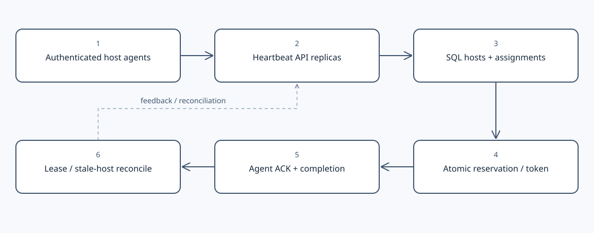

# W158. HPC Host Control Plane and Job Coordination

**Priority group:** Second 100 — important

**Category:** ML infrastructure and distributed training

**Study position:** 158 of 547

[Group list](../NEXT_100.md) · [All categories](../ALL_CATEGORIES.md) · [Chapter guide](../README.md)

## Question

HPC Host Control Plane and Job Coordination

Design a central service that tracks many hosts, knows their current state, and coordinates job assignment. The prompt explicitly focuses on communication between hosts and the central service, database choice and schema, high-concurrency handling, and a roughly 1,000-host scale target; detailed job-scheduling policy is out of scope.

### Requirements

Design a central control-plane service for an HPC software environment.

Functional requirements:

Maintain current state for many hosts under the central service.
Let hosts communicate health, availability, and resource state to the central service.
Support job assignment coordination, while leaving detailed scheduling algorithms mostly out of scope.
Store host and job-related state in a database with a clear schema.
Handle high concurrency when many hosts update state at once.

Scale / constraints:

Reason about approximately 1,000 hosts.
Host state should refresh frequently enough for job assignment decisions.
The central service should avoid becoming a single point of failure.
Notes

The expected discussion is a narrow control-plane design, not a broad cloud platform.

Heartbeats are a natural host-to-service communication model; clarify heartbeat interval, timeout, retry behavior, and stale-host handling.
In-memory stores such as Redis can make fast host-state updates easy, but the answer still needs persistence / recovery and clear ownership of authoritative state.
Atomic updates matter under concurrency. Lua scripts or transactions can be used to update related host fields consistently in Redis-style designs.
The schema should distinguish host identity, resource capacity, current allocation, health state, last heartbeat, and job assignment state.
High availability needs leader election or active / standby service instances, plus a plan for failover without double-assigning work.

## Worked solution

### A narrow control plane

At approximately 1,000 hosts, a replicated relational database is enough; Redis can cache the live view but should not be the only copy of assignment authority. Use stateless API instances behind a load balancer and a host agent authenticated with a host-specific mTLS identity. Hosts call `POST /hosts/{id}/heartbeats` with boot_id, increasing sequence number, observed capacity, allocation summary and health. The response contains desired assignment changes. Long polling can reduce assignment delay without requiring the service to dial every host.

Assume a five-second heartbeat with jitter, a 15-second SUSPECT threshold and a 30-second LOST threshold. This yields about 200 heartbeat requests/s; even 1 KB per request is only about 0.2 MB/s before overhead. Persist only necessary observations or batch historical telemetry; 200 full historical writes/s is 17.28 million/day. Retry with jitter, but preserve sequence numbers so an old delayed packet cannot replace newer state. Compare server receive time for liveness; do not trust host clocks.

### Schema and atomic ownership

Host(id,boot_id,capacity_cpu,capacity_ram,capacity_gpu,allocated_cpu,allocated_ram,allocated_gpu,health,last_seen,last_seq,version) separates capacity, allocation and liveness. Job(id,state,payload_ref) and Assignment(id,job,host,host_boot_id,attempt,token,state,lease_expiry) hold durable work authority. Index health/last_seen for stale-host scans, host/state for assignments and lease_expiry for cleanup. Store a job's one active assignment under a unique constraint.

`POST /assignments` locks the host and job, checks healthy/free capacity, inserts assignment and increases allocated resources in one transaction. The host receives the assignment with token, acknowledges idempotently, and reports completion through `POST /assignments/{id}:complete`; only the matching current token and boot_id may commit it. Cancellation revokes the token before releasing logical ownership. A Redis alternative needs a Lua script for reservation plus related counters and a durable transactional journal; SQL avoids introducing that recovery protocol at this scale.

### Failover and example

The diagram's resource state store is the SQL host/assignment authority, its reconciliation queue carries assignment/retry changes, and its node agents report observations. Health is an observation; assignment is durable intent. API instances may be active-active because transactions serialize conflicts. If a single reconciliation leader is used, a database lease with a monotonically increasing fencing epoch prevents the old leader from assigning after failover. Replicate the database across zones, back it up and test restoration. Losing the cache must merely make reads slower.

Example: H has eight CPUs and six reserved. Two controllers each request two CPUs. The first locks H, commits allocation eight; the second then sees no capacity and waits. If H reboots, its boot_id changes and old attempt completions are rejected. If H is partitioned, mark it SUSPECT and stop new assignments, then LOST after timeout; reassign work only with fencing and idempotent outputs, since timeout does not prove the old process stopped. On database outage stop assigning rather than accepting unrecorded reservations; agents may continue valid leases and stop renewing ownership when authority is unavailable. Monitor heartbeat age, assignment acknowledgment latency, conflicting-token rejections, reconciliation backlog and available versus allocated resources. Detailed optimization/fair scheduling is deliberately outside this prompt.

<!-- architecture:W158:start -->

Read the numbered path as Authenticated host agents → Heartbeat API replicas → SQL hosts + assignments → Atomic reservation / token → Agent ACK + completion → Lease / stale-host reconcile. The dashed return is the feedback or reconciliation path described in the solution; durable state and authorization remain authoritative when work is retried.
<!-- architecture:W158:end -->

### Runnable checks

[Batch behavior checks](../test_review_151_200.py) also validate this page's Python syntax and referenced diagrams. The architecture, capacity and metric reasoning is reviewed as a design; no production load, availability or model-quality result is claimed.

### Further study

- [F035: Compare data, tensor and pipeline parallel training.](../04_serving_and_training_systems.md#f035)
- [F039: Design a fair GPU job scheduler.](../04_serving_and_training_systems.md#f039)
- [F163: Handle dependency-aware job scheduling.](../17_distributed_systems_depth.md#f163)
