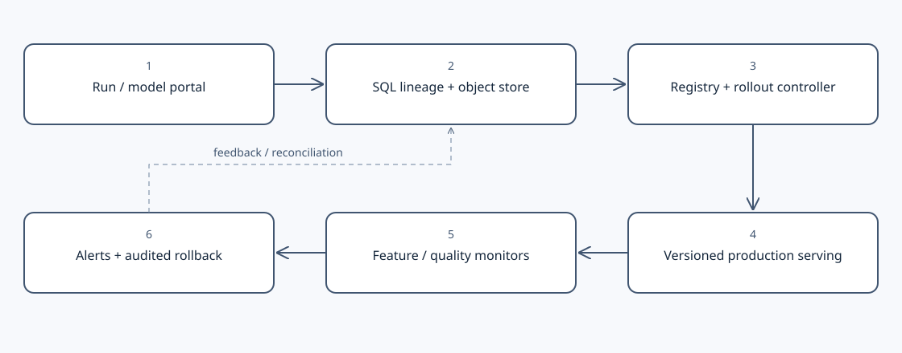

# W159. ML Platform Portal Full-Stack Design

**Priority group:** Second 100 — important

**Category:** ML infrastructure and distributed training

**Study position:** 159 of 547

[Group list](../NEXT_100.md) · [All categories](../ALL_CATEGORIES.md) · [Chapter guide](../README.md)

## Question

Design a web portal that gives ML engineers and data scientists one place to record experiments, register models, deploy/promote models, and monitor production model health.

### Requirements

Record experiments with parameters, metrics, artifacts, owner, and lineage.
Register models and versions.
Deploy a model to an environment and promote it to production.
Monitor model quality, data drift, data quality, percent-empty, PSI, and alerts.
Design REST APIs, database schema, and a UI flow.
Be ready for GraphQL and frontend/JavaScript questions.

## Worked solution

### Data model and researcher workflow

Start with a project-scoped portal: experiments → model versions → deployments → health. SQL tables include Project/Member(role), Experiment, Run(id,owner,code_hash,data_version,params,state), Metric(run,name,step,time,value), Artifact(run,uri,digest), Model(id,project), ModelVersion(model,version,run,artifact_digest,input_schema), Deployment(environment,desired_version,observed_version,generation,state), MonitorDefinition(reference_dataset,metric,window,threshold) and Alert. Large artifacts go to object storage; metric time series go to a time-series/columnar store with SQL references. Lineage is explicit foreign keys and immutable digests, not a free-text description.

`POST /runs` creates an idempotent run; batch `POST /runs/{id}/metrics` deduplicates by (run,name,step,event_id). Signed uploads store artifacts, then a finalize API verifies hashes. `POST /models/{id}/versions` registers only complete artifacts; `POST /deployments` or `POST /deployments/{id}:promote` accepts expected generation, destination, version and approval. `GET /runs?...`, `/models/{id}/versions`, `/deployments/{id}` and `/health?environment=&from=&to=` support UI lists, comparisons and charts. Enforce project RBAC on every resolver/API, and production promotion may require an independent approver.

The UI guides a scientist from run comparison with pinned filters, to a model-version detail/lineage page, to staging deployment, canary evaluation, approval and production promotion. Show pending versus live version, promotion history and one-click rollback to a compatible model/feature schema. Asynchronous operations return operation IDs; refreshing the page must not repeat a promotion.

### Deployment and monitoring flow

The revised diagram below places the registry and rollout controller between run metadata and production monitoring. A transaction updates desired generation and an outbox. A rollout reconciler provisions the versioned serving image, verifies schema and health, shadows traffic, canaries a fixed fraction and then shifts the stable routing pointer. Conflicting promotions use compare-and-swap, so an old controller cannot overwrite a newer target. Retry by operation ID after timeouts; preserve the previous version for rollback. Failure before readiness leaves production on the old route, with a failed operation and diagnostic.

Serving logs feature/model versions, prediction, timestamps and a join key. Streaming jobs compute data quality and percent-empty per feature, while delayed labels compute quality only on mature cohorts. Percent-empty is missing_count/eligible_count with the denominator recorded. Population Stability Index uses fixed reference bins:

$$PSI=\sum_i(q_i-p_i)\log(q_i/p_i),$$

with a documented smoothing convention for zero bins. Monitor drift, schema violations, label coverage, latency and error rates; PSI indicates distribution change, not proof of model-quality loss. Alerts include model/environment/window/reference version and deduplicate repeated breaches with recovery hysteresis. Compare slices as well as global rates.

### Full-stack and sizing decisions

GraphQL is useful for one page needing a model, its runs and deployments; use pagination, query depth/cost limits and batched loaders to avoid N+1 database reads. Mutations retain idempotency and authorization. In JavaScript, render loading/error/empty states separately, cancel stale requests when filters change, debounce search, virtualize long metric lists and invalidate cached deployment data after a mutation. Never trust a hidden UI button as permission enforcement.

Scale is not supplied. Assuming 10,000 runs/day, 100 metrics/run and 1 MB artifacts/run gives one million metric points/day and 10 GB artifacts/day; actual checkpoints could be orders larger, so estimate these independently. Cache project-scoped reads with version keys, partition metric history by date/run, and use an outbox for durable rollouts. Test concurrent promotion, duplicate metric batches, incomplete artifact registration, rollback schema compatibility and delayed-label monitoring. Audit who viewed sensitive data and who changed production; watch portal error rates, rollout reconciliation lag and alert false-positive rates.

<!-- architecture:W159:start -->

Read the numbered path as Run / model portal → SQL lineage + object store → Registry + rollout controller → Versioned production serving → Feature / quality monitors → Alerts + audited rollback. The dashed return is the feedback or reconciliation path described in the solution; durable state and authorization remain authoritative when work is retried.
<!-- architecture:W159:end -->

### Runnable checks

[Batch behavior checks](../test_review_151_200.py) also validate this page's Python syntax and referenced diagrams. The architecture, capacity and metric reasoning is reviewed as a design; no production load, availability or model-quality result is claimed.

### Further study

- [F039: Design a fair GPU job scheduler.](../04_serving_and_training_systems.md#f039)
- [F087: Design an online model rollout with rollback.](../09_ml_system_design.md#f087)
- [F198: Prepare a research experiment with limited compute.](../20_research_and_behavioral_depth.md#f198)
