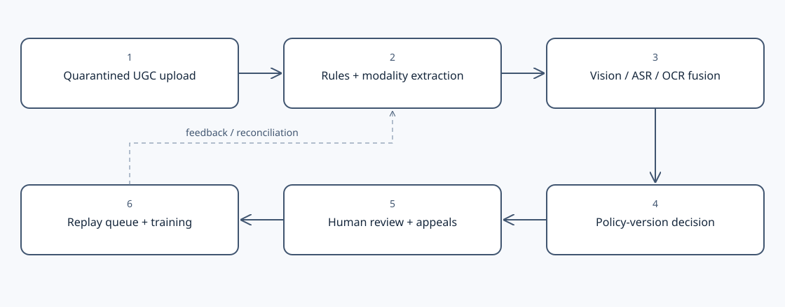

# W162. Content Moderation System Design

**Priority group:** Second 100 — important

**Category:** Production ML and product design

**Study position:** 162 of 547

[Group list](../NEXT_100.md) · [All categories](../ALL_CATEGORIES.md) · [Chapter guide](../README.md)

## Question

Design a content-moderation system for a high-volume short-video / live / e-commerce platform.

### Requirements

Functional: ingest UGC (video, image, text); pre-publish moderation; flag violations into a human review queue; expose the outcome to publishing.
ML infra: per-modality model serving (vision, ASR transcript, OCR, text classifier); feature pipeline; offline retraining loop.
Scale: 100M+ uploads/day; sub-second decision SLA for short videos; full re-scan within minutes.
Reliability: at-least-once delivery; replay past content on rule changes; audit log.
Follow-up: a job scheduler for high-frequency re-moderation (priority queue + worker pool + at-least-once).
Notes

Three planes: ingestion / decision / review. Hourglass model serving — cheap rule filters -&gt; vision/ASR/OCR -&gt; expensive multimodal LLM for ambiguous cases only. Idempotent processing keyed on content_id + rule_version.

## Worked solution

### Decision contract and capacity

Define a versioned policy taxonomy, severity and actions ALLOW, HOLD_FOR_REVIEW, BLOCK. `POST /content` returns content_id/upload URL; `GET /content/{id}/moderation` exposes a decision with policy/model versions and reason codes. Publishing requires a matching current-version decision, not merely a completed worker. Video duration/size are unspecified; assume bounded short clips. Long uploads and live streams need incremental decisions and cannot receive exhaustive whole-video analysis before the bytes exist.

100 million uploads/day is about 1,157/s average. Assume a fivefold peak: 5,787/s. Sampling four frames/upload means about 23,148 frames/s at that peak before ASR/OCR work. At an assumed 100 frame inferences/GPU/s, vision alone needs about 232 busy GPUs plus headroom. “Full re-scan within minutes” must clarify corpus size: rescanning a day's 100 million items in five minutes requires 333,333 items/s, about 288 times average upload throughput. Do not promise this on the ordinary fleet; prioritize affected content and provision separate replay capacity or negotiate the scope.

### Ingestion, decision and review planes

Upload media to quarantined object storage, validate file type/malware, and commit Content(id,owner,media_digest,object_ref,state) plus an outbox event. The diagram separates ingestion from model decisions and review: workers extract sampled frames, OCR, ASR, text and audio/visual embeddings; the fusion scorer combines them, then a policy engine maps probabilities to actions. Cheap hashes/rules and small models handle clear cases; expensive multimodal reasoning is reserved for ambiguous cases. A sub-second illustrative budget is 50 ms intake, 250 ms parallel preprocessing, 250 ms model inference, 50 ms policy/persistence and 400 ms network/headroom; exhaustive ASR for arbitrary clips is not guaranteed.

Store Decision(content,content_version,policy_version,model_version,scores,action), ReviewTask(reason,priority,assignment,state) and append-only audit records. A unique processing key includes content version plus rule/model version so retries deduplicate while intentional model rescoring remains possible. Completion uses conditional version checks; an old allow result cannot overwrite a new block. At-least-once events and transactional outbox tolerate crashes between object/metadata publication and queue delivery. Keep undecided content held on dependency outage; fail-open is an explicit risk policy, never an accidental timeout behavior.

### Labels, re-moderation and operations

Train multi-label heads on expert-reviewed gold data, appeals and weak report signals, retaining label provenance and reviewer disagreement. Use policy-specific held-out calibration and separate thresholds for block versus review; review thresholds also respect staffing. Measure severe-harm recall, action precision, appeal reversal, time-to-removal, subgroup errors and queue age. A 0.1% review rate at this volume is already 100,000 items/day; at 30 seconds/item it is 833 reviewer-hours/day before double review.

A priority scheduler enqueues policy-change rescans by severity, reach, age and expiry. Workers claim leases, heartbeat, retry transient failures with backoff and dead-letter repeated corrupt inputs. Use separate live/upload/replay quotas to prevent replay starving pre-publish decisions. A review outcome is versioned and audited; a newer human appeal may supersede an older model result. Replay from durable content manifests/event history and monitor processing lag, duplicate rejection, modality failures and audit completeness. Test old-decision races, duplicate queue messages, reviewer overrides and model rollback against a fixed gold suite before rollout.

<!-- architecture:W162:start -->

Read the numbered path as Quarantined UGC upload → Rules + modality extraction → Vision / ASR / OCR fusion → Policy-version decision → Human review + appeals → Replay queue + training. The dashed return is the feedback or reconciliation path described in the solution; durable state and authorization remain authoritative when work is retried.
<!-- architecture:W162:end -->

### Runnable checks

[Batch behavior checks](../test_review_151_200.py) also validate this page's Python syntax and referenced diagrams. The architecture, capacity and metric reasoning is reviewed as a design; no production load, availability or model-quality result is claimed.

### Further study

- [F083: Design multi-modal harmful-content detection.](../09_ml_system_design.md#f083)
