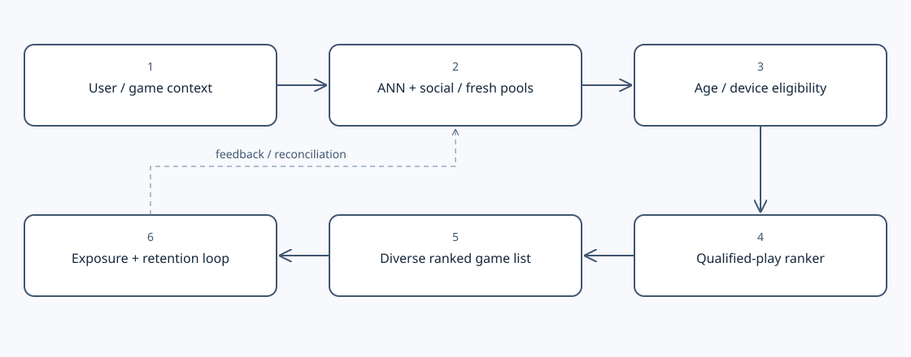

# W163. Design a Game Recommendation System

**Priority group:** Second 100 — important

**Category:** Production ML and product design

**Study position:** 163 of 547

[Group list](../NEXT_100.md) · [All categories](../ALL_CATEGORIES.md) · [Chapter guide](../README.md)

## Question

Design the recommendation system of a large online game platform, with millions of users and hundreds of thousands of user-created games. For each user the system returns a ranked list of games they are likely to enjoy and keep playing. The design should cover the whole pipeline end to end, with breadth across the parts rather than depth on one component.

What to cover
1. Problem framing: the objective the system optimizes (engagement, retention, monetization), the metric that stands for long-term value, and how new users and new games (cold start) are handled.
2. Data and features: user, game and context signals, including social signals, and how they are computed offline and online.
3. Candidate generation: how the catalog is narrowed from the full set of games to a few hundred candidates per request.
4. Ranking: the model that scores the candidates, its inputs and outputs, and the re-ranking rules for diversity and freshness.
5. Evaluation: offline metrics for retrieval and ranking, and why they are not enough.
6. Online experimentation: how the system is A/B tested, and the pitfalls to guard against (feedback loops, popularity bias, label bias, non-stationarity).

### Constraints

Serving latency of a recommendation request is on the order of 100 ms.
The catalog changes continuously: new games appear and old ones decay every day.

## Worked solution

### Objective and training data

Optimize satisfying, repeat play rather than raw session length or spend. Choose weekly retained players as the long-term primary outcome, with qualified play sessions and explicit satisfaction as faster proxies. Guard age safety, latency, crashes, excessive play, creator coverage and monetization pressure. An impression row records user, game, request/time, position, eligibility, retrieval source and model version; labels include launch, minutes played capped for outliers, early exit and return within seven days. Wait for label maturity and distinguish an unshown game from a shown-and-skipped game.

User features include genre preferences, recent sessions, device, language and declared interests. Game features include description/thumbnail embeddings, genre, controls/platform compatibility, update age, quality/crash rates and age rating. Context includes time, session intent and available party size; social signals include friends currently playing and co-play history, subject to privacy and permission. Offline jobs build long-term embeddings and quality aggregates; streams maintain recent interactions and live friend/game availability with event-time versioning.

### Serving the catalog in about 100 ms

`GET /recommendations?user_id=&cursor=` retrieves eligible candidates from two-tower ANN similarity, item-to-item co-play, social activity, regional trending and a new-game exploration pool. Merge and deduplicate a few thousand, apply age/device/region rules, pre-rank to a few hundred and score with a multi-task ranker predicting launch, enjoyable play and return. Utility weights are chosen through experiments, not by adding incomparable probabilities blindly. Re-rank for genre/creator diversity, freshness and exploration while retaining relevance. A possible budget is 10 ms request/features, 20 ms parallel retrieval, 10 ms filtering/pre-rank, 35 ms ranking, 10 ms re-rank and 15 ms headroom. These are design allocations requiring load measurement.

The diagram's retrieval, ranking and policy stages represent different responsibilities: ANN narrows hundreds of thousands of games; the ranker uses richer user-game interactions; re-ranking enforces list constraints. Store Game metadata and versions in durable storage, embeddings in versioned indexes and hot features in a key-value store. New game text/image features make it retrievable before plays exist; new users get sign-up preferences and safe diverse regional defaults. Do not claim launch popularity data for an entirely unseen game.

### Evaluation, feedback and scale

Train on forward time splits, grouping near-duplicate games and measuring new-user/new-game cohorts. Evaluate retrieval recall@hundreds, ranking NDCG@20 on qualified-play labels, calibration and per-genre coverage. Logged-policy relevance is biased by exposure and popularity, so use controlled exploration with logged propensities and capped off-policy estimates when overlap exists. A high offline score cannot establish increased retention or healthier discovery.

Randomize users persistently for an adequately powered multi-week A/B test, cluster social groups if spillover matters, and predefine primary metric, guardrails and stopping rules. Observe novelty, seasonality, creator concentration and feedback loops; limit popularity dominance and retain exploration. Scale is otherwise unspecified: assuming 20,000 QPS and ranking 200 candidates means four million pair scores/s. Shard ANN indexes, batch candidate scoring and cache item features; user-specific results must have short TTLs. A model/index version mismatch fails health checks. If features or rankers fail, return compatible safe trending games, retain exposure logging and alert on fallback rate, tail latency, stale availability and cohort regressions.

<!-- architecture:W163:start -->

Read the numbered path as User / game context → ANN + social / fresh pools → Age / device eligibility → Qualified-play ranker → Diverse ranked game list → Exposure + retention loop. The dashed return is the feedback or reconciliation path described in the solution; durable state and authorization remain authoritative when work is retried.
<!-- architecture:W163:end -->

### Runnable checks

[Batch behavior checks](../test_review_151_200.py) also validate this page's Python syntax and referenced diagrams. The architecture, capacity and metric reasoning is reviewed as a design; no production load, availability or model-quality result is claimed.

### Further study

- [F082: Design a recommendation system from candidate generation to ranking.](../09_ml_system_design.md#f082)
- [F063: Choose metrics for ranking and recommendation.](../07_evaluation_and_data.md#f063)
