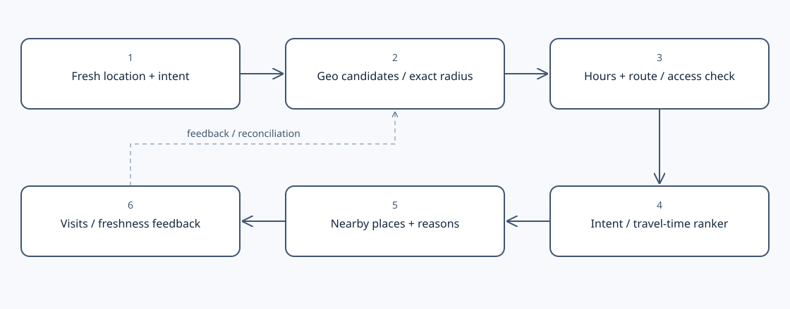

# W164. Design a Nearby-Place Recommender (Location-Aware)

**Priority group:** Second 100 — important

**Category:** Production ML and product design

**Study position:** 164 of 547

[Group list](../NEXT_100.md) · [All categories](../ALL_CATEGORIES.md) · [Chapter guide](../README.md)

## Question

Design a location-aware recommender that returns ranked nearby places (Marketplace shops, Places) given a user's location and browsing intent.

Cover spatial retrieval, the ranking stack, feature engineering, the mobile freshness constraint (location updates frequently), and evaluation metrics. Interviewers probe metric design and feature engineering more than architecture — lead there.

## Worked solution

### Start with what “nearby and useful” means

Assume the product seeks a successful visit/contact/purchase, not merely a tap. Optimize qualified place interactions or verified visits where consent and attribution permit; guard wasted trips, closed-place rate, distance burden, safety and latency. Measure precision/NDCG@10 on intent-specific relevance, distance/travel-time regret and open/accessible-place accuracy offline; A/B-test successful visits or contacts per active user, with dismissals and privacy opt-outs as guardrails. Click labels alone favor attractive photos and centrally located popular places.

Build features at the moment of recommendation: user intent/query, preferred categories and price, recent browsing, consented location plus accuracy radius and timestamp; place category, price, hours, rating count/reliability, inventory and amenities; user-place distance, route travel time, previous visits and category affinity; context weather/time/day and travel mode if available. Opening hours must be interpreted in the place's timezone. A location accuracy radius of 200 m makes a 50 m boundary ambiguous; avoid false precision and request fresher location only when useful.

### Retrieval and ranking

`POST /nearby` takes location, timestamp, accuracy, intent, filters and cursor, returning place IDs, reasons and data timestamps. A geospatial index retrieves candidates from intersecting cells or an R-tree within an expanding radius. Neighboring cells must be included: a place across a cell border may be closest. Apply exact radius/delivery/accessibility rules, open status and permissions, then cap candidates. Approximate straight-line distance is cheap retrieval; compute route time only for a small final set or use cached travel-time estimates keyed by origin cell and travel mode.

Start with a rules/linear relevance-distance score, then train a GBDT ranker on logged impressions with features above and conversion/qualified engagement labels. Compare to a content-embedding retrieval branch for sparse queries. Re-rank for diversity and near-duplicate businesses. The diagram should be read as location-aware retrieval → eligibility/travel features → rank → list; freshness is a cross-cutting requirement, not another model.

### Freshness, cold start and reliability

A mobile location update invalidates spatial candidates when movement exceeds an agreed threshold, not on every noisy GPS tick. Debounce updates, tag requests with increasing client sequence and discard stale responses. Cache by coarse origin cell, intent and filters for candidate retrieval, but recompute exact distance with the fresh location. Cache keys include place/index versions; stream closures and hours corrections and recheck the final shortlist. New users use intent and location, while new places use content/metadata with bounded exploration rather than zero scores.

Scale is missing; assume 5,000 requests/s and 200 rank candidates: one million pair scores/s. Parallel feature reads and a bounded route-time fanout keep an illustrative 100–150 ms budget viable; slow routing falls back to clearly marked approximate travel estimates. Store place metadata durably, changes through an outbox, and idempotently index increasing versions so stale updates cannot reopen a closed place. Validate cell-border cases, inaccurate/stale GPS, timezone changes, two overlapping requests and index lag. Monitor failed searches, empty-result rates by geography, freshness, route errors and subgroup performance; forward-time/geographic holdouts reveal failures hidden by random splits.

<!-- architecture:W164:start -->

Read the numbered path as Fresh location + intent → Geo candidates / exact radius → Hours + route / access check → Intent / travel-time ranker → Nearby places + reasons → Visits / freshness feedback. The dashed return is the feedback or reconciliation path described in the solution; durable state and authorization remain authoritative when work is retried.
<!-- architecture:W164:end -->

### Runnable checks

[Batch behavior checks](../test_review_151_200.py) also validate this page's Python syntax and referenced diagrams. The architecture, capacity and metric reasoning is reviewed as a design; no production load, availability or model-quality result is claimed.

### Further study

- [F082: Design a recommendation system from candidate generation to ranking.](../09_ml_system_design.md#f082)
- [F063: Choose metrics for ranking and recommendation.](../07_evaluation_and_data.md#f063)
