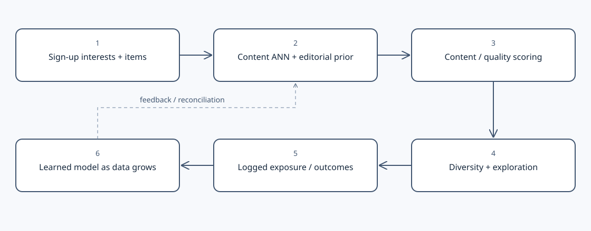

# W165. Design a Recommendation System for a New Product (the Cold-Start Problem)

**Priority group:** Second 100 — important

**Category:** Production ML and product design

**Study position:** 165 of 547

[Group list](../NEXT_100.md) · [All categories](../ALL_CATEGORIES.md) · [Chapter guide](../README.md)

## Question

Design a recommendation system for a brand-new product that launches with little to no interaction data — the cold-start problem — for both new users and new items.

In your design, address:

the multi-stage recommender funnel — cheap candidate retrieval (millions of items → hundreds) then an expensive ranker,
feature and representation design (content / metadata embeddings) when there is no collaborative signal,
bootstrapping at launch: popularity priors, content-based matching, and deliberate exploration to gather data,
the data flywheel — transitioning from cold-start heuristics to learned collaborative models as interactions accumulate,
handling new users vs new items, and online vs offline evaluation,
failure modes (feedback loops, popularity bias) and the key trade-offs.

The crux to nail: at launch there is no interaction data, so collaborative filtering can't work — lean on content features, popularity, and exploration, then design the bootstrap-to-steady-state path as the data flywheel spins up.

## Worked solution

### Make day one explicit

Assume a content marketplace and optimize qualified engagement followed by seven-day return, with safety, catalog coverage and latency guardrails. At launch, no user-item interaction matrix exists, so collaborative filtering cannot be trained from product history. External popularity is usable only if licensed, relevant and actually available. Otherwise “popular” initially means editorial/cohort priors or uniform quality-filtered sampling, explicitly labeled as priors rather than observed success.

Build item representations from title, category, tags, text/image embeddings and quality/safety metadata. Ask new users for a small set of interests or goals, form an interest embedding and retain context such as language/device. A user who skips onboarding gets a diverse regional/editorial slate and exploration. A new item uses content similarity immediately and receives a limited randomized exposure budget; absence of clicks before exposure is not a negative label.

### A staged launch-to-learning plan

`GET /recommendations` obtains candidate IDs through metadata filters and an ANN content index, then a cheap rules or linear scorer combines interest match, freshness and editorial quality. Re-rank hundreds to the requested list with category/creator diversity and constraints. This avoids expensive scoring over millions of items. For illustration, five million 256-dimensional fp16 vectors require 2.56 GB raw embeddings before index overhead and replication; the ANN index and sharding still require measured sizing.

Reserve a chosen 5% of eligible slots for bounded exploration, logging exact selection propensities, request/position/model versions and every exposure. Record clicks, meaningful use, conversion, hides and delayed outcomes through idempotent event IDs. A durable item database and outbox feed versioned content indexes; changing embeddings requires an index/model version pair. The diagram's retrieval and ranking stages initially operate on content and rules; they become learned components only when reliable interaction labels arrive.

First fit a regularized click/qualified-use model on matured impressions, using content and context plus smoothed item aggregates. Time-aware validation determines whether it beats the launch policy. As user histories grow, train a two-tower collaborative retrieval model with exposure-aware negatives, blend its candidates with content and exploration, and later introduce a richer ranker. Gate each transition on cohort sample size, calibrated offline gains and an online experiment rather than a calendar date. Preserve content fallbacks for users/items with sparse evidence.

### Evidence, failure modes and serving

At launch offline evaluation can measure taxonomy coverage, embedding relevance using human judgments, constraint violations and latency; it cannot honestly measure personalized click uplift with nonexistent logs. Later use forward-time splits, new-user/item holdouts, retrieval recall, NDCG and calibration, while recognizing exposure bias. Randomize users persistently in A/B tests, keep an untouched exploration bucket and monitor longer-term retention and creator concentration.

For a demonstration request, a new user choosing “camping” retrieves tents, hiking guides and outdoor gear by content; the slate includes several categories and one explored item. A tent with no history remains eligible. If a few early clicks make every slate tents, cap concentration and uncertainty-weight aggregates so the feedback loop does not erase discovery. Cache candidate pools by interest cohort, not private user data in a global key; refresh item indexes incrementally and retry outbox updates idempotently. During ranker failure use the launch policy. Alert on missing exposure logs, stale embeddings, position/popularity bias, train/serve feature skew and fallback usage. The trade-off is exploration's short-term relevance cost in exchange for evidence and a healthier future model.

<!-- architecture:W165:start -->

Read the numbered path as Sign-up interests + items → Content ANN + editorial prior → Content / quality scoring → Diversity + exploration → Logged exposure / outcomes → Learned model as data grows. The dashed return is the feedback or reconciliation path described in the solution; durable state and authorization remain authoritative when work is retried.
<!-- architecture:W165:end -->

### Runnable checks

[Batch behavior checks](../test_review_151_200.py) also validate this page's Python syntax and referenced diagrams. The architecture, capacity and metric reasoning is reviewed as a design; no production load, availability or model-quality result is claimed.

### Further study

- [F082: Design a recommendation system from candidate generation to ranking.](../09_ml_system_design.md#f082)
- [F063: Choose metrics for ranking and recommendation.](../07_evaluation_and_data.md#f063)
