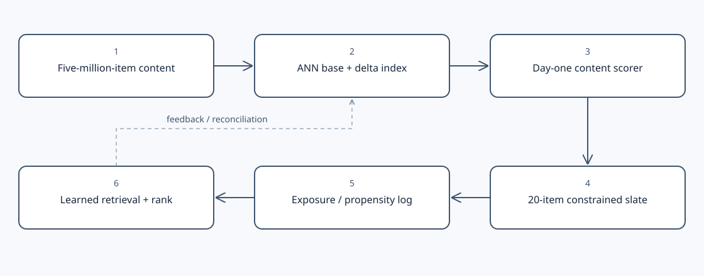

# W166. Design a Recommendation System for a New Product (the Cold-Start Problem)

**Priority group:** Second 100 — important

**Category:** Production ML and product design

**Study position:** 166 of 547

[Group list](../NEXT_100.md) · [All categories](../ALL_CATEGORIES.md) · [Chapter guide](../README.md)

## Question

Design the recommendation system for a newly launched content marketplace, where the first release has to work on day one with no interaction history.

Context
The catalog has about 5 million items, with roughly 50,000 new items added per day.
The product expects 20 million monthly active users and about 5,000 recommendation requests per second at peak.
On launch day there are no clicks, purchases or other interaction logs; only item content (text, category, tags, creator) and what users tell you at sign-up are available.
Each request must return a ranked list of 20 items within a p99 latency of 150 ms.

### Requirements

1. State the business goal and the metrics you optimise (online and offline), including guardrails.
2. Describe the multi-stage architecture (candidate retrieval, ranking, re-ranking) and why it is staged given the catalog size and latency budget.
3. Explain exactly how the system behaves on day one with no interaction data: which signals it uses, and how it gathers the data it lacks.
4. Describe the features, the models and the labels, and how you move from the cold-start approach to learned collaborative models as interactions accumulate.
5. Describe training, offline evaluation and online experimentation, including what you cannot evaluate offline at launch.
6. Describe serving and scaling: indexes, feature store, caching and refresh cadence.
7. Name the main failure modes (feedback loops, popularity and position bias, train/serve skew) and how you monitor and mitigate them.

## Worked solution

### Day-one policy and measurable objective

Return 20 eligible content items, optimizing qualified consumption/conversion and repeat use; guard safety, dismissals, diversity, creator concentration and p99≤150 ms. There are five million items, 50,000 additions/day and 5,000 peak requests/s, but no initial interaction history. Use declared sign-up interests, item text/category/tags/creator and language. Editorial quality or imported popularity may be priors only if genuinely provided; there are no observed in-product popular items on day one.

Encode items offline with a fixed content encoder. A 256-dimensional fp16 embedding is an illustrative choice: five million vectors occupy 2.56 GB raw before ANN overhead and replicas. Fifty thousand new items/day averages 0.58/s, but provision for ingest bursts, not just that average. Make new items searchable through a delta index, then merge into immutable snapshots. User vectors average declared-interest embeddings; users with no interests receive a safe, diverse editorial slate with exploration.

### Request and data paths

`GET /recommendations` carries authenticated user/context/cursor; return item IDs, exposure_id and optional reasons. The diagram's retrieval stage searches ANN plus category/fresh/editorial pools for roughly 1,000 candidates, a cheap content scorer reduces to 200, a ranker scores those, then diversity/access/safety rules return 20. Initially that “ranker” is a documented weighted content/quality/freshness rule; do not claim trained CTR without data. Reserve an assumed 5% exploration exposure with known propensities. Stable per-session tie-breaking avoids chaotic refreshes.

A proposed 150 ms tail budget is 10 ms gateway, 20 ms parallel feature reads, 30 ms retrieval, 15 ms filtering/pre-rank, 40 ms scoring/re-rank and 35 ms headroom. At 200 candidates/request, peak scoring is one million pairs/s, so item embeddings/features are precomputed and retrieved in batches. Shard indexes by language/region if eligibility supports it, replicate hot shards, cache cohort candidate pools briefly and keep recent user actions in an online feature store. Index/model versions travel together; private permissions and fresh exclusions are checked after cached retrieval.

### The learning loop

Log impressions, position, policy/version, selection probability, clicks, qualified use, purchase and dismissals. Deduplicate events by event_id and join delayed labels only after a chosen maturity window. Use event-time feature snapshots with the same transforms as serving. Begin with a regularized content/context classifier trained on observed exposures; fit a calibrated probability on held-out data. With enough repeat behavior, blend learned two-tower retrieval and user embeddings into the existing content pools, then train a richer multi-task ranker. New items continue using content; new users use onboarding, context and quickly updated session features.

At launch, human relevance sets and coverage/latency tests are possible; historical personalized NDCG or conversion uplift is not. Later evaluate forward-time holdouts, cold-start cohorts, recall@1000, NDCG@20, calibration and slice coverage. User-randomized online tests measure qualified outcomes and retention with prespecified guardrails and stopping rules. Exposure/position bias requires randomized exploration and logged propensities; inverse propensity estimates need support and clipping, not magical recovery of unseen outcomes.

### State, outages and checks

Durable Item(version,content,eligibility), UserPreferences, Exposure and model/index manifests feed an outbox and idempotent index updates. Reject an index update older than the stored item version; deletion tombstones prevent resurrecting removed content. On feature failure use onboarding content vectors; on ranker failure use the launch scorer; on index failure serve a cached safe cohort slate with fresh eligibility checks. Monitor p99 stage latency, index lag, exposure completeness, feature skew, new-item reach and concentration. For example, an item arriving between base-index rebuilds is found through the delta index; duplicate ingest must create one searchable version. Test this, permission invalidation, missing sign-up preferences, and a 5,000-QPS load with the proposed candidate counts before claiming the latency target.

<!-- architecture:W166:start -->

Read the numbered path as Five-million-item content → ANN base + delta index → Day-one content scorer → 20-item constrained slate → Exposure / propensity log → Learned retrieval + rank. The dashed return is the feedback or reconciliation path described in the solution; durable state and authorization remain authoritative when work is retried.
<!-- architecture:W166:end -->

### Runnable checks

[Batch behavior checks](../test_review_151_200.py) also validate this page's Python syntax and referenced diagrams. The architecture, capacity and metric reasoning is reviewed as a design; no production load, availability or model-quality result is claimed.

### Further study

- [F082: Design a recommendation system from candidate generation to ranking.](../09_ml_system_design.md#f082)
- [F063: Choose metrics for ranking and recommendation.](../07_evaluation_and_data.md#f063)
