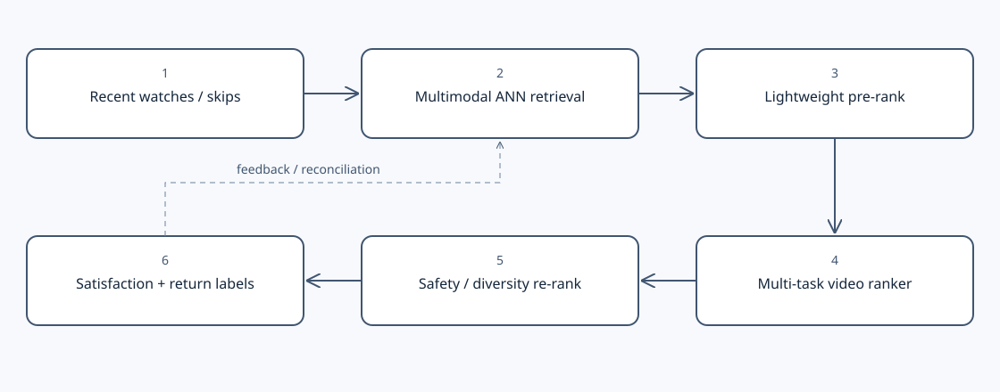

# W167. Design a Reels Short-Video Recommender

**Priority group:** Second 100 — important

**Category:** Production ML and product design

**Study position:** 167 of 547

[Group list](../NEXT_100.md) · [All categories](../ALL_CATEGORIES.md) · [Chapter guide](../README.md)

## Question

Design the Reels short-video recommendation system. Serve a personalized feed of short videos to each user, optimizing for engagement (watch-time, completion, share).

The four-stage retrieval → pre-rank → rank → re-rank scaffold is table stakes — the differentiation is in features, metrics, and A/B-test design. Interviewers now lead on metric design and evaluation over novel architecture.

## Worked solution

### Metrics determine the design

Optimize satisfied engagement and longer-term return, using capped watch time, duration-adjusted completion and shares as immediate signals. Watch time alone can promote compulsive or misleading content; raw completion favors short clips. Guard hides, reports, negative surveys, unsafe exposure, creator concentration and latency. A 5-second and 60-second clip with equal completion do not represent equal utility, so model watch duration and completion conditional on duration separately.

Log every impression with user/video, start time, position, autoplay state, candidate source and model version. Labels include watch seconds, completion, rewatch, like/share/follow, rapid skip, hide and delayed return. Define exposure from actual rendered/visible playback rather than a prefetched item. Join mature labels; a user who has not yet returned is censored before the return window closes.

### Features and four stages

Offline video features are frame/audio/text embeddings, speech/OCR, topic, language, creator, duration and safety quality. Online user features include a short session sequence of watches, skips and hides, longer-term topic affinity, recent creator exposure and context/device/network. Keep session features fresh in a stream-backed online store and reconstruct the same event-time features for training. Content embeddings allow new clips without captions to enter retrieval.

Retrieve thousands from two-tower ANN, co-watch, followed creators, trending/fresh and exploration pools; pre-rank to hundreds, run a multi-task ranker, then re-rank a short feed for topic/creator diversity and exclusions. The diagram's candidate and rank boxes correspond to these separate compute budgets. The ranker predicts watch-time distribution plus engagement/negative-event probabilities; use masked task losses for missing/delayed labels. Utility combines calibrated outputs under explicit business weights and constraints, rather than adding raw logits. New users receive declared-interest/safe diverse feeds, and new clips receive limited exploration from content-matched users.

### Evaluation and experiments

Forward-time evaluation measures retrieval recall on qualified watches, NDCG on satisfaction-weighted labels, watch-time error, calibration and cold-start slices. Use random exploration or position interventions to estimate exposure bias; unexposed videos are not known disliked examples. Deduplicate near-identical content across splits to avoid inflated multimodal performance. Keep a fixed human/survey set for quality that clicks do not capture.

Randomize persistently by user, stratify by activity/region and run long enough to observe repeat usage beyond novelty. Predeclare the primary metric, minimum detectable effect, guardrails and stopping rule; check sample-ratio mismatch and instrumentation parity. Creator supply and social sharing create interference, so measure creator-level effects and consider geographic/cluster tests for large marketplace changes. Watch for a positive watch-time result accompanied by worse hides, retention or content diversity; that is not an unqualified win.

Assume a 120 ms feed decision budget: 20 ms features, 25 ms parallel retrieval, 15 ms pre-rank, 35 ms final rank and 25 ms re-rank/network headroom. No exact QPS is supplied; at a chosen 10,000 QPS and 200 final candidates, provision two million pair scores/s plus headroom. Cache only a short continuation and invalidate removed content. Version the model/index, canary rollouts, and fall back to safe fresh/trending pools on feature/ranker outage. Monitor stage p99, feature age, skip/holdout trends, mature-label quality and exploration coverage.

<!-- architecture:W167:start -->

Read the numbered path as Recent watches / skips → Multimodal ANN retrieval → Lightweight pre-rank → Multi-task video ranker → Safety / diversity re-rank → Satisfaction + return labels. The dashed return is the feedback or reconciliation path described in the solution; durable state and authorization remain authoritative when work is retried.
<!-- architecture:W167:end -->

### Runnable checks

[Batch behavior checks](../test_review_151_200.py) also validate this page's Python syntax and referenced diagrams. The architecture, capacity and metric reasoning is reviewed as a design; no production load, availability or model-quality result is claimed.

### Further study

- [F184: Design personalized short-video ranking.](../19_product_ml_case_studies.md#f184)
- [F082: Design a recommendation system from candidate generation to ranking.](../09_ml_system_design.md#f082)
