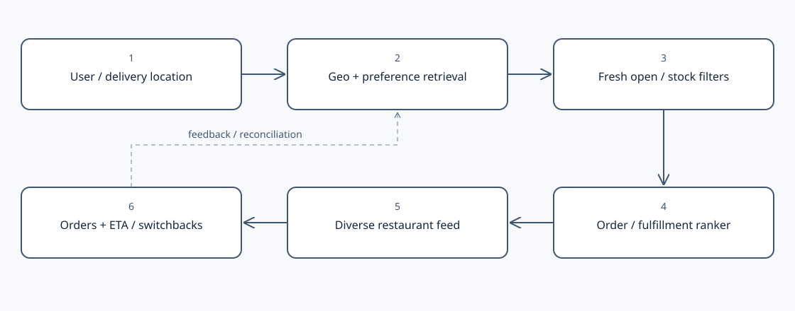

# W168. Design a Restaurant Recommendation and Ranking System for a Food Delivery App

**Priority group:** Second 100 — important

**Category:** Production ML and product design

**Study position:** 168 of 547

[Group list](../NEXT_100.md) · [All categories](../ALL_CATEGORIES.md) · [Chapter guide](../README.md)

## Question

Design an end-to-end machine learning system that recommends and ranks restaurants for each user in a food-delivery app. Cover the feature pipeline, model training, online serving, evaluation and the experimentation framework, and say how the same design carries over to related marketplace prediction problems such as feed ranking and delivery-time (ETA) prediction.

### Requirements

1. Prediction target: define what the model predicts and why (click-through rate, order conversion, ETA error, matching success) and which business metric it serves.
2. Feature pipeline: design the offline batch features, the online real-time features and the entity joins (user, restaurant, location, time), including how training features match serving features.
3. Model family: choose and justify one (gradient-boosted trees, wide-and-deep, two-tower retrieval, Transformer ranker), and describe the candidate-generation and ranking stages.
4. Online serving: meet a p99 latency budget of under 100 ms for feed ranking (under 500 ms for ETA), including the feature lookup path.
5. Evaluation: offline metrics (such as NDCG for ranking, MAPE for ETA) and online evaluation by A/B test, or by switchback tests when marketplace effects make user-level randomisation invalid.
6. Operations: logging, label delay, cold start, feature freshness, drift monitoring and retraining cadence.
Scale
100M+ users, 1M+ candidate items, 100K+ queries per second.
Follow-ups
Follow-up 1: ETA prediction. How do the target, features, loss and evaluation change when the model predicts delivery time instead of relevance?
Follow-up 2: feedback loops. How does training on logged recommendations bias the model, and how do you correct it?

## Worked solution

### Prediction and feature contract

Optimize completed satisfactory orders per feed request, with retention, cancellations, late deliveries, affordability and restaurant concentration as guardrails. Model P(order|impression,user,restaurant,context), optionally alongside click and successful fulfillment; a high CTR on an unavailable restaurant is useless. Log rendered impressions, positions, availability snapshot, model version and order/fulfillment IDs, then join labels after cancellations/fulfillment mature.

Join user cuisine/price/order history, restaurant cuisine/menu/quality/preparation distributions, and context location/time/weather. Batch jobs compute longer-term affinities and embeddings; streams update restaurant open status, courier supply, current kitchen load, inventory and user session actions. Use point-in-time entity joins keyed by user_id, restaurant_id, location cell and event time. Future preparation duration or final cancellation reason cannot be checkout features. Shared feature transforms and freshness checks prevent training/serving skew.

### Retrieval, ranking and capacity

Retrieve local deliverable restaurants through a geo index, content/two-tower similarity and intent/popularity pools; filter hours, delivery coverage and out-of-stock/closed stores. Score hundreds with a GBDT baseline, justified by heterogeneous tabular features and low-latency CPU inference. A wide-and-deep multi-task ranker is a later option if it improves matched-latency tests. Re-rank for relevance, cuisine/merchant diversity and operational load without violating eligibility. The diagram's retrieval/filter/rank stages must use current marketplace state; stale global candidate caches cannot decide deliverability.

At 100,000 QPS, 200 candidates/request is 20 million pair scores/s. Precompute item/user representations, batch feature reads, regionalize by delivery zone and replicate hot shards. For an illustrative p99<100 ms budget allocate 10 ms gateway/user features, 15 ms retrieval, 15 ms eligibility/item-feature lookup, 35 ms ranking and 25 ms network/re-rank/headroom. This is a budget, not a benchmark. One million item vectors at 256 fp16 dimensions require 512 MB raw, but 100 million user vectors would require 51.2 GB plus indexes/replicas and skew handling.

### Training, evaluation and marketplace experimentation

Use future time holdouts, mature order labels and geography/cold-start slices. Measure recall@candidate count, NDCG@20, log loss, calibration and operational rejection rate. Correct position/exposure bias with randomized exploration and propensities when support exists. A model trained only on previously recommended restaurants can amplify popular merchants; preserve exploration and inspect coverage. New users use geography/context and declared preferences; new restaurants use metadata and constrained trial exposure. Retrain daily initially, update fast operational features in seconds, and monitor missingness/freshness, drift and delayed conversion performance.

User A/B tests work for small personalization changes with limited interference; courier/kitchen capacity changes affect other users, so use zone-time switchbacks with washout, balanced demand periods and clustered uncertainty. Measure completed orders, cancellation/late rate, courier utilization and merchant distribution, not CTR alone.

For ETA, define delivery_timestamp minus prediction_timestamp, distinguish checkout from post-dispatch models, and predict quantiles using pinball loss or a duration distribution. Features add preparation, route, traffic and courier assignment state available at that instant. Under 500 ms permits a bounded routing lookup, with fallback to regional travel-time estimates. Evaluate MAE, p90 lateness, interval coverage and pinball loss; MAPE is unstable for tiny durations and should not stand alone. Feed ranking can consume ETA quantiles, but serving must keep its stricter 100 ms budget through cached estimates. Fallback ranking uses safe local popular choices and fresh eligibility; deployment uses versioned features/models, canaries and rollback. Test stale hours, delayed labels, simultaneous stock changes and zone outages.

<!-- architecture:W168:start -->

Read the numbered path as User / delivery location → Geo + preference retrieval → Fresh open / stock filters → Order / fulfillment ranker → Diverse restaurant feed → Orders + ETA / switchbacks. The dashed return is the feedback or reconciliation path described in the solution; durable state and authorization remain authoritative when work is retried.
<!-- architecture:W168:end -->

### Runnable checks

[Batch behavior checks](../test_review_151_200.py) also validate this page's Python syntax and referenced diagrams. The architecture, capacity and metric reasoning is reviewed as a design; no production load, availability or model-quality result is claimed.

### Further study

- [F082: Design a recommendation system from candidate generation to ranking.](../09_ml_system_design.md#f082)
- [F063: Choose metrics for ranking and recommendation.](../07_evaluation_and_data.md#f063)
