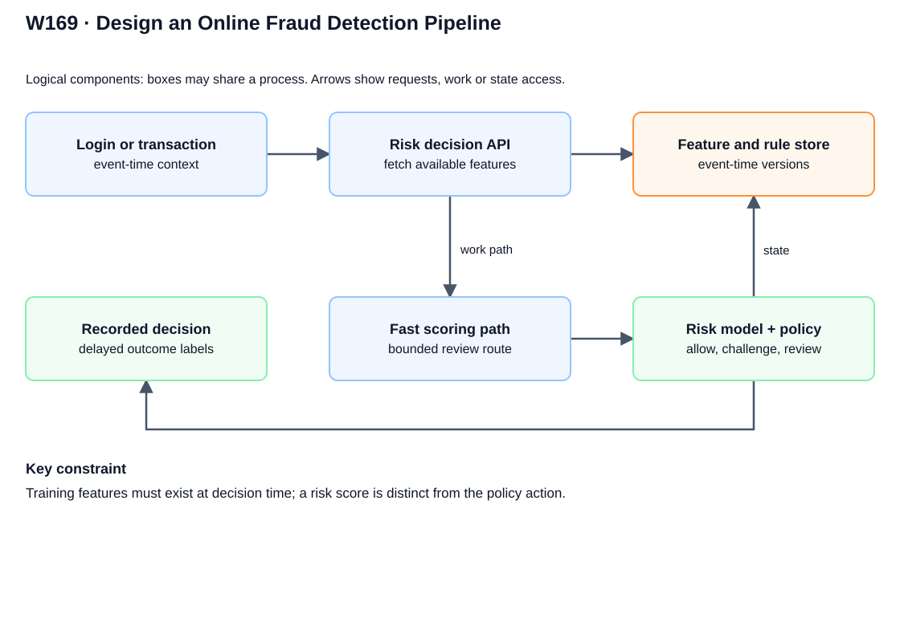

# W169. Design an Online Fraud Detection Pipeline

**Priority group:** Second 100 — important

**Category:** Production ML and product design

**Study position:** 169 of 547

[Group list](../NEXT_100.md) · [All categories](../ALL_CATEGORIES.md) · [Chapter guide](../README.md)

## Question

Design an online fraud detection pipeline that scores user actions in near real time and escalates suspicious activity.

## Worked solution

<!-- architecture:W169:start -->
### Architecture and request flow

[Open the diagram at full size](../diagrams/W169_architecture.svg). This is a baseline component diagram for this question. The boxes describe responsibilities; they do not require a separate microservice for every box.

- **Request and state:** Login or transaction — event-time context → Risk decision API — fetch available features. That component consults or updates **Feature and rule store — event-time versions** under the required access and consistency rules.
- **Work and result:** the work path passes through **Fast scoring path — bounded review route** and **Risk model + policy — allow, challenge, review**, producing **Recorded decision — delayed outcome labels**. Bound waiting and retries where a slow dependency can stall this path.
- **Correctness point:** Training features must exist at decision time; a risk score is distinct from the policy action.

When explaining the drawing, trace one normal request first, then a duplicate request, an unavailable dependency and recovery from saved state. If the question requires stricter guarantees or a different scope, state the change explicitly rather than treating this baseline as the only possible design.
<!-- architecture:W169:end -->

### Solution outline

Predict risk at a concrete event and route it to an action whose cost is explicitly understood.

1. Collect time-valid device, account and behavior features with privacy and access controls.
2. Use a fast risk model and a policy layer for allow, challenge, review or block; tune thresholds to error costs and review capacity.
3. Evaluate on time-based splits with mature labels, account for adversarial adaptation and monitor false positives by user segment.

### Understand why the approach works

#### Design the decision, not only the predictor

State which user action follows the model output, when the prediction occurs and which errors are costly. Then define labels and features using information available at that time. A feature recorded after the outcome is not made legitimate by being stored in the same table.

For a retrieval/ranking product, use a cascade: generate a broad eligible set, score a bounded candidate set, then apply policy and presentation rules. Evaluate retrieval recall separately because a ranker cannot rescue an item excluded upstream. Availability, permissions and budgets are hard constraints, not merely features a model may learn to respect.

Expected action utility can be written as

$$
a^*(x)=\arg\max_a\sum_y P(y\mid x)\,U(a,y).
$$

This makes clear why a probability metric and a product objective are different. The same calibrated probability may produce different actions when error costs change.

Describe a baseline, time/entity-aware validation, exposure logging and one controlled rollout. For a recommender, unexposed items are not automatically observed negatives. For moderation or fraud, mature labels and human-review capacity matter. Finish with a failure walkthrough: what happens when features are stale, the model is unavailable or the distribution changes? A simpler fallback with explicit monitoring is often more defensible than an elaborate system without an operational plan.

### Work a small example

A suspicious login can trigger a step-up challenge rather than an irreversible account block, reducing the cost of uncertain predictions.

### Edge cases and common mistakes

Leaking post-investigation labels or future account events into training-time features.

### Further study

- [F084: Design fraud or account-takeover detection.](../09_ml_system_design.md#f084)

### Explain it back

Close the answer. State the main invariant or equation, work the example with changed inputs, and explain which assumption would make your solution fail. For a design, walk through a retry or partial failure; for a derivative, check a shape and a finite-difference case.
