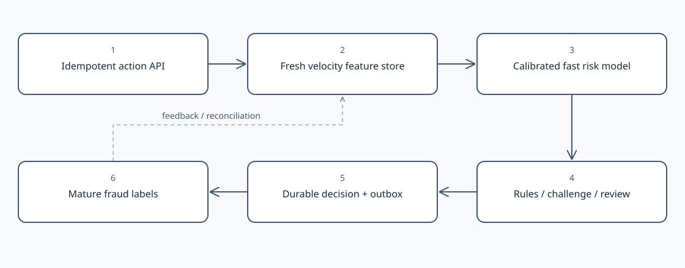

# W169. Design an Online Fraud Detection Pipeline

**Priority group:** Second 100 — important

**Category:** Production ML and product design

**Study position:** 169 of 547

[Group list](../NEXT_100.md) · [All categories](../ALL_CATEGORIES.md) · [Chapter guide](../README.md)

## Question

Design an online fraud detection pipeline that scores user actions in near real time and escalates suspicious activity.

## Worked solution

### Specify the action and label

The prompt leaves action type, throughput and latency open. Assume account/payment actions, a 100 ms p99 synchronous decision target and an asynchronous investigator queue. Return ALLOW, STEP_UP, REVIEW or BLOCK with decision_id, reason codes and policy/model versions. Clarify fraud-loss versus false-positive cost and review capacity before setting thresholds. A login challenge has a different customer cost from declining a payment; keep action-specific thresholds.

`POST /risk/evaluate` takes an authenticated event_id, account/device context, action type, amount if relevant and event time. Deduplicate by event_id plus request hash and persist the decision so a client retry receives the same result. Store immutable Event, Decision, Investigation and Label records with model/feature versions. Chargebacks, confirmed account takeover and verified reviews are delayed labels; absence of a label immediately after an action is not verified legitimate behavior.

### Features and decision path

Stream events through deduplicating keyed processors to compute account/device/IP velocity, amount deviation, failed-login counts, account age and cross-account link signals. Put recent features in a low-latency store and historical aggregates offline. Use event-time windows and watermarks; retain feature timestamps and missingness. Never join future investigation notes, later refunds or a fraud label into prospective training features.

The diagram is gateway → feature lookup → fast scorer → rules/actions, with an async audit and review branch. Train a GBDT baseline on time-split, mature outcomes with class weighting if useful; calibrate on a separate held-out period at natural prevalence. Apply hard security rules separately and route intermediate risk to step-up/review. Select thresholds using expected fraud loss, customer friction and the number of reviews staff can handle. A calibrated 1% risk can still justify action for a huge loss exposure; score alone does not determine policy.

### Reliability, learning and a concrete estimate

Assume peak 5,000 evaluations/s, one 2 KB decision event each: 10 MB/s audit ingress before replication. With an average 20 ms scoring time, Little's law gives about 100 simultaneous in-flight scoring requests, before headroom and feature latency. A possible 100 ms budget is 10 ms ingress, 20 ms feature lookup, 20 ms inference, 10 ms rules/persistence and 40 ms network/headroom. Parallel bounded lookups and precomputation matter more than online joins over full history.

On feature timeout use last-known features with explicit age/missing flags and a validated fallback model. Choose fail-review, challenge or allow for low-risk actions according to a written policy; never universally fail-open. Durable outbox publishes decisions to audit/review even after an API crash. Workers claim review tasks atomically, retry notifications idempotently and retain investigator overrides as versioned labels. For example, a burst of failed logins on an old trusted device may trigger step-up instead of permanent blocking; a retry of that event must not issue another independent challenge.

Evaluate PR-AUC, recall at fixed false-positive/review rate, expected money lost and calibration, segmented by geography/device/new accounts. Shadow then canary the model and keep a rollback version. Monitor decision p99, feature freshness, approval/challenge rates, fraud loss after maturity, investigation backlog and adversarial distribution change. Auditing randomized low-risk samples helps reveal selective-label bias from only investigating flagged events. Validate duplicate events, late event windows, store outage, lost response after decision commit and old-model rollback.

<!-- architecture:W169:start -->

Read the numbered path as Idempotent action API → Fresh velocity feature store → Calibrated fast risk model → Rules / challenge / review → Durable decision + outbox → Mature fraud labels. The dashed return is the feedback or reconciliation path described in the solution; durable state and authorization remain authoritative when work is retried.
<!-- architecture:W169:end -->

### Runnable checks

[Batch behavior checks](../test_review_151_200.py) also validate this page's Python syntax and referenced diagrams. The architecture, capacity and metric reasoning is reviewed as a design; no production load, availability or model-quality result is claimed.

### Further study

- [F084: Design fraud or account-takeover detection.](../09_ml_system_design.md#f084)
