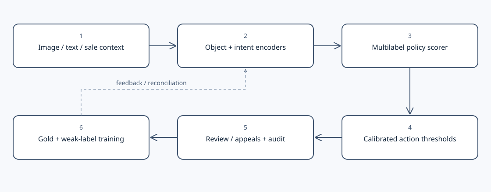

# W170. Design Harmful-Content Detection (Weapon Sales) at Scale

**Priority group:** Second 100 — important

**Category:** Production ML and product design

**Study position:** 170 of 547

[Group list](../NEXT_100.md) · [All categories](../ALL_CATEGORIES.md) · [Chapter guide](../README.md)

## Question

Design an integrity ML system that detects harmful content (e.g., weapon sales, harmful ads) at scale with precision high enough to take action while minimizing false positives against legitimate creators.

Discuss the classification pipeline, how you get labels (weak/active learning), the metrics, and operations (human-review routing, feedback ingestion, policy nuance, reviewer disagreement).

## Worked solution

### Policy-aware classification and actions

Detect prohibited commerce intent, not simply the presence of a weapon. Legitimate news, history, sports and policy-permitted items need different treatment from an offer to sell a prohibited item. Define a versioned taxonomy with content type, jurisdiction, intent and severity; obtain policy/legal decisions from the organization rather than inventing universal rules. Return calibrated per-policy scores and ALLOW/REVIEW/REMOVE actions with reason codes. Severe automatic removal requires very high action precision, while uncertain cases go to review.

Represent text, OCR, speech, sampled images/video, links and seller/context metadata. A dual encoder extracts visual/text embeddings; concatenate them with structured features and modality-presence masks, then train a fusion network with multi-label heads for object, sales intent and policy violation. This lets “museum display” and “contact for purchase” differ even when images resemble one another. Use a cheap rule/hash layer, medium multimodal classifier and expensive ambiguous-case model rather than sending every upload to the heaviest model. The diagram's decision and human-review planes form a loop, not two independent authorities.

### Labels and evaluation

Start with expert-adjudicated examples spanning permitted and prohibited context. Weak labels from reports, keyword rules and known enforcement are noisy features for training-label generation, not ground truth. Estimate their precision on a random audited sample and retain provenance. Active learning samples uncertain, model-disagreement and novel high-reach items, but also sample random content to estimate prevalence and blind spots. Reviewer instructions include jurisdiction/context and permit “uncertain”; use double review/adjudication, agreement statistics and policy-version tags. A reviewer majority cannot resolve an undefined policy.

Split forward in time, group near-duplicates/campaigns, and hold out new sellers and language slices. Measure per-policy PR curves, removal precision, severe-violation recall, false removals per million legitimate items, appeal reversal and exposure before takedown. Calibrate per-policy probabilities on held-out gold data; choose thresholds from harm costs and review capacity. For illustration, at one million items/day, 0.2% routed to review means 2,000 items/day; 45 seconds each means 25 reviewer-hours/day. This staffing assumption constrains the review operating point.

### Operations and edge cases

Store Content/version, Decision(content_version,policy_version,model_version), ReviewTask and append-only Appeal/Action history. Idempotent queue processing includes these versions; conditional writes prevent an old model's allow from reversing a newer human removal. Reviewers claim tasks transactionally; appeals can supersede model actions with audit provenance. Retry transient feature/model failures with backoff; corrupt media goes to a distinct technical-failure path instead of an unsupported safe verdict. New policy versions trigger targeted rescoring through a separately limited replay queue.

Scale is not specified. Assuming 10 million items/day with a 5× peak yields about 579 items/s; four sampled frames/item is 2,316 frame inferences/s before OCR/audio. Set live-path budgets after measuring media size and model cost. Canary updates, monitor subgroup action precision and drift, and retain policy-aware rollback. Example: an image of a historical weapon with educational context should not be blocked merely by the object head; a clear prohibited sale can cross the action threshold. Stress-test such context reversals, adversarial obfuscation and reviewer disagreement with a gold suite rather than aggregate accuracy alone.

<!-- architecture:W170:start -->

Read the numbered path as Image / text / sale context → Object + intent encoders → Multilabel policy scorer → Calibrated action thresholds → Review / appeals + audit → Gold + weak-label training. The dashed return is the feedback or reconciliation path described in the solution; durable state and authorization remain authoritative when work is retried.
<!-- architecture:W170:end -->

### Runnable checks

[Batch behavior checks](../test_review_151_200.py) also validate this page's Python syntax and referenced diagrams. The architecture, capacity and metric reasoning is reviewed as a design; no production load, availability or model-quality result is claimed.

### Further study

- [F083: Design multi-modal harmful-content detection.](../09_ml_system_design.md#f083)
