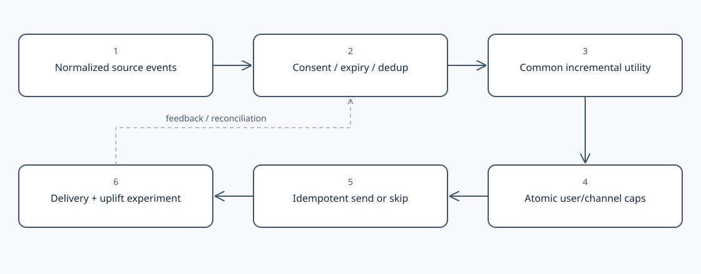

# W171. Design Multi-Source Notification Ranking

**Priority group:** Second 100 — important

**Category:** Production ML and product design

**Study position:** 171 of 547

[Group list](../NEXT_100.md) · [All categories](../ALL_CATEGORIES.md) · [Chapter guide](../README.md)

## Question

Design a system that ranks notifications from heterogeneous sources (friend activity, ads, product, system) under a unified objective, deciding both order and send/skip.

Discuss the pipeline, cross-source value normalization (how to compare an ad bid in dollars to a friend-event CTR), frequency capping, cold start, and the feedback-loop/exploration problem. Metrics and calibration are key deep-dive axes.

## Worked solution

### A common decision unit

Normalize each candidate to Notification(id,user,source,event_id,expires_at,urgency,channel,content,eligibility,model_features). Deduplicate one underlying friend event emitted by several producers. Transactional/system messages with a required delivery contract use a separate protected channel; promotional sources cannot buy their way past safety or consent. Rank only eligible candidates after opt-in, quiet hours, expiry, region and policy checks.

Do not directly compare an ad's dollar bid with friend-event CTR. Estimate a shared incremental utility, for example expected seven-day retained-use value plus allowed revenue weight minus interruption/opt-out cost. A calibrated per-source p(open) is useful but does not measure incremental benefit: some users would visit anyway. Learn uplift through randomized send-versus-holdout experiments by source/segment. Explicitly choose the dollar-to-user-value trade-off with product owners and cap commercial share; no universal conversion exists.

### Models, send/skip and atomic budgets

Generate candidates from source queues and retrieve personalized pins/events. Train a multi-task model on exposure rows with user history, source, content embedding, recency, time-of-day, previous notification load and recent app activity. Predict open, meaningful downstream action, hide/unsubscribe and longer-term return, using masked losses for delayed outcomes. Calibrate each source and inspect common probability bins; compare utilities on a held-out cross-source set. Cold-start sources/users use content/cohort priors with limited exploration and conservative send rates.

The diagram's rank stage selects a candidate, while a separate policy/budget gate chooses send or skip. Include no-send as an action with zero baseline incremental utility; send only when expected incremental gain exceeds interruption cost and uncertainty policy. An atomic budget record keyed by (user,channel,day/window) reserves capacity before delivery. For rolling caps use timestamped sends or bucket counters with boundary checks, not merely a daily reset. An outbox plus notification_id lets retried delivery remain one logical send; track provider-accepted versus delivered versus opened separately. After provider timeout the result may be uncertain, so retry with provider deduplication when supported rather than refunding the budget and duplicating sends.

### Evaluation and example

Assume a cap of three promotional pushes per rolling 24 hours. A user with two sent and one reserved cannot receive another merely because two ranker instances run concurrently. Both must conditionally reserve the same budget state; one wins. Expired reservations can be reclaimed only after delivery state is reconciled. User opt-out/version is rechecked at dispatch, since a queued notification may wait minutes.

Measure calibration/log loss, incremental meaningful sessions per thousand sends, notification fatigue, unsubscribe, complaint and long-term retention, with source/segment breakdowns. User-randomized experiments test the whole policy and retain no-send holdouts; avoid comparing delivered users with self-selected nonrecipients. Log candidate availability, chosen action, propensity, cap state and delivery failure so exploration/off-policy analysis is possible. Address position bias for in-app lists and delayed labels for downstream purchases.

Scale is missing. Assume 10 million send opportunities/hour, about 2,778/s average and a fivefold burst; shard budgets by user and bound per-user candidate heaps. Cached candidates may be stale, but budgets and consent need authoritative conditional writes. Fail budget service closed for noncritical pushes and preserve urgent contractual channels separately. Monitor send lag, duplicate delivery, cap violations, source calibration and new-source crowd-out; a higher open rate with more opt-outs is not a successful unified policy.

<!-- architecture:W171:start -->

Read the numbered path as Normalized source events → Consent / expiry / dedup → Common incremental utility → Atomic user/channel caps → Idempotent send or skip → Delivery + uplift experiment. The dashed return is the feedback or reconciliation path described in the solution; durable state and authorization remain authoritative when work is retried.
<!-- architecture:W171:end -->

### Runnable checks

[Batch behavior checks](../test_review_151_200.py) also validate this page's Python syntax and referenced diagrams. The architecture, capacity and metric reasoning is reviewed as a design; no production load, availability or model-quality result is claimed.

### Further study

- [F082: Design a recommendation system from candidate generation to ranking.](../09_ml_system_design.md#f082)
- [F063: Choose metrics for ranking and recommendation.](../07_evaluation_and_data.md#f063)
