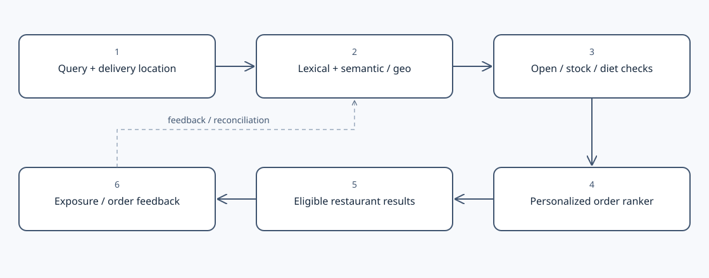

# W172. Design the Uber Eats Search System

**Priority group:** Second 100 — important

**Category:** Production ML and product design

**Study position:** 172 of 547

[Group list](../NEXT_100.md) · [All categories](../ALL_CATEGORIES.md) · [Chapter guide](../README.md)

## Question

Design the Uber Eats search system for an ML Engineer onsite: a geo-aware restaurant and menu-item search that combines query understanding, hybrid candidate retrieval, hard marketplace filtering, and personalized ranking under a tight latency budget.

The core challenge is connecting retrieval, ranking, online serving, feedback logging, and offline training into one coherent loop optimized toward completed orders. Cover query understanding, candidate generation, filtering, ranking features/model, latency, and the training/serving loop.

## Worked solution

### Completed orders define relevance

For a query such as “vegan noodles,” the target is a completed satisfactory order, with relevance, cancellations, lateness and merchant diversity as guardrails. Parse spelling, language, cuisine/dish/entities, dietary constraints and intent. Do not turn a hard dietary request into a soft affinity feature. Log normalized query, candidates/sources, displayed positions, current eligibility, clicks, carts, orders and eventual fulfillment with model/index versions.

`POST /search` takes query, delivery location, user context and filters, and returns restaurant/menu-item groups plus a stable cursor. Lexical retrieval finds exact dishes/brands while embedding retrieval handles semantic matches. A geospatial index limits to potentially deliverable restaurants. Union candidates, resolve menu-item-to-restaurant joins and deduplicate. Hard filters use open hours, actual delivery polygon, item stock, dietary certainty and merchant status; recheck the final shortlist against fresh operational state. An ANN similarity score cannot establish delivery eligibility.

### Features, model and serving

Use query-item lexical match, semantic similarity, cuisine/diet compatibility, user cuisine/price affinity, historical order preference, restaurant quality, price, delivery fee, route/ETA estimates and kitchen/courier load. Build long-term features offline, update session/stock/load in streams and store feature timestamps. A GBDT pairwise/listwise ranker is a strong low-latency baseline; a multi-task neural ranker can model click→cart→order/fulfillment if matched-budget evaluation supports it. Train on impression rows with mature order labels, position/exposure correction and hard negatives from real retrieval, not arbitrary irrelevant restaurants alone. Re-rank for relevance, merchant diversity and duplicates, with sponsored placements explicitly constrained/labeled.

The diagram's query stage feeds parallel hybrid retrieval, then fresh marketplace filtering and personalized ranking. For an assumed 100 ms p99 budget, allocate 10 ms understanding, 20 ms parallel retrieval, 15 ms feature/eligibility batch lookup, 30 ms ranking and 25 ms response/headroom. Precompute menu embeddings and typical ETA features; do not invoke a slow generative model or unbounded route API per candidate. Cache query/location candidate sets briefly, then recheck freshness and personalization. Index changes use monotonic menu versions through a transactional outbox; tombstones prevent deleted dishes returning after delayed updates.

### Evidence and operating loop

Train with forward time splits, separate new merchants/queries and geographic slices, and prevent future order/stock outcomes entering features. Measure retrieval recall on ordered items, NDCG@10, query success/no-result rate, calibration and hard-filter violations. Offline gains are limited by historical exposure; run persistent user A/B tests for small ranking changes and zone/time switchbacks if courier/merchant congestion creates meaningful interference. Primary online metric is completed orders per search, with satisfaction, cancellation, lateness and latency guardrails.

Scale is unspecified. At an illustrative 20,000 QPS and 200 ranked candidates, capacity is four million pair scores/s; regional shards and batched feature reads are necessary. Cold users rely on query/location; cold dishes use content and exploration with safety constraints. If embeddings fail, use lexical/geo retrieval; if personalization fails, use query relevance and current availability. If eligibility cannot be checked, return fewer confirmed results rather than confidently listing unavailable meals. Monitor feature/index lag, query intent slices, label delay, zero-result rates and rollout versions. Test closed restaurants during cache TTL, duplicate menu events and a query whose semantic match violates an explicit allergy/diet constraint.

<!-- architecture:W172:start -->

Read the numbered path as Query + delivery location → Lexical + semantic / geo → Open / stock / diet checks → Personalized order ranker → Eligible restaurant results → Exposure / order feedback. The dashed return is the feedback or reconciliation path described in the solution; durable state and authorization remain authoritative when work is retried.
<!-- architecture:W172:end -->

### Runnable checks

[Batch behavior checks](../test_review_151_200.py) also validate this page's Python syntax and referenced diagrams. The architecture, capacity and metric reasoning is reviewed as a design; no production load, availability or model-quality result is claimed.

### Further study

- [F082: Design a recommendation system from candidate generation to ranking.](../09_ml_system_design.md#f082)
- [F063: Choose metrics for ranking and recommendation.](../07_evaluation_and_data.md#f063)
