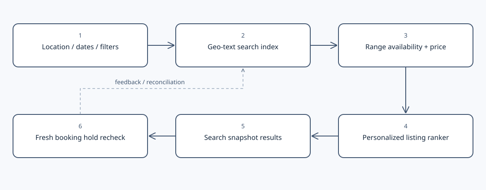

# W173. Home Page — Search + Availability + Ranking

**Priority group:** Second 100 — important

**Category:** Production ML and product design

**Study position:** 173 of 547

[Group list](../NEXT_100.md) · [All categories](../ALL_CATEGORIES.md) · [Chapter guide](../README.md)

## Question

Design the backend powering the Airbnb home page: search, availability filtering, ranking with ML integration. Senior/staff version of the booking-system prompt with heavier emphasis on the recommendation layer.

### Requirements

Functional
Free-text + filter search (location, dates, guests, price band, amenities).
Personalized ranking using user features + listing features.
Availability filter must respect the requested date range.
Latency target: sub-second p95.
Non-functional
Tens of millions of listings; hundreds of millions of users.
Read-heavy; thousands of QPS at peak.
Tolerate seconds-of-staleness on listing edits; minutes-of-staleness on ranking signals.

## Worked solution

### Search and availability have different freshness contracts

Support location/free-text, check-in/check-out, guest count, price and amenity filters through `POST /search`; return listing IDs, price summary, feature timestamps and a query snapshot cursor. Interpret dates as property-local calendar dates with half-open stays [check-in,check-out). A three-night stay requires all three nights free; checking only the arrival night is incorrect. Listing edits may lag seconds and rank features minutes, but booking must recheck authoritative inventory.

Store Listing(id,owner,location,capacity,amenities,version), NightInventory(listing,date,state,version), Price(listing,date,amount,currency), UserFeatures and immutable model/index manifests. A search index has text/geospatial/filter fields plus coarse availability bitmaps; durable inventory is separately authoritative. Owner updates commit with an outbox and monotonic versions; stale events cannot overwrite a newer price or reopen blocked nights.

### Read path and ranking

The diagram's search stage retrieves matching geographic/text candidates across tens of millions of listings. Use coarse date bitmaps to reject obvious conflicts, then bulk-check exact requested date ranges on the bounded shortlist, aggregate full-stay price and apply capacity/amenity constraints. Cache popular query/cell/date candidate IDs briefly, not a universal claim of availability. Personalized ranking uses query intent, user preferences/history, listing quality/reviews, total cost, location fit, host reliability and cancellation risk; a GBDT or multi-task ranker predicts booking and satisfactory stay from exposure logs. Re-rank for diversity and new-listing exposure after hard eligibility.

For sub-second p95, allocate an illustrative 100 ms query/retrieval, 150 ms bulk availability/price, 100 ms feature lookup/ranking, 50 ms re-rank and 300 ms network/headroom. Avoid per-night per-listing network calls by partitioned range reads and batched inventory bit operations. At assumed 5,000 QPS and 300 candidate checks, inventory sees 1.5 million listing-range checks/s; local shards, candidate reduction and caching are essential. Tens of millions of listings do not mean every request scans them all.

### Concurrency and failure behavior

Search is a discovery snapshot, not a reservation. At booking, create a short-lived hold transactionally across all requested nights in one listing's inventory partition, enforce no-overlap/exclusive-night constraints, then confirm payment and booking through an idempotent saga. Two guests can see the same available listing in search, but only one overlapping hold succeeds. Payment retries use booking/payment idempotency keys; expired holds release nights only if not confirmed. This is the necessary boundary preventing stale search from double-booking.

If a calendar shard fails, omit unverifiable candidates or label unavailable checks rather than silently asserting availability. If personalized features fail, fall back to query-quality ranking with current date checks. A delayed listing update may affect discovery for seconds; fresh detail/booking reads resolve it. Versioned outbox consumers retry and rebuild indexes from snapshots after failure.

Train on time-valid impression and mature booking/stay labels, separating search clicks from completed bookings and accounting for exposure bias. Evaluate recall, NDCG, calendar rejection at detail/checkout and new-listing slices; user A/B tests measure bookings, cancellations and successful stays, with latency/host-distribution guardrails. Monitor inventory-check lag, stale-result rate, index freshness and failover. Test adjacent nonoverlapping stays, leap/timezone dates, concurrent holds, cancellation versus confirmation and cursor paging under listing edits.

<!-- architecture:W173:start -->

Read the numbered path as Location / dates / filters → Geo-text search index → Range availability + price → Personalized listing ranker → Search snapshot results → Fresh booking hold recheck. The dashed return is the feedback or reconciliation path described in the solution; durable state and authorization remain authoritative when work is retried.
<!-- architecture:W173:end -->

### Runnable checks

[Batch behavior checks](../test_review_151_200.py) also validate this page's Python syntax and referenced diagrams. The architecture, capacity and metric reasoning is reviewed as a design; no production load, availability or model-quality result is claimed.

### Further study

- [F082: Design a recommendation system from candidate generation to ranking.](../09_ml_system_design.md#f082)
- [F063: Choose metrics for ranking and recommendation.](../07_evaluation_and_data.md#f063)
