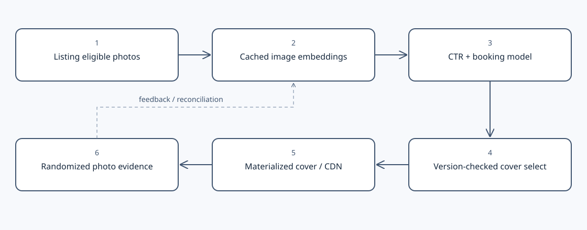

# W174. Improve Booking via Cover Photo Selection (ML Design)

**Priority group:** Second 100 — important

**Category:** Production ML and product design

**Study position:** 174 of 547

[Group list](../NEXT_100.md) · [All categories](../ALL_CATEGORIES.md) · [Chapter guide](../README.md)

## Question

Pick the cover photo for each listing to maximize click-through and booking. Open-ended ML design — the candidate drives the framing.

### Requirements

Functional
For each listing with &gt;= 5 photos, choose the cover photo shown on the search results page.
Optimize for click-through to the listing page; secondary for booking conversion.
Non-functional
Batch inference acceptable; daily or weekly recompute.
Latency at serve time is negligible (cover photo is materialized in the listing record).

## Worked solution

### Define the decision and comparison

For each listing with at least five eligible photos, choose one cover once per daily/weekly batch. The primary near-term objective is click-through per search impression; require booking conversion/booking-per-impression and misrepresentation complaints as guardrails so clickbait does not win. Clarify whether a single universal cover or a personalized cover is required; assume one materialized cover per listing as stated. A contextual personalized policy would need a different serving contract.

Create one training row per displayed listing-cover impression, with search context, listing, photo/version, position, current displayed price and exposure policy. Label click in-session and booking within a defined mature attribution window. Historic non-cover photos have no counterfactual CTR label; assigning them zero clicks creates severe selection bias. Run a controlled within-listing photo experiment with logged assignment probabilities to collect comparisons, respecting photo quality and safety eligibility.

### Model and batch pipeline

Extract image embeddings, scene type (bedroom, exterior, living room), brightness, sharpness, crop quality, resolution and visual clutter. Combine listing context such as property type, region, room count, price band and attributes; add search position/context only as observed at prediction time. A pretrained image encoder plus a small tabular ranker is a practical baseline, compared to a sharpness/room-type rule. Predict calibrated CTR and optionally booking conditional on click with shared features. Randomized cover exposures identify relative performance better than old owner-selected covers.

The diagram's candidate pool is the listing's own eligible photos, not the entire catalog. A daily job reads immutable photo/listing versions, scores each candidate under representative traffic contexts, aggregates expected CTR across that context distribution and selects the best subject to quality/bookings guardrails. Persist CoverChoice(listing,photo_id,photo_version,model_version,computed_at,expected_listing_version) using compare-and-swap. A concurrent photo deletion or listing edit invalidates the proposed choice. CDN thumbnails are generated before the new pointer goes live; serving just reads that pointer, with a safe previous/default cover fallback.

### Evaluation and operational checks

Split by listing/property owner and time to prevent near-duplicate photo leakage. Offline evaluate pairwise preference/CTR calibration on randomized holdout data and booking performance after label maturity, segmented by property type and geography. User- or search-session A/B tests compare the cover policy consistently, log actual rendered cover and prevent a user repeatedly switching variants mid-session. Listing-level randomization may be appropriate for a fixed global cover, but traffic interference and repeated impressions require clustered confidence intervals. Monitor CTR, booking per impression, click-to-book drop, complaint/cancellation signals and host overrides.

Illustration only: photo A gets 30/1,000 clicks and B gets 40/1,000 under comparable randomized exposure; B's observed CTR is one point higher, but uncertainty and booking outcomes still matter. Assuming ten million listings with ten photos each, full scoring touches 100 million photos; cache embeddings by photo digest and rescore only changed listings or changed model versions. At 1,000 cached-photo scores/s the full pass is about 27.8 hours, so incremental updates or more workers are needed for a daily SLA. Validate deleted covers, missing embeddings, duplicate jobs, and drift in search traffic. Batch failures retain the previous valid cover instead of erasing it.

<!-- architecture:W174:start -->

Read the numbered path as Listing eligible photos → Cached image embeddings → CTR + booking model → Version-checked cover select → Materialized cover / CDN → Randomized photo evidence. The dashed return is the feedback or reconciliation path described in the solution; durable state and authorization remain authoritative when work is retried.
<!-- architecture:W174:end -->

### Runnable checks

[Batch behavior checks](../test_review_151_200.py) also validate this page's Python syntax and referenced diagrams. The architecture, capacity and metric reasoning is reviewed as a design; no production load, availability or model-quality result is claimed.

### Further study

- [F182: Recommend cover photos to improve bookings.](../19_product_ml_case_studies.md#f182)
