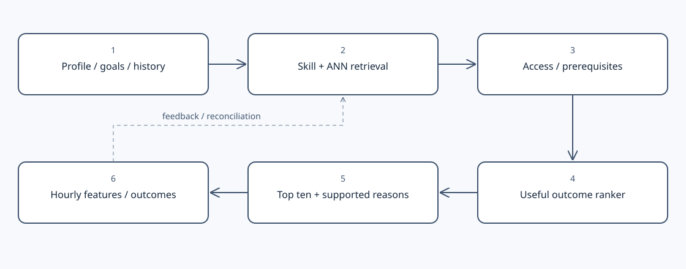

# W175. Learning / Job Recommendation Ranking

**Priority group:** Second 100 — important

**Category:** Production ML and product design

**Study position:** 175 of 547

[Group list](../NEXT_100.md) · [All categories](../ALL_CATEGORIES.md) · [Chapter guide](../README.md)

## Question

Design a recommender that surfaces LinkedIn Learning courses (or jobs) based on a user's profile, recently applied jobs, and behavioral history.

Functional: return a ranked list of items the user is likely to engage with; handle cold-start for new users/items; provide explainability ("why is this recommended?").

Non-functional: sub-200 ms candidate generation + ranking; recall over the full catalog, precision over the top-10 served; online learning loop closes within hours.

LinkedIn twist: heavy feature engineering on the job/course side and explicit per-item explainability.

## Worked solution

### Choose an outcome and preserve intent

Assume LinkedIn Learning courses; optimize useful starts followed by completion or skill progress, with seven/thirty-day return and user satisfaction. Jobs use the same funnel but labels become qualified application, recruiter response and eventual placement, with much longer delays. A course click is not a completed course, and a job click is not a successful match. Enforce content access, language and prerequisites; for jobs enforce location/work eligibility and current posting status where legally/product-appropriate.

User features include profile skills, role/seniority, declared career goals, recent applications and searches, completed courses and recent session behavior. Item engineering is central: normalized skills, prerequisites, difficulty, duration, syllabus/topic embeddings, language, credential, freshness and instructor quality; jobs add required/preferred skills, seniority, employment type and normalized location. Compute user-item skill gaps, role transitions, completion compatibility and explicitly requested versus inferred interest. Keep profile inferences separate from verified skills and protect sensitive attributes.

### Retrieval, ranking and explanation

`GET /recommendations` returns IDs, model version, exposure_id and a structured reason. Retrieve across the full catalog using skill/inverted indexes, two-tower/content ANN, similar-career paths and fresh items. Merge roughly 1,000 candidates, rank a few hundred with a GBDT or multi-task neural model predicting start, completion and useful outcome, then diversify by skill, provider and difficulty. The diagram's candidate stage ensures broad recall; the final stage aims at top-10 precision under a sub-200-ms request budget. Allocate, illustratively, 30 ms features, 40 ms retrieval, 60 ms rank and 70 ms filtering/network/headroom.

Reasons come from supported features, for example “builds SQL used in your recently applied analyst roles” or “next course after your completed introduction.” Store reason_code plus evidence IDs with the recommendation; do not ask a generator to invent causal explanations for a score. Suppress sensitive or stale evidence and allow users to correct preferences. A cold user gets profile/goal-based content matching; a cold item uses syllabus/skill embeddings with limited exploration.

### Learning and serving reliability

Exposure rows record user,item,time,position,source,feature/model versions and selection propensity. Deduplicate engagement events, retain label maturity and use point-in-time joins; application outcomes after the impression cannot be input features. Streams refresh recent actions within minutes, hourly jobs update aggregates and incremental embeddings, and a model refresh/shadow evaluation can close the loop within hours without forcing unsafe full retraining every event. Keep a slow mature completion/placement evaluator as well.

Forward-time splits plus new-user/new-item and skill-domain holdouts assess recall@1000, NDCG/precision@10, calibration and completion quality. Online user A/B tests measure useful outcomes with dismissal, unsubscribes, latency and opportunity-distribution guardrails; exposure bias needs exploration and careful propensity correction. Scale is unspecified: at assumed 10,000 QPS and 200 rank candidates, capacity is two million pair scores/s. Cache content embeddings and short-lived eligible candidates, but recheck expired job postings and user access. Model/index versions deploy together; fall back to goal/skill rules on failure. Test a prerequisite violation, revoked access, removed posting and an explanation whose evidence was deleted. Monitor skill-extraction drift, stale profiles, feature age and top-10 concentration.

<!-- architecture:W175:start -->

Read the numbered path as Profile / goals / history → Skill + ANN retrieval → Access / prerequisites → Useful outcome ranker → Top ten + supported reasons → Hourly features / outcomes. The dashed return is the feedback or reconciliation path described in the solution; durable state and authorization remain authoritative when work is retried.
<!-- architecture:W175:end -->

### Runnable checks

[Batch behavior checks](../test_review_151_200.py) also validate this page's Python syntax and referenced diagrams. The architecture, capacity and metric reasoning is reviewed as a design; no production load, availability or model-quality result is claimed.

### Further study

- [F082: Design a recommendation system from candidate generation to ranking.](../09_ml_system_design.md#f082)
- [F063: Choose metrics for ranking and recommendation.](../07_evaluation_and_data.md#f063)
