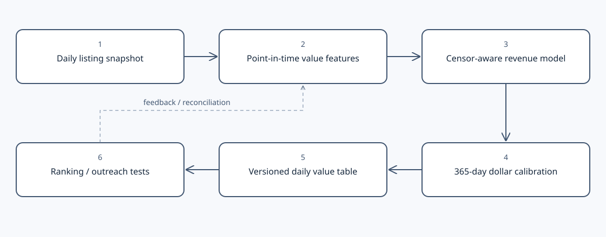

# W176. Listing Lifetime Value — Estimation (ML Design)

**Priority group:** Second 100 — important

**Category:** Production ML and product design

**Study position:** 176 of 547

[Group list](../NEXT_100.md) · [All categories](../ALL_CATEGORIES.md) · [Chapter guide](../README.md)

## Question

Estimate the lifetime value of a listing — projected revenue over the next 12 months. Used downstream for ranking, host outreach, and inventory acquisition decisions. The prompt is intentionally open and rewards strong scoping.

### Requirements

Functional
Predict per-listing 12-month booking revenue (or a related target the candidate proposes).
Output consumed by ranking (boost high-LTV listings) and by host-success teams (prioritize outreach).
Non-functional
Batch inference is acceptable; daily refresh.
Predictions should be calibrated — absolute dollar values, not relative scores.

## Worked solution

### Define dollars and the observation window

Assume the target is gross completed-booking revenue in the next 365 days, net of cancellations/refunds but before platform fees, in a fixed reporting currency using a documented conversion convention. If the business wants platform margin instead, change both labels and cost model; these are different targets. At daily snapshot t, predict E[Y(t)|features available at t], where Y(t) sums eligible stay-night revenue in [t,t+365). Allocate bookings crossing the window by night, and avoid double-counting a future reservation already known at t. Clarify whether host churn/blocked nights are part of future value; assume they are.

Daily snapshot rows include listing age, location/property type/capacity/amenities, host reliability, available calendar nights, current prices and booked pipeline, historical occupancy/revenue/cancellations, review trends, local seasonality/events and market demand. Features are time-stamped; future calendar changes, future price corrections and final cancellation information are leakage. A new listing has sparse history but metadata and market priors.

### Baseline and stronger model

Start with cohort occupancy×available nights×average daily rate, adjusted for expected active survival and known booked revenue. Compare a two-part model P(active/bookable) times expected revenue conditional on activity, or a direct Tweedie/GBDT revenue regressor suited to nonnegative zeros and a long tail. A monthly decomposition predicts 12 revenue increments and sums them, making seasonality and survival explicit. Calibrate the summed dollar prediction on a held-out period rather than just ranking scores. Predict intervals/quantiles for outreach decisions with uncertain new listings.

Only snapshots whose complete next year and cancellation finalization are observed have an ordinary full label. An in-progress listing's first month is not its final 12-month revenue. Use mature cohorts for a simple baseline; if freshness demands recent cohorts, use a survival/censoring-aware likelihood or explicitly model observed monthly outcomes with censor masks. Administrative censoring differs from real listing churn, which may legitimately produce zero later revenue. Repeated daily snapshots of one listing require grouped/temporal evaluation and correlated-error handling.

### Evaluate downstream uses separately

Use rolling-origin splits, leaving a full label horizon before an untouched future test when necessary. Report dollar MAE, aggregate bias, RMSLE as a supplementary scale metric, calibration by predicted decile/cohort/age/market and interval coverage. A model can order listings well but systematically overpredict absolute dollars, violating this prompt. Example: 40 available nights at $100 and 50% expected occupancy give $2,000 for a month; sum month-specific values, not simply 12× a peak month. If predicted annual dollars sum to $10 million but mature revenue is $8 million, investigate systematic calibration and market shift.

The diagram's batch feature/model/output flow materializes ListingValue(listing,snapshot,horizon,currency,model_version,mean,quantiles) daily. Consumers reject stale/incompatible versions. Ranking boosts based on predicted LTV can create a feedback loop by increasing exposure; control the boost and A/B-test booking/satisfaction and host fairness. Outreach needs incremental treatment benefit or an experiment: high baseline LTV does not imply high outreach uplift.

Assume 20 million listings and one score/day: about 232 scores/s average, excluding feature construction. Incremental aggregates and partitioned daily output can support this with batch workers. Publish a complete version manifest atomically; a failed daily job leaves the prior valid snapshot. Monitor freshness, missing currencies, market drift and delayed mature-cohort calibration, not just daily proxy clicks.

<!-- architecture:W176:start -->

Read the numbered path as Daily listing snapshot → Point-in-time value features → Censor-aware revenue model → 365-day dollar calibration → Versioned daily value table → Ranking / outreach tests. The dashed return is the feedback or reconciliation path described in the solution; durable state and authorization remain authoritative when work is retried.
<!-- architecture:W176:end -->

### Runnable checks

[Batch behavior checks](../test_review_151_200.py) also validate this page's Python syntax and referenced diagrams. The architecture, capacity and metric reasoning is reviewed as a design; no production load, availability or model-quality result is claimed.

### Further study

- [F183: Estimate listing lifetime value.](../19_product_ml_case_studies.md#f183)
