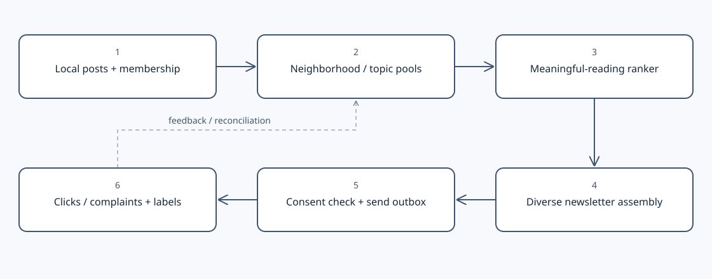

# W177. ML News Recommendation System Design

**Priority group:** Second 100 — important

**Category:** Production ML and product design

**Study position:** 177 of 547

[Group list](../NEXT_100.md) · [All categories](../ALL_CATEGORIES.md) · [Chapter guide](../README.md)

## Question

Design a machine learning system to recommend email newsletter content to users of the Nextdoor platform. You need to outline the overall architecture of the system and the required machine learning models. Consider details on feature engineering, model selection, training, and evaluation.

## Worked solution

### Newsletter objective and locality

Assume a daily personalized Nextdoor email containing local news/posts/events. Optimize meaningful local engagement and sustained newsletter satisfaction, with unsubscribes, spam complaints, misinformation/safety, neighborhood diversity and send frequency as guardrails. Opens alone are unreliable because mail clients may prefetch tracking pixels; define clicked/qualified reading and subsequent local action separately. Enforce neighborhood access and privacy before ranking so a good embedding never leaks private posts.

Build content records with post/article ID, neighborhood/geography, author/source permissions, publish/expiry time, topic, event date and text/image embeddings. User features include consented home neighborhood, interests, language, recent local interactions, followed topics and historical email engagement. Batch jobs compute long-term affinities; streaming updates add new stories, remove expired/unsafe content and update recent actions. Labels come from actually sent/rendered content: click, qualified read, local participation, hide/report and unsubscribe with chosen mature windows. Log selected slate, position, send time, policy/model version and delivery status.

### Candidate generation, ranking and assembly

The diagram's retrieval stage unions geographically eligible recent stories, interest/content similarity, trusted-source editorial picks and controlled new-topic exploration. Group near-duplicate reports of one local event; expired event notices are removed. Start with a recency/locality/content baseline, then train a calibrated multi-task GBDT or neural ranker on impression rows to predict meaningful engagement and dissatisfaction. Collaborative embeddings can augment content once enough history exists, but recent local news still needs content retrieval and freshness.

Rank a few hundred candidates, then assemble a small newsletter with topic/source diversity, urgent local information and no duplicate story. Send-time selection can be a separate learned policy with explicit quiet hours and user preferences. The output is materialized Newsletter(user,edition,slate,versions,state); an idempotent send key (user,edition) and transactional outbox prevent ordinary duplicate dispatch. Provider timeouts are reconciled using provider message IDs; delivered/opened/clicked are different states. Membership, consent and takedowns are rechecked before send, not just during yesterday's batch.

### Evidence, capacity and recovery

Train/evaluate forward in time and hold out new stories/neighborhoods; a future story cannot enter the candidate set for an earlier email. Measure candidate recall on engaged local content, NDCG@newsletter size, click calibration, freshness and neighborhood coverage. Randomized positions/exploration help diagnose exposure bias. A user-randomized A/B test measures qualified engagement and weekly retention with complaint/unsubscribe guardrails, stratified by neighborhood/activity. Community spillovers may require cluster experiments; novelty and seasonal events can confound short tests.

Scale is unspecified. Assuming ten million daily recipients, a two-hour send window requires about 1,389 sends/s, plus provider limits/retries. Precompute neighborhood candidate pools, personalize bounded sets offline and schedule per-region sends. If ranking fails, use a vetted local digest; if permission data is unavailable, omit uncertain content. If delivery stalls, expire time-sensitive items and avoid sending yesterday's emergency as fresh news. Monitor feature/content age, provider failure, duplicate sends, per-neighborhood no-content rates and mature quality metrics. A useful failure test is an event canceled after assembly but before send: invalidation or a final eligibility check must remove it.

<!-- architecture:W177:start -->

Read the numbered path as Local posts + membership → Neighborhood / topic pools → Meaningful-reading ranker → Diverse newsletter assembly → Consent check + send outbox → Clicks / complaints + labels. The dashed return is the feedback or reconciliation path described in the solution; durable state and authorization remain authoritative when work is retried.
<!-- architecture:W177:end -->

### Runnable checks

[Batch behavior checks](../test_review_151_200.py) also validate this page's Python syntax and referenced diagrams. The architecture, capacity and metric reasoning is reviewed as a design; no production load, availability or model-quality result is claimed.

### Further study

- [F082: Design a recommendation system from candidate generation to ranking.](../09_ml_system_design.md#f082)
- [F063: Choose metrics for ranking and recommendation.](../07_evaluation_and_data.md#f063)
