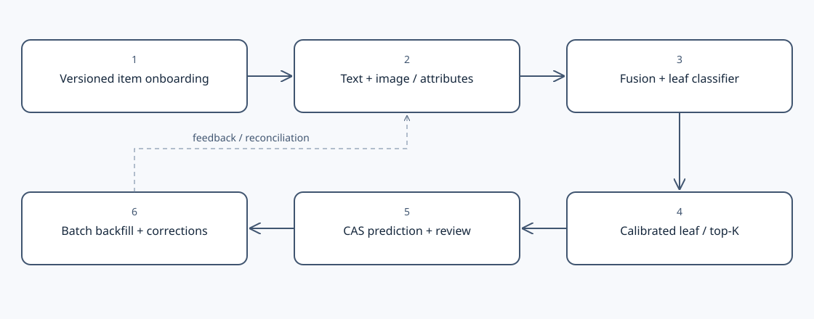

# W178. ML System Design - Predict Item Category

**Priority group:** Second 100 — important

**Category:** Production ML and product design

**Study position:** 178 of 547

[Group list](../NEXT_100.md) · [All categories](../ALL_CATEGORIES.md) · [Chapter guide](../README.md)

## Question

Build an ML system that predicts the category of a new catalog item (e.g. "Outdoor -&gt; Camping -&gt; Tents") from its title, description, attributes, and images. Cover data, labels, model architecture, serving, and evaluation.

### Requirements

Functional: given an unlabeled item (title + description + structured attributes + images), output a predicted category path within Walmart's taxonomy, plus a confidence score and (optionally) top-K alternatives.
Non-functional: latency in tens of milliseconds at write time (called during item onboarding); throughput sized for catalog ingest spikes; offline batch mode for back-filling historical items; observable per-category accuracy with drift detection.
Outputs: a single best leaf-level category, top-K alternatives, and a calibrated probability per output for downstream routing thresholds.

## Worked solution

### Output and labels

This version asks for one best leaf path plus top-K alternatives with calibrated probabilities. Define a taxonomy_version and emit {item_version,taxonomy_version,model_version,best_leaf,path,top_k:[(leaf,p)]}. A single leaf induces its ancestors; top-K probabilities are not renormalized to sum to one because omitted leaves retain mass. If confidence is low, return the prediction but route it for human confirmation rather than silently asserting certainty.

Training data combines adjudicated catalog labels and reliable merchant corrections, retaining label source/version. Map old taxonomy labels through explicit migration tables; ambiguous splits require relabeling. Group duplicate products/brands across train/test and use forward-time plus new-category/seller holdouts. Category text copied from a later correction is leakage. Rare categories need class-balanced sampling/weights and human review, evaluated at natural production prevalence.

### Multimodal model and serving

Encode title/description with a compact text transformer, images with a pretrained vision encoder, and attributes with categorical embeddings/numeric transforms. Concatenate pooled vectors plus missing-modality masks, then a small fusion MLP and leaf softmax or hierarchical conditional heads. Text-only TF-IDF/logistic regression is the baseline; compare image-only, text-only and fused ablations. Train cross-entropy for one leaf, optionally adding an ancestor-consistency loss. A hierarchical head multiplies conditional branch probabilities along the path; greedy traversal can miss the most likely leaf, so use beam search or compute all candidate path scores.

Calibrate with held-out temperature scaling or another validated method, checking rare-category reliability. A photo of a tent with title “replacement tent pole” should rely on attributes/text enough to avoid confusing the accessory with the entire product. Missing images use the text branch and a missingness mask, not a fabricated zero-confidence image prediction.

The diagram's ingestion stage validates/canonicalizes an item, its model stage fuses modalities and its output stage writes a versioned prediction/review request. `POST /categorize` takes item fields plus image references or cached embeddings; synchronous tens-of-ms latency is plausible only if image upload/decode/embedding is already completed or tightly bounded. State that contract explicitly. An illustrative 40 ms budget is 5 ms validation/cache, 15 ms text/structured encoding, 10 ms cached-image fusion/scoring and 10 ms response/headroom. Uncached large images need a pending/asynchronous path, not a hidden SLA violation.

### Batch, consistency and evaluation

Catalog change events carry item_id/version. Workers reuse the same model/feature package for write-time and historical backfill, batch GPU embedding jobs and conditionally write only if the item version still matches. Duplicate events are idempotent and old completions cannot overwrite a newer description. A model/taxonomy rollout publishes compatible versions atomically; on model outage store a pending classification or return a clearly marked prior prediction, depending on onboarding policy.

Throughput is unspecified: assuming a 10,000-item/s spike and 20 ms unbatched service time implies 200 concurrent inferences before headroom. Benchmark batching, cache reuse and backpressure, retaining an ingest queue for batch work. Measure leaf accuracy, hierarchical distance, top-K recall, macro/per-leaf F1, calibration and review coverage/error by confidence threshold. Monitor drift, unknown attributes, modality missingness, p99 latency and per-category corrections. Validate taxonomy migration, image absence, duplicate items, conflicting updates and cold rare leaves before claiming correctness.

<!-- architecture:W178:start -->

Read the numbered path as Versioned item onboarding → Text + image / attributes → Fusion + leaf classifier → Calibrated leaf / top-K → CAS prediction + review → Batch backfill + corrections. The dashed return is the feedback or reconciliation path described in the solution; durable state and authorization remain authoritative when work is retried.
<!-- architecture:W178:end -->

### Runnable checks

[Batch behavior checks](../test_review_151_200.py) also validate this page's Python syntax and referenced diagrams. The architecture, capacity and metric reasoning is reviewed as a design; no production load, availability or model-quality result is claimed.

### Further study

- [F181: Predict the category of a newly listed item.](../19_product_ml_case_studies.md#f181)
