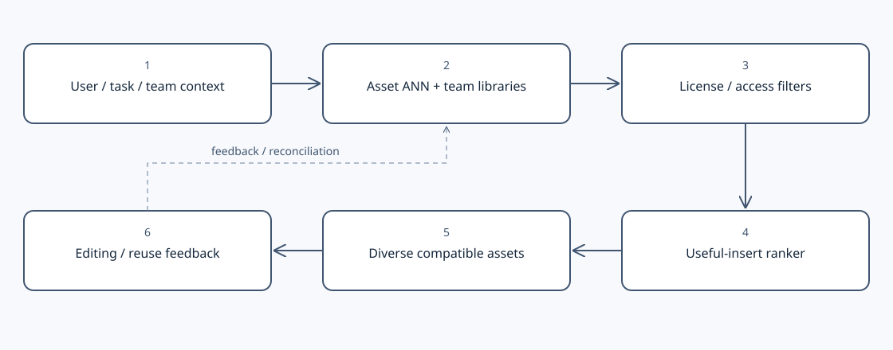

# W179. ML System Design — Asset / Template Recommendation & Feed

**Priority group:** Second 100 — important

**Category:** Production ML and product design

**Study position:** 179 of 547

[Group list](../NEXT_100.md) · [All categories](../ALL_CATEGORIES.md) · [Chapter guide](../README.md)

## Question

ML System Design — Asset / Template Recommendation & Feed

ML system-design round: build a recommender for Figma assets/templates, or a home feed. Treated as a fairly standard newsfeed-style recsys — candidate generation plus ranking — adapted to Figma's content.

MLE RS · tags: recommendation, feed, ranking, mlsd, system-design

### Requirements

Design a recommendation/feed system for Figma:

Recommend assets / templates to users, or design the home feed.
Expected to look like a standard newsfeed recommender: candidate generation → ranking, with the usual feature, training, and serving discussion.
Notes
Candidates treated this like an FB-newsfeed recsys and that framing was accepted — cover candidate retrieval (e.g. two-tower / embedding retrieval), a ranking model, features (user, asset, context), training data and labels, online serving, and metrics.
Adapt the content specifics to Figma (design assets/templates, collaboration signals) rather than reciting a generic social feed.
Part of the longer ML onsite, usually alongside an ML model-design round and a project deep dive.

## Worked solution

### Adapt the objective to design work

Assume a Figma asset/template discovery feed. Optimize successful insert/duplicate followed by meaningful editing or retained use, with satisfaction, license violations, load time and creator diversity as guardrails. A thumbnail click is a weak label; accidental duplicates and immediate undo should not count as successful use. Log impressions, position, asset/version, workspace context, insert/duplicate, edits after a defined interval, undo/remove, save and delayed reuse. Never use private file content without permission.

Features include user role/interests, recent searches, preferred style and prior assets; asset category, tags, visual/text embedding, component type, editable format, dependencies, license, version compatibility, quality and freshness; context includes current design task, device and team-approved libraries. Collaboration features can use authorized team usage and shared-library relevance, but another team's private assets must not enter candidates or explanations.

### Retrieval and ranker

`GET /assets/recommendations` takes authorized workspace/task context and returns IDs, versions and structured reasons. Candidate generation unions content/two-tower ANN, related assets, team-library choices, editorial quality and a new-creator pool. Deduplicate near-identical templates and apply access, license and compatibility rules. Rank hundreds with a multi-task model predicting meaningful reuse, quality and negative outcomes; a GBDT over content and usage features is a fast baseline, with richer user-asset interaction models after enough data exists. Re-rank by style/category/creator diversity so a page is not twenty recolored copies of one template.

The diagram's retrieval is over versioned assets, its ranking uses user/task context, and its policy stage checks permissions and licensing. New users get role/task/onboarding-based content matches; new assets use embeddings and limited randomized exposure. Cache public item embeddings globally and team-private candidates only within the authorized tenant boundary. Index deletions and permission changes through monotonic versions/tombstones, with final access rechecks when opening/inserting.

### Training, evaluation and operations

Use point-in-time features, mature reuse labels and grouped splits by asset family/creator to prevent duplicate-template leakage. Measure candidate recall, NDCG@20 on useful inserts, calibration, compatibility rejection and new-creator coverage; human task relevance helps evaluate cold-start content. Exposure and position bias require logged propensities/randomized slots, not treating every unshown template as disliked. User-randomized A/B tests may contaminate teams through shared assets, so assign by workspace/team when collaboration spillover is material; monitor useful editing sessions, re-use, undo, complaints and creator concentration.

Scale is not provided. Assume ten million assets at 256 fp16 dimensions: 5.12 GB raw vectors, excluding ANN and replicas. At 5,000 requests/s and 200 ranked candidates, score one million pairs/s. An illustrative 150 ms budget reserves 30 ms retrieval, 30 ms batch features, 50 ms rank and 40 ms policy/network. Version model/index together, canary changes and fall back to safe compatible curated assets on ranker failure. Idempotent insertion/export requests and content-version checks prevent retries creating duplicate copies unexpectedly. Test revoked team access, missing dependency/version mismatch, delayed takedown, near-duplicate leakage and a permission change during a cached session.

<!-- architecture:W179:start -->

Read the numbered path as User / task / team context → Asset ANN + team libraries → License / access filters → Useful-insert ranker → Diverse compatible assets → Editing / reuse feedback. The dashed return is the feedback or reconciliation path described in the solution; durable state and authorization remain authoritative when work is retried.
<!-- architecture:W179:end -->

### Runnable checks

[Batch behavior checks](../test_review_151_200.py) also validate this page's Python syntax and referenced diagrams. The architecture, capacity and metric reasoning is reviewed as a design; no production load, availability or model-quality result is claimed.

### Further study

- [F082: Design a recommendation system from candidate generation to ranking.](../09_ml_system_design.md#f082)
- [F063: Choose metrics for ranking and recommendation.](../07_evaluation_and_data.md#f063)
