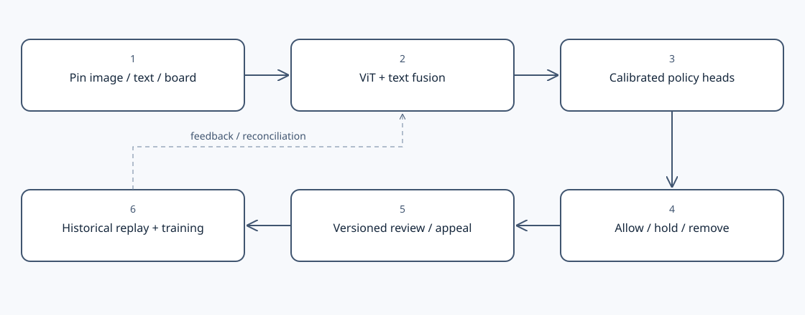

# W180. ML System Design: Bad / Unsafe Content Detection

**Priority group:** Second 100 — important

**Category:** Production ML and product design

**Study position:** 180 of 547

[Group list](../NEXT_100.md) · [All categories](../ALL_CATEGORIES.md) · [Chapter guide](../README.md)

## Question

Design a content-understanding pipeline that flags unsafe / bad pins (or bad images) at upload time and at re-evaluation time. Used by Trust & Safety / Content Signal teams; the framing changes between teams but the underlying ML system is recognizably one design.

### Requirements

Design an end-to-end content-safety pipeline for Pinterest pins. Address:

How content (image + text + metadata) is represented as features.
Multi-modal embedding choice — image + caption + board context.
Labeling strategy: human review queue, weak labels from report signals, gold-set evaluation.
Model architecture and training (multi-label classification, threshold calibration per policy).
Inference pipeline: synchronous (block upload) vs asynchronous (post-publish takedown).
How the system handles model updates and re-scoring of historical content.
How human reviewers feed back into training.
Notes
Multi-modal embedding is the central design choice. The expected answer covers image embeddings (CNN / ViT) + text embeddings (transformer) + a fusion layer; many candidates underspecify the fusion and lose signal.
Calibration matters more than accuracy in this domain — policy thresholds are set per category, and miscalibrated probabilities translate to wrong policy enforcement. Mention temperature scaling or isotonic regression as the calibration step.
Asynchronous re-scoring of historical content is a common follow-up. The accepted answer: a Kafka-backed event log of all pins, a worker pool that consumes the log against the current model version, sharded by content-id to limit duplicate work.
Bias-and-fairness analysis is sometimes pushed — subgroup metric breakdowns and counterfactual evaluation.
One reported variant is bank/transaction fraud detection used as a generic real-time scoring system; the architecture overlaps (feature pipeline -&gt; scoring -&gt; threshold -&gt; action).

## Worked solution

### Representation and calibrated policy decisions

Treat Pinterest pin safety as multi-label classification: a pin can violate several policies, and the thresholds for removal, limited distribution and review differ. Inputs are image, caption/OCR text, board context, source URL and available metadata. Use a ViT/CNN image vector v, a text-transformer vector t over caption/OCR/board text, and structured features z. A concrete fusion is h=MLP([v;t;v⊙Pt;z;modality_masks]), with a projection P aligning dimensions; sigmoid heads output one score per policy. Compare image-only, text-only and concatenation versus interaction ablations. Board context is a signal, not permission to infer unrelated private attributes.

Train weighted binary cross-entropy with a mask for unannotated labels; unknown labels are not negative. Expert gold labels, adjudicated appeals and human review form trusted data. Reports, blocked URLs and heuristic rules are weak labels with provenance and measured noise. Sample uncertain/new-pattern content for active learning plus random production content for unbiased prevalence/error estimates. Reviewer disagreement requires guidelines and adjudication, not averaging away policy ambiguity. Split by time and near-duplicate/source clusters.

Calibrate each policy using held-out temperature scaling or isotonic regression where data supports it. Measure action precision, severe-harm recall, false removals per million, PR-AUC, calibration and appeal reversals by language, content type and subgroup. Choose thresholds under explicit harm costs and review capacity. A single aggregate accuracy number hides rare severe failures and cannot determine safe enforcement.

### Upload and historical paths

`POST /pins` stores media in quarantine, commits Pin(id,version,media_digest,state) and publishes an outbox event. Cheap hash/rule checks and a bounded fast model run synchronously; confidently unsafe content blocks, uncertain severe cases remain held, and lower-risk uncertain cases may publish with limited distribution only if policy allows. A slower model/reviewer can later take down published content. The diagram's model output is therefore followed by a policy/version-aware action service, not direct unconditional deletion.

Historical rescoring consumes a durable pin manifest/event log into partitioned workers keyed by pin_id. Deduplication key is (pin_id,pin_version,policy_version,model_version). Claim leases, retry transient media/model failures with backoff and dead-letter corrupt content. Conditional writes compare input version and current decision authority, so a late older model cannot undo a newer appeal or rescore. A new model version intentionally gets a new key; using only content_id+rule_version would mistakenly suppress it. Replay capacity is separated from upload capacity to protect latency.

### Sizing, failure handling and feedback

Traffic is unspecified. Assume 20 million uploads/day, fivefold peak: about 1,157/s. If 1% require human review, that is 200,000 reviews/day, so staffing becomes a major design constraint; at 30 seconds each that is 1,667 reviewer-hours/day. Measure rather than assume that threshold choice is operationally affordable. Persist Decision, Action, ReviewAssignment and Appeal with immutable versions and audit logs; reviewer claims and overrides use atomic state transitions.

On model/storage outage, hold high-risk new content instead of issuing an unsupported safe verdict; preserve the prior decision for existing pins pending reevaluation. Canary/shadow new models against fixed gold and recent random samples, verify subgroup calibration and retain rollback compatibility. Review outcomes feed a versioned dataset after quality checks, with random audits to counter selection bias. Monitor upload p99, moderation lag, stale models, review age and reversal rates. Tests include image/text contradiction, missing caption, duplicate replay, simultaneous human override and a removed pin receiving an old allow result.

<!-- architecture:W180:start -->

Read the numbered path as Pin image / text / board → ViT + text fusion → Calibrated policy heads → Allow / hold / remove → Versioned review / appeal → Historical replay + training. The dashed return is the feedback or reconciliation path described in the solution; durable state and authorization remain authoritative when work is retried.
<!-- architecture:W180:end -->

### Runnable checks

[Batch behavior checks](../test_review_151_200.py) also validate this page's Python syntax and referenced diagrams. The architecture, capacity and metric reasoning is reviewed as a design; no production load, availability or model-quality result is claimed.

### Further study

- [F083: Design multi-modal harmful-content detection.](../09_ml_system_design.md#f083)
