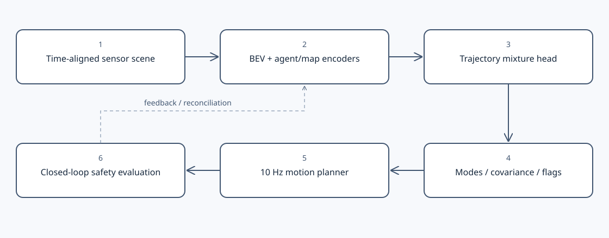

# W181. ML System Design: Behavior Prediction from Sensor + Camera Data

**Priority group:** Second 100 — important

**Category:** Production ML and product design

**Study position:** 181 of 547

[Group list](../NEXT_100.md) · [All categories](../ALL_CATEGORIES.md) · [Chapter guide](../README.md)

## Question

Design a machine learning system for an autonomous vehicle that predicts the future behavior of the vehicles, pedestrians and cyclists around it from the car's sensor and camera data, and hands calibrated uncertainty to the motion planner that consumes the predictions.

### Requirements

1. Inputs. Time-aligned LiDAR / radar data and camera streams from the ego vehicle, plus the tracked history of each surrounding agent.
2. Outputs. For every agent, a trajectory prediction over a future horizon of about 3 to 8 seconds, with uncertainty: either a per-step covariance or a categorical distribution over trajectory modes.
3. Planner contract. The motion planner needs (a) deterministic outputs at a fixed cadence, (b) uncertainty in a form it can use inside its cost functions, and (c) a bounded latency budget.
4. Cover these parts of the design:
problem framing and the input and output representation;
model architecture and output head;
loss function;
uncertainty: aleatoric versus epistemic, and how each reaches the planner;
data collection and long-tail curation of rare, dangerous scenarios;
training stages;
evaluation, offline and in closed loop;
serving and latency.

### Constraints

The planner runs at about 10 Hz, so the predictor must return a fresh batch of predictions in under 100 ms, with a bounded 99th-percentile latency.
Safety-critical use: a design that averages several plausible futures into one trajectory is not acceptable.
Follow-up 1: interactive prediction

Condition the predictions on the ego vehicle's planned action, so the forecast reflects how other agents react to what the ego plans to do. Say what changes in the inputs, the training data and the evaluation.

Follow-up 2: emergent dangers

Extend the system to flag emergent dangers that call for intervention, for example a pedestrian stepping into the road. Say how you would label, train and evaluate this.

## Worked solution

### Planner-facing representation

At each 10 Hz tick, form one synchronized scene in the ego coordinate frame at timestamp t: calibrated camera/point-cloud/radar features, ego pose/motion, map lanes/crosswalks and tracked agent histories with masks, velocity, heading and covariance. Motion-compensate asynchronous sensors and mark staleness; a future observation cannot enter a training feature. For each agent return K trajectory modes over an assumed five-second horizon at fixed steps, mode probabilities summing to one and optionally a positive-definite covariance per step. Include timestamp, coordinate frame, valid horizon, model version and out-of-distribution/quality flags. Deterministic inference means fixed inputs produce the same bounded, ordered output, not sampling a different future every call.

### Model, objective and uncertainty

A BEV sensor encoder fuses cameras/LiDAR/radar, a temporal encoder summarizes agent history, and an interaction/map encoder models agents and lane relations. A mixture head predicts πk, means μk,1:T and covariance Cholesky factors Lk,t with positive diagonals, giving Σ=LLᵀ. Train a trajectory mixture negative log likelihood:

$$L=-\log\sum_{k=1}^K\pi_k\,\mathcal N(y_{1:T};\mu_{k,1:T},\Sigma_k),$$

masking unobserved future steps and using log-sum-exp. If covariance is block-diagonal across time, state that approximation; it does not represent full temporal correlation. Add physical-feasibility/map losses carefully and inspect mode collapse. A constant-velocity baseline establishes how much complex interactions help. Turning left and going straight must remain separate modes; their average may point into a sidewalk.

Aleatoric uncertainty is represented by distinct futures and within-mode covariance. Epistemic uncertainty comes from a small ensemble evaluated within the latency budget, disagreement/distilled uncertainty, and OOD diagnostics; it should trigger a conservative planner response, not be mislabeled as calibrated mode probability. Calibrate likelihood/mode probabilities and coverage on held-out drives. The planner consumes the full mixture in collision-risk/expected-cost or chance constraints and receives an explicit stale/failure flag; marginal per-agent forecasts do not establish a safe joint scene distribution.

### Data, evaluation and latency

Train sensor encoders/self-supervised representations, then supervised forecasting and interaction fine-tuning; compare modalities and rare-scenario ablations. Curate turns, occlusions, emergency braking, unusual cyclists and pedestrian near-misses, retaining random driving for real prevalence. Correct for oversampling in evaluation/calibration. Split by drive, geography and time, never adjacent video frames. Track label noise from tracking and uncertain future identities.

Offline metrics include minADE/minFDE, miss rate, mixture NLL, probability/coverage calibration, collision/off-road rate and rare-event slices; minADE alone rewards many guesses. Closed-loop simulation with the actual planner measures collisions, near misses, progress and comfort under reactive agents, followed by guarded real-world validation. The diagram's predictor-to-planner boundary is an explicit safety contract.

An illustrative <100 ms budget is 15 ms sync/preprocess, 30 ms shared sensor encoder, 20 ms interactions/head, 10 ms calibration/serialization and 25 ms headroom; if perception already supplies features, avoid double-counting it. Cap agent count with a conservative fallback for omitted actors, use fixed shapes/precision validation and monitor p99 under worst-case crowded scenes. On deadline miss the planner receives a failure flag and uses a validated conservative reachable-set/previous-prediction policy with age limits, not a silently stale confident forecast.

For interactive prediction, condition the head on candidate ego trajectories/actions and learn responses from logged interactions. Logs cover only the executed ego policy; counterfactual reactions to untried actions are not identifiable without coverage, carefully validated simulation or controlled data. Evaluate reactive closed-loop outcomes and sensitivity to ego plans rather than only open-loop imitation. To flag emergent danger, add a time-to-conflict/intervention head with event/horizon labels from expert-adjudicated near misses and counterfactual collision risk; avoid leakage from the eventual intervention. Evaluate recall at a fixed false-alert rate, time-to-warning and subgroup/scenario calibration, including benign road-edge pedestrians. Intervention authority stays with a separately validated safety/planning policy.

<!-- architecture:W181:start -->

Read the numbered path as Time-aligned sensor scene → BEV + agent/map encoders → Trajectory mixture head → Modes / covariance / flags → 10 Hz motion planner → Closed-loop safety evaluation. The dashed return is the feedback or reconciliation path described in the solution; durable state and authorization remain authoritative when work is retried.
<!-- architecture:W181:end -->

### Runnable checks

[Batch behavior checks](../test_review_151_200.py) also validate this page's Python syntax and referenced diagrams. The architecture, capacity and metric reasoning is reviewed as a design; no production load, availability or model-quality result is claimed.

### Further study

- [F056: Fit a baseline on messy tabular data without leakage.](../06_classical_ml.md#f056)
- [F085: Design image-text retrieval.](../09_ml_system_design.md#f085)
