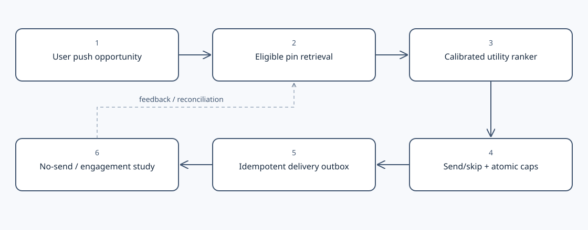

# W182. ML System Design: Notification Ranking & Ads CTR

**Priority group:** Second 100 — important

**Category:** Production ML and product design

**Study position:** 182 of 547

[Group list](../NEXT_100.md) · [All categories](../ALL_CATEGORIES.md) · [Chapter guide](../README.md)

## Question

Two adjacent prompts that share an architecture: design the ML system for Pinterest notifications (which pin to push, when, with what frequency cap) or for ads CTR prediction (rank ad candidates for an impression slot). Both want explicit feature, loss, calibration, and online-experimentation design.

### Requirements

Design one of:

Notification ranking — pick the best pin (or no pin) to surface to a user via push notification, given the user's history, the available pin pool, and a frequency-capping budget.
Ads CTR prediction — rank ad candidates for a given impression slot to maximize expected revenue (eCPM = bid x pCTR).

Address: feature engineering, model architecture, loss function, calibration, the send-or-not-send decision (notifications) or the floor-price interaction (ads), and the online experimentation strategy (A/B test design, online metric vs offline metric divergence).

### Notes

The send-or-not-send decision is the key notification-specific design point: rank candidate pins by expected user engagement; apply a frequency cap (per-user, per-day, per-channel); use a calibrated probability threshold for the send / no-send gate. Mention the cold-start problem for new users.
For ads CTR, calibration is non-optional because the downstream auction multiplies bid x pCTR. Mis-calibrated CTR distorts the auction. Isotonic regression or Platt scaling on a held-out set is the standard answer.
Two-tower retrieval for the candidate pool + a heavier ranker for the top-N is the same skeleton as the search / ranking card; focus the round on what makes notifications / ads distinct.
Online-vs-offline metric divergence is a graded sub-thread. Common causes: position bias, novelty effects, A/B-test contamination.

## Worked solution

### Choose the notification variant

Rank Pinterest pins for a push opportunity and explicitly allow no-send. Optimize incremental meaningful visits/retained engagement, with opt-out, spam complaints, fatigue and safety guardrails. Required transactional messages have a separate delivery contract. `POST /notification-opportunities` accepts user, time and channel; return selected pin and decision_id or SKIP with reason. Store Decision, candidate snapshot, model/feature versions and budget reservation; retries of the same opportunity return the same result.

Retrieve fresh eligible pins through content/two-tower ANN, followed interests and a safe fresh pool. Filter access, removed content and previously sent duplicates. Features include user topic/creator affinity, recent browsing, pin visual/text embeddings and quality, recency, local time, recent sends, recent opens and current activity. A two-tower retriever is cheap over a huge catalog; a GBDT or multi-task neural ranker uses richer interactions over hundreds. Train binary cross-entropy heads for click/meaningful session/opt-out with mature windows and masks, and compare to a content/cohort baseline for new users.

### Calibration, send gate and frequency

Calibrate held-out predictions using Platt/isotonic scaling as data permits, by important activity/cohort/channel slices. High p(open) does not prove an incremental visit, so maintain randomized no-send holdouts and estimate incremental downstream value. Rank candidates by calibrated expected utility and send only when the best candidate exceeds an interruption-cost threshold, is eligible and fits the frequency budget. A conservative cold-start user gets declared-interest pins and low frequency, not an aggressively confident behavioral prediction.

The diagram's ranker feeds a separate send/skip policy and atomic cap check. For an assumed two promotional pushes per rolling day, two racing workers must conditionally reserve against one user/channel budget before enqueueing delivery. Outbox delivery carries a unique notification_id; distinguish reserved, provider-accepted, delivered and failed states. Recheck opt-out and content safety at dispatch. Timeouts do not prove nondelivery; reconcile provider IDs before resending or releasing budget. A model outage skips noncritical pushes or uses a validated conservative fallback, preserving quiet hours.

### Experiment and contrast with ads

Offline measure log loss, calibration, NDCG on mature meaningful-engagement labels and cold-start coverage using forward-time splits. User A/B tests assess incremental meaningful sessions and long-term retention with guardrails; test send rate as part of the policy, not just ranking among sent users. Check position/exposure bias, novelty, sample-ratio mismatch and cross-device contamination. An offline click win may fail online because it changes frequency, user fatigue or candidate distribution. Keep logging candidates, selection propensity and no-send outcomes.

If choosing the ads variant instead, replace send costs/caps with targeting, advertiser budget/pacing and auction constraints. Model calibrated pCTR from observed impression/click rows, with user/ad/context features; rank expected click revenue as bid×pCTR, converting to eCPM by ×1,000 when bids are per click. Apply floor and eligibility in consistent units and auction semantics, not a separate arbitrary probability threshold. A bid $2 and pCTR 0.01 yield expected $0.02/impression or $20 eCPM. Miscalibration changes auction allocation/revenue, so held-out calibration is essential. Evaluate revenue, advertiser value and user harm in an auction-aware experiment.

Scale is absent; assuming 5,000 opportunities/s and 200 ranked pins gives one million pair scores/s. An assumed 150 ms budget reserves 30 ms retrieval, 30 ms features, 50 ms rank and 40 ms policy/delivery enqueue. Test duplicate opportunities, rolling-window boundaries, opt-out while queued and stale pin removal; monitor latency, cap violations, delivery uncertainty and mature calibration.

<!-- architecture:W182:start -->

Read the numbered path as User push opportunity → Eligible pin retrieval → Calibrated utility ranker → Send/skip + atomic caps → Idempotent delivery outbox → No-send / engagement study. The dashed return is the feedback or reconciliation path described in the solution; durable state and authorization remain authoritative when work is retried.
<!-- architecture:W182:end -->

### Runnable checks

[Batch behavior checks](../test_review_151_200.py) also validate this page's Python syntax and referenced diagrams. The architecture, capacity and metric reasoning is reviewed as a design; no production load, availability or model-quality result is claimed.

### Further study

- [F082: Design a recommendation system from candidate generation to ranking.](../09_ml_system_design.md#f082)
- [F063: Choose metrics for ranking and recommendation.](../07_evaluation_and_data.md#f063)
