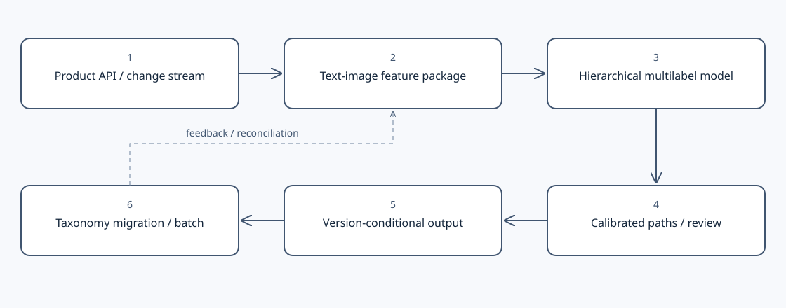

# W183. ML System Design: Product Categorization / Taxonomy

**Priority group:** Second 100 — important

**Category:** Production ML and product design

**Study position:** 183 of 547

[Group list](../NEXT_100.md) · [All categories](../ALL_CATEGORIES.md) · [Chapter guide](../README.md)

## Question

ML System Design: Product Categorization / Taxonomy

The MLE system-design round, most often a product-categorization problem over Shopify's product taxonomy (10,000+ hierarchical categories across 26+ business verticals): design real-time and streaming classification of merchant products into the taxonomy. Variants include search autocomplete and personalized product feeds.

### Requirements

Design a system to classify merchant products into Shopify's Product Taxonomy: 10,000+ categories, hierarchical, spanning 26+ business verticals.
Cover both serving modes the interviewers push on:
Real-time categorization when a user/merchant submits a single product.
Streaming categorization that detects changes across many products and re-categorizes at scale.
Address the modeling side too: it is framed as a multi-class (multi-label) classification over a hierarchy. A known wrinkle: the hierarchical tags are not mutually exclusive, so a flat multi-class assumption breaks — discuss hierarchical/multi-label handling.
Notes
This round emphasizes serving and architecture (real-time vs. batch/streaming paths, latency, throughput) while still expecting sound modeling choices — distinct from the separate ML modeling round, which is modeling-only.
Interviewer fit is inconsistent: some panels are senior/disengaged and jump straight to "how do you handle real-time vs. batch," sometimes asserting "assume no labeled data" and asking how you'd bootstrap labels. Be ready to discuss label sourcing/weak supervision.
Reported variants in this slot: search autocomplete design, and personalized product feeds. One candidate strong in personalization was still failed for "insufficient depth," so push concrete detail (candidate generation, ranking, features, evaluation), not just a block diagram.
Useful framing references candidates mention: product-taxonomy classification writeups and large-catalog categorization papers.

## Worked solution

### Hierarchical multi-label output

The required contract permits multiple compatible tags; a single flat softmax over 10,000+ categories would force mutually exclusive labels incorrectly. Return product_version, taxonomy_version, model_version and a set of category paths with calibrated per-node/leaf probabilities. A selected child implies its ancestors; probabilities for sibling tags need not sum to one when several can apply. If a merchant UI requires a primary category, derive it separately from the tag set and document that rule.

Encode product title/description, structured attributes and images, with missing-modality masks. Fuse text/image embeddings with attributes into an MLP and sigmoid label heads, possibly first routing to several of the 26+ verticals and scoring candidate subtrees. Do not force a single vertical before classification if cross-vertical labels are possible. Train masked binary cross-entropy on observed positives/verified negatives, plus hierarchical consistency constraints such as p(child)≤p(parent). Unknown labels are not negatives. Compare lexical/content baselines and text-only versus multimodal ablations.

### Label bootstrap and taxonomy changes

When labeled data exists, use adjudicated merchant assignments/corrections and gold sets, retaining taxonomy version and provenance. With no labels, start from taxonomy descriptions, content-embedding retrieval, merchant metadata and high-precision weak rules; these are suggestions with measured uncertainty, not a claimed supervised classifier. Experts label a stratified seed set across verticals and rare categories. Active learning adds uncertain/disagreement cases, while random samples estimate true prevalence/error. Train and calibrate only after these labels exist. Splits hold out future time, duplicate product families and merchants; category-text leakage from later corrections is removed.

A taxonomy release records added/deprecated/moved nodes and migration mappings. Simple renames can migrate; category splits may need reclassification or human review. Version output schemas and model/index manifests together, and retain old mappings for audit.

### Real-time and streaming share one model contract

`POST /categorize` takes product fields/version and returns paths, scores or PENDING_REVIEW. For a chosen 50 ms online target, precompute/reuse image embeddings at upload and use a compact text/fusion model; uncached media cannot silently consume unbounded time. The diagram's online path goes directly through the shared feature/model service, while change events drive a separate batching worker pool. `ProductChanged(product_id,version)` is emitted through an outbox from the product database. Streaming workers coalesce rapid edits, fetch current content, score in batches and conditionally write only when source version matches. Unique (product,version,model,taxonomy) deduplicates retries, and tombstones prevent deleted products reappearing. Historical backfills use the same contract with lower-priority capacity.

### Capacity, failure and evaluation

Throughput is unspecified. Assume 2,000 updates/s and 10,000 label scores each: 20 million output scores/s before candidate pruning. At 4 bytes each, naively persisting every score would be 80 MB/s; store selected tags/top-K plus audit summaries and retain full scores only as needed. Queue lag/backpressure isolates bulk rescoring from interactive traffic. Transient failures retry with backoff; malformed inputs go to a dead-letter/review path. Model outage returns pending or a marked older prediction, never a fabricated confident category. Database CAS prevents stale completions overwriting newer merchant edits.

Evaluate micro/macro F1, per-vertical/leaf precision-recall, hierarchical distance, path consistency, top-K recall, calibration and human-review coverage. Calibrate per-label or pooled families with enough support. Monitor taxonomy-specific drift, merchant disagreement, streaming lag, p99 and stale prediction rate. Test multi-path products, category migration, duplicate/reordered changes, no-label launch and a merchant edit racing a backfill. For autocomplete/feed variants, reuse taxonomy content features but define separate retrieval/ranking labels; classification quality alone does not measure search or recommendation success.

<!-- architecture:W183:start -->

Read the numbered path as Product API / change stream → Text-image feature package → Hierarchical multilabel model → Calibrated paths / review → Version-conditional output → Taxonomy migration / batch. The dashed return is the feedback or reconciliation path described in the solution; durable state and authorization remain authoritative when work is retried.
<!-- architecture:W183:end -->

### Runnable checks

[Batch behavior checks](../test_review_151_200.py) also validate this page's Python syntax and referenced diagrams. The architecture, capacity and metric reasoning is reviewed as a design; no production load, availability or model-quality result is claimed.

### Further study

- [F181: Predict the category of a newly listed item.](../19_product_ml_case_studies.md#f181)
