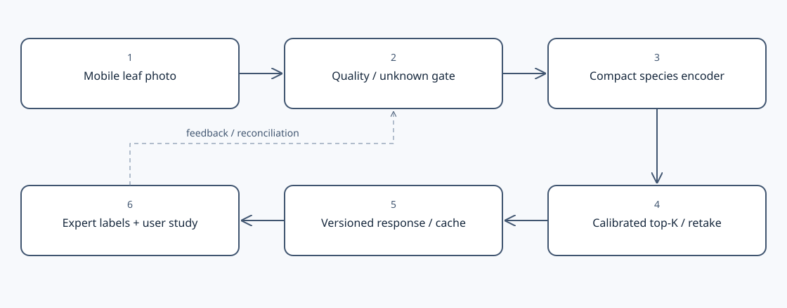

# W184. ML System Design: Recsys, Chatbot, Image Classifier

**Priority group:** Second 100 — important

**Category:** Production ML and product design

**Study position:** 184 of 547

[Group list](../NEXT_100.md) · [All categories](../ALL_CATEGORIES.md) · [Chapter guide](../README.md)

## Question

Google MLE / AI-ML L4–L5 loops include a ~60-min ML System Design round. Prompts span: (1) a real-time recommendation system for an e-commerce/social platform; (2) a mobile app that photographs a leaf and classifies it into one of K species; (3) a chatbot grounded in mixed structured + unstructured data; (4) short-video duplicate detection at billions scale. Interviewers probe pipeline structure, feature engineering, training/serving split, cold start, A/B testing, and latency vs accuracy trade-offs. Design one and cover the key axes.

## Worked solution

### Choose one design: leaf-species identification

Design the mobile leaf-photo classifier rather than answering four different prompts incompletely. Assume K known species, one leaf/plant per image, a top-three result with calibrated probabilities and an UNKNOWN/RETAKE option for unsupported or unreadable photos. Clarify geography, poisonous-species consequences, offline use and target devices; this is identification assistance, not a safe-to-eat decision. Optimize verified species accuracy at chosen coverage, with dangerous-confusion rate, latency, battery and abstention quality as guardrails.

The app uploads a resized photo or runs an on-device quality gate; the response contains species IDs, taxonomy/model version, confidence and evidence-quality warnings. Image records retain consent/license, species, annotator confidence, capture time/location if permitted, plant/photographer identity and image digest. Expert/botanical labels form a gold set; user confirmations alone are noisy. Detect duplicate images and split by plant, photographer, geography and time, so near-identical shots do not inflate test accuracy. Cover seasons, leaf damage, lighting, backgrounds and class imbalance. Unknown species and non-leaf images need dedicated evaluation, not just K-way test data.

### Model and training/serving split

Start with a pretrained compact CNN/ViT encoder and a K-way head, trained with cross-entropy on verified labels and realistic crop/color/blur augmentations. Compare a nearest-embedding baseline and a quantized model at matched quality/latency. Train a quality/leaf-presence head and an out-of-distribution/abstention gate; maximum softmax alone is not a reliable unknown detector. Calibrate on held-out data, including rare species and lookalikes. Optional user region can define a transparent prior, but hard exclusion risks missing introduced plants and must be tested.

The diagram's path is mobile capture → quality/preprocess → versioned classifier → calibrated top-K/retake. Batch training produces signed model and label-map artifacts; online inference uses the same resize/normalization package. Cache by image digest plus model version, enforce image size/decode limits and strip unnecessary location metadata. If offline use matters, ship a compact on-device model; a larger server model can offer an explicit second pass with network consent. Cold species require labeled examples and a taxonomy/model release, not collaborative filtering; unknown users need no behavior history.

### Latency, evidence and operations

Assume a 300 ms server-side p95 target excluding upload on slow mobile links: 30 ms validation/decode, 100 ms encoder, 20 ms calibration/output and 150 ms queuing/network headroom. Report end-to-end upload separately. At an assumed 1,000 QPS and 0.1 GPU-seconds/image, at least 100 fully utilized GPU equivalents are required without batching gains, plus headroom; benchmark real hardware instead of assuming this rate. On timeout return retry/queued state, not a stale answer for a different image. Idempotent request IDs deduplicate uploads; versioned hashes prevent old results overriding a replacement photo.

Offline measure macro/per-species F1, top-1/top-3 accuracy, calibration, risk-coverage curves and dangerous lookalike confusion. Online randomize users/devices persistently between validated models and measure expert-audited identification success, retakes, abandonment and p95/battery guardrails; self-reported confirmation is biased. Canary releases, monitor image-quality/domain drift, unknown rates and geography slices, and keep rollback label-map compatibility. Test corrupt images, multiple leaves, rare species, offline fallback and model-update/cache mismatch. This explicitly chosen design covers the prompt's feature, training/serving, cold-start, experimentation and latency axes.

<!-- architecture:W184:start -->

Read the numbered path as Mobile leaf photo → Quality / unknown gate → Compact species encoder → Calibrated top-K / retake → Versioned response / cache → Expert labels + user study. The dashed return is the feedback or reconciliation path described in the solution; durable state and authorization remain authoritative when work is retried.
<!-- architecture:W184:end -->

### Runnable checks

[Batch behavior checks](../test_review_151_200.py) also validate this page's Python syntax and referenced diagrams. The architecture, capacity and metric reasoning is reviewed as a design; no production load, availability or model-quality result is claimed.

### Further study

- [F082: Design a recommendation system from candidate generation to ranking.](../09_ml_system_design.md#f082)
- [F071: Design a minimal retrieval-augmented question-answering system.](../08_rag_and_agents.md#f071)
- [F056: Fit a baseline on messy tabular data without leakage.](../06_classical_ml.md#f056)
