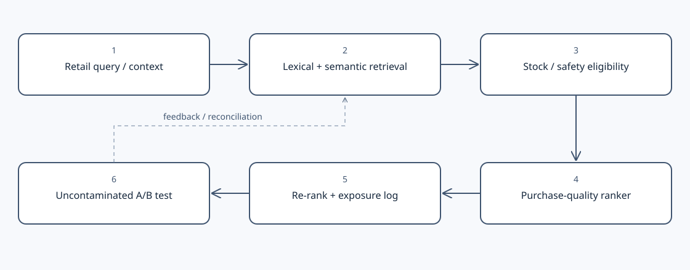

# W185. ML System Design: Search, Ranking, Experimentation

**Priority group:** Second 100 — important

**Category:** Production ML and product design

**Study position:** 185 of 547

[Group list](../NEXT_100.md) · [All categories](../ALL_CATEGORIES.md) · [Chapter guide](../README.md)

## Question

Applied Scientist full-loop ML system design on search / ranking / experimentation. Pick a domain (often 'search ranking' or 'image generation for brand ads') and walk through the ML stack: retrieval, candidate generation, ranking, re-ranking, business-rule overlays, and online evaluation. Discuss offline metrics (NDCG, MRR), online metrics (CTR, conversion, brand-safety), and how to design an uncontaminated A/B test.

Recent prompts: 'How would you evaluate generation quality for image or text?' and 'If the image is for brand ads, how do you make sure the brand name is right in the image?'

## Worked solution

### Concrete domain: retail search ranking

Optimize completed satisfactory purchases per query, with relevance, returns, brand safety, price transparency and latency guardrails. `POST /search` accepts query, user context and filters; return eligible products, positions, exposure_id and model/index versions. Query understanding extracts brand/category/attributes and corrects spelling while preserving explicit constraints. Union lexical retrieval for exact names/SKUs, semantic ANN for intent, and category candidates; hard-filter stock, shipping eligibility, policy and explicit user filters before ranking.

Use query-product lexical/semantic match, price, availability, user purchase/intent features, product quality and context. A GBDT learning-to-rank baseline scores hundreds; a neural multi-task ranker can predict click, purchase and return-adjusted value. Re-rank for near-duplicate suppression, diversity and business rules with documented sponsored placement. The diagram's retrieval broadens recall, rank orders by relevance/value and re-ranking enforces list-level rules. Do not let revenue weights bypass brand-safety or availability constraints.

### Labels and experiments are part of the stack

Log all displayed impressions with position, retrieval source, feature timestamp/version, assignment and propensities where randomized. Join clicks/cart/purchases and mature returns using stable keys; unshown products are unlabeled rather than observed negatives. Build point-in-time features and forward-time/duplicate-family splits. Evaluate recall@candidate count, graded NDCG@10 for usefulness, MRR for navigational queries, calibration and per-query-type brand-safety/filter violations. A higher CTR can reflect clickbait rather than more satisfied purchases.

For an uncontaminated A/B test, randomize persistently by user/account across devices where possible, assign before candidate generation, and keep feature/index/eligibility logging compatible. Predeclare primary purchase/satisfaction metric, minimum effect, duration, guardrails and stopping rule; check sample-ratio mismatch and exclude internal bots consistently. Avoid training treatment and control on mixed treatment-generated feedback during an initial test unless this interference is intentionally modeled. Marketplace inventory and seller response can spill across users, so use cluster/geo or switchback designs for material supply effects. Novelty, position bias and delayed returns explain offline/online divergence.

Assume 10,000 QPS, 300 ranked products and a 150 ms budget: three million pair scores/s; allocate 30 ms retrieval, 30 ms features, 50 ms ranking and 40 ms policy/network. Use cached item embeddings, batch lookups and per-region indexes; stale stock is rechecked. On semantic/ranker failure fall back to lexical/relevance rules. Outbox updates and monotonic product versions handle retries/deletions; model/index rollout uses canaries and instant compatible rollback.

### Generation-quality follow-up

For generated text/images, create a blinded task-specific gold set and expert rubric for instruction adherence, factual/visual correctness, usefulness, safety and brand fidelity. Use pairwise human preferences with inter-rater agreement and confidence intervals; automated scores/model judges are proxies validated against humans and protected against prompt manipulation. Deduplicate evaluation prompts from training and segment difficult languages/brands. Online test downstream qualified conversions with complaint and safety guardrails, not just aesthetic ratings.

If an advertisement must show the exact brand name, generate the scene separately and composite an approved vector/raster wordmark or typeset text with known fonts, permissions and layout constraints. OCR/spelling checks and logo/template validation are gates, with human approval for high-risk output. A generative model merely prompted to spell correctly cannot guarantee exact text. Cache approved assets by input/spec/model/version and fail closed on failed brand validation. This turns brand-name correctness into a verifiable rendering contract rather than an unsupported model claim.

<!-- architecture:W185:start -->

Read the numbered path as Retail query / context → Lexical + semantic retrieval → Stock / safety eligibility → Purchase-quality ranker → Re-rank + exposure log → Uncontaminated A/B test. The dashed return is the feedback or reconciliation path described in the solution; durable state and authorization remain authoritative when work is retried.
<!-- architecture:W185:end -->

### Runnable checks

[Batch behavior checks](../test_review_151_200.py) also validate this page's Python syntax and referenced diagrams. The architecture, capacity and metric reasoning is reviewed as a design; no production load, availability or model-quality result is claimed.

### Further study

- [F082: Design a recommendation system from candidate generation to ranking.](../09_ml_system_design.md#f082)
- [F063: Choose metrics for ranking and recommendation.](../07_evaluation_and_data.md#f063)
