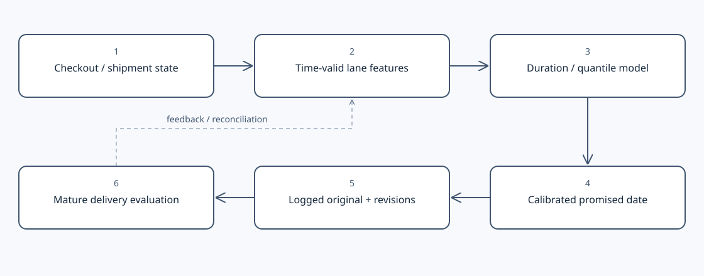

# W186. Model Delivery-Time Prediction for Online Orders

**Priority group:** Second 100 — important

**Category:** Production ML and product design

**Study position:** 186 of 547

[Group list](../NEXT_100.md) · [All categories](../ALL_CATEGORIES.md) · [Chapter guide](../README.md)

## Question

An online retail platform wants to tell buyers when an order will arrive. Design the machine-learning model that predicts delivery time for each order. This is a modeling question, not a serving-architecture question.

What to cover

Answer each part with concrete details:
1. Problem framing. Is this classification, regression or ranking? What is the prediction unit, and how would you quote a promised date to the buyer?
2. Label. Define exactly what the target is and how it is obtained. Address orders still in transit and label noise.
3. Data and features. Name the data sources and concrete features, grouped by entity, and call out leakage and freshness risks.
4. Algorithm. Propose a baseline and a stronger alternative, with the trade-offs of each.
5. Offline evaluation. Choose metrics tied to the business goal, define the train/validation/test split, and say how you would segment the error.
6. Deployment and monitoring. Describe the online experiment, the success metric and guardrails, what you monitor after launch, and how you iterate.

State your assumptions explicitly where the problem is underspecified.

### Constraints

Orders arrive at high volume and a prediction is needed at checkout and again after shipment.
Predictions feed a customer-facing promise, so late deliveries cost more than early ones.

## Worked solution

### Regression with an asymmetric customer promise

Assume the prediction unit is a shipment, because one order may split across packages; quote an order date as the latest promised shipment date, explaining partial delivery. At checkout predict duration from order acceptance to customer delivery. After shipment predict remaining duration from the current timestamp, using newly available carrier events. The target is a duration distribution or selected quantiles, not ranking or a coarse on-time class alone.

Let y be realized delivery duration and a the quoted duration. If late cost is c_l(y-a)+ and early/overconservative cost is c_e(a-y)+, minimizing expected loss gives F_Y(a)=c_l/(c_l+c_e). With explicitly assumed costs c_l=9 and c_e=1, quote a calibrated p90 date. This trades lateness against unnecessarily pessimistic promises; it does not justify arbitrarily adding days. Customer-facing dates apply destination timezone/calendar/cutoffs and retain the underlying timestamp distribution.

### Labels, censoring and features

Use verified delivered timestamp minus the appropriate prediction timestamp, with event corrections and timestamp provenance. Still-in-transit shipments are right-censored: omit them only for a clearly mature-cohort baseline, or fit a survival/distribution model with censoring likelihood. A shipment delivered before horizon contributes density f(y); one still traveling at c contributes survival 1-F(c). Lost/canceled/returned-to-sender shipments need explicit competing outcomes, not fake delivery dates. Audit carrier scans, missing delivery confirmations and clock/timezone errors.

Order features: item size/weight, split shipment, order time/cutoff, fulfillment choice and inventory known at checkout. Warehouse/seller features: current backlog, handling-time distribution, processing calendar and reliability. Route/destination: origin/destination region, distance, customs, service level, holidays and weather forecast available then. Carrier features: lane transit history and operational incidents. Post-shipment features add actual dispatch, latest scan/location, time since scan and route progress. Actual dispatch or future traffic cannot appear in the checkout model; train separate contracts or explicitly masked stages.

### Baseline, stronger model and validation

A lane×carrier×service×weekday empirical median/p90 with pooled backoff is interpretable and strong. Quantile GBDTs capture nonlinear interactions and missingness at low cost; a survival/distributional model handles censoring and supports coherent updated intervals but adds complexity/calibration work. Train pinball loss for selected quantiles, enforce noncrossing quantiles and calibrate held-out coverage. Do not multiply independent stage quantiles and call the result an order quantile without checking dependence.

Use rolling-origin train/validation/test by order time with mature outcomes and no future aggregate leakage. Test holiday peaks, new lanes/warehouses and carriers separately. Measure MAE for typical accuracy, pinball loss for promise quantiles, late-delivery rate, mean days late, excess quoted days and interval coverage/width. Segment by lane, service, basket/seller, region and censoring age. MAPE is unstable for near-zero durations and is supplementary at best.

### Launch and iteration

Shadow the model, then randomize users/orders consistently for promise display with a prespecified primary outcome such as conversion with promised-date adherence. Guard cancellations, support contacts, late rate and overly pessimistic promises; carrier/warehouse capacity interference may require cluster/switchback analysis. Store prediction timestamp, feature/model version and quoted date for honest backtesting. Monitor input freshness/missing carrier scans, drift, p90 coverage after maturity and cost-weighted error; early proxy scan delays cannot replace delivered outcomes.

Example: checkout p50 is four days and calibrated p90 six days; a six-day promise may fit the assumed cost ratio. After a late departure scan, the remaining p90 can move to five more days; log the revision rather than rewriting the original promise. Failed feature updates use a conservative validated lane prior and an explicit freshness flag. This is chiefly a modeling design: capacity/architecture choices matter only insofar as they keep the two prediction-time contracts intact.

<!-- architecture:W186:start -->

Read the numbered path as Checkout / shipment state → Time-valid lane features → Duration / quantile model → Calibrated promised date → Logged original + revisions → Mature delivery evaluation. The dashed return is the feedback or reconciliation path described in the solution; durable state and authorization remain authoritative when work is retried.
<!-- architecture:W186:end -->

### Runnable checks

[Batch behavior checks](../test_review_151_200.py) also validate this page's Python syntax and referenced diagrams. The architecture, capacity and metric reasoning is reviewed as a design; no production load, availability or model-quality result is claimed.

### Further study

- [F056: Fit a baseline on messy tabular data without leakage.](../06_classical_ml.md#f056)
- [F058: How should you split data for reliable model selection?](../06_classical_ml.md#f058)
- [F065: Distinguish data drift, concept drift and label delay.](../07_evaluation_and_data.md#f065)
