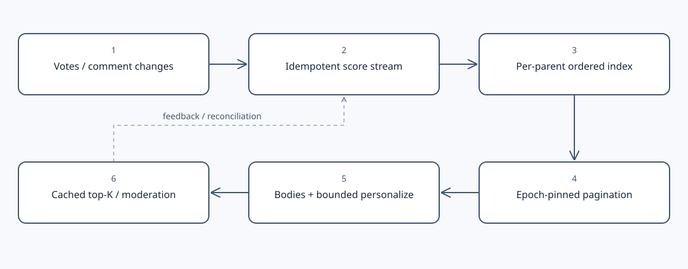

# W187. Post-Comment Ranking System

**Priority group:** Second 100 — important

**Category:** Production ML and product design

**Study position:** 187 of 547

[Group list](../NEXT_100.md) · [All categories](../ALL_CATEGORIES.md) · [Chapter guide](../README.md)

## Question

Design a ranking system for a post's discussion tree (and a subreddit post feed): when a user opens a post with a large thread, quickly surface the most relevant, highest-quality comments without loading and re-sorting the whole tree.

### Requirements

Functional: rank top comments per post (personalized + stable global order), rank posts in a subreddit feed, paginate, refresh scores as votes/comments arrive.
Non-functional: P99 &lt; 150ms; freshness within seconds; consistent read stream during pagination; graceful degradation.
Design anchors

Blended pluggable score (Wilson score interval / hot formula, recency decay, reputation, personalization, moderation); denormalized comment_score table keyed by (post_id, score DESC); event-driven recompute on vote/comment change + cached per-post top-K; cursor pagination over (score DESC, comment_id); rank within a parent (per-subtree top-K) rather than a global flat sort; Wilson interval resists brigading.

## Worked solution

### Score within the tree, then store ordered results

Store Comment(id,post_id,parent_id,author,created_at,body_version,moderation_state), Vote(user,comment,value,version) and CommentScore(post,parent,comment,rank_epoch,global_score,features_version). A unique user/comment vote prevents duplicate votes; vote edits emit idempotent versioned events. Rank siblings within each parent and cache top children for popular parents. A global flat sort destroys reply context. A subreddit PostScore table uses the same approach keyed by subreddit rather than parent.

A pluggable global score combines a conservative quality estimate, recency, author reputation and moderation. For binary helpful/unhelpful votes, Wilson's lower bound is

$$W=\frac{\hat p+z^2/(2n)-z\sqrt{\hat p(1-\hat p)/n+z^2/(4n^2)}}{1+z^2/n},$$

with a stated z, e.g. assumed 1.96, and a prior rule for n=0. Blend W with time decay and bounded personalization; logged voting propensity matters if interpreting votes as quality. Wilson penalizes uncertainty at small n; it does **not** prevent coordinated brigading or sybil voters. Add rate limits, reputation, graph/anomaly signals and moderation independently. Raw score terms need explicit normalization/weights, tested against quality judgments and satisfaction.

### Events, indexes and stable pagination

The diagram's event stream recomputes affected comment/post scores in bounded batches and updates a denormalized ordered index (post_id,parent_id,rank_epoch,score DESC,comment_id). Update high-traffic parents in microbatches and cache their top-K lists. Event consumers track source versions so delayed votes cannot revert newer aggregates. A materialized score/read model can lag seconds while the canonical vote records remain authoritative.

`GET /posts/{id}/comments?parent=&cursor=` returns a ranked sibling page and continuation. A cursor with only (score,id) is insufficient when scores change between pages: rows can jump past the cursor. Pin the first page to rank_epoch/snapshot_id, user/model version and filters; paginate within that immutable order using (score DESC,id) and retain it for a short TTL. If the snapshot expires, explicitly restart. New-score refresh creates a new snapshot. Read-time moderation/access checks can remove items even from old snapshots; fetch extra candidates to fill gaps. Expand child subtrees separately to bound work.

### Latency, scale and race example

P99<150 ms can use an illustrative 15 ms auth/cache, 30 ms ordered-index lookup, 35 ms batch body/features, 30 ms bounded personalization and 40 ms network/headroom. Personalization only re-ranks a stored bounded candidate pool; full arbitrary personalization over millions of comments conflicts with this target. A stable global fallback remains available. For assumed 20,000 reads/s, top-K caches reduce hot-post database load; 10,000 vote events/s requires keyed aggregation, not a full tree sort for each vote. Large threads distribute by parent/subtree while preserving post lookup metadata.

Example: page one pins epoch 42. A comment gaining votes appears higher in epoch 43, but page two continues epoch 42 and therefore does not repeat/skip it due to score movement. A new deleted comment remains hidden through a tombstone even in epoch 42. Cache eviction falls back to the indexed snapshot; scorer failure serves the last valid global order and reports freshness. Monitor score lag, p99, duplicate/skip rates, parent coverage and moderation propagation. Test equal-score tie-breaks, vote deduplication, score movement between pages, snapshot expiry and a million-comment post. User A/B tests evaluate helpful replies found, meaningful participation and complaint/moderation rates, not votes alone.

<!-- architecture:W187:start -->

Read the numbered path as Votes / comment changes → Idempotent score stream → Per-parent ordered index → Epoch-pinned pagination → Bodies + bounded personalize → Cached top-K / moderation. The dashed return is the feedback or reconciliation path described in the solution; durable state and authorization remain authoritative when work is retried.
<!-- architecture:W187:end -->

### Runnable checks

[Batch behavior checks](../test_review_151_200.py) also validate this page's Python syntax and referenced diagrams. The architecture, capacity and metric reasoning is reviewed as a design; no production load, availability or model-quality result is claimed.

### Further study

- [F082: Design a recommendation system from candidate generation to ranking.](../09_ml_system_design.md#f082)
- [F063: Choose metrics for ranking and recommendation.](../07_evaluation_and_data.md#f063)
