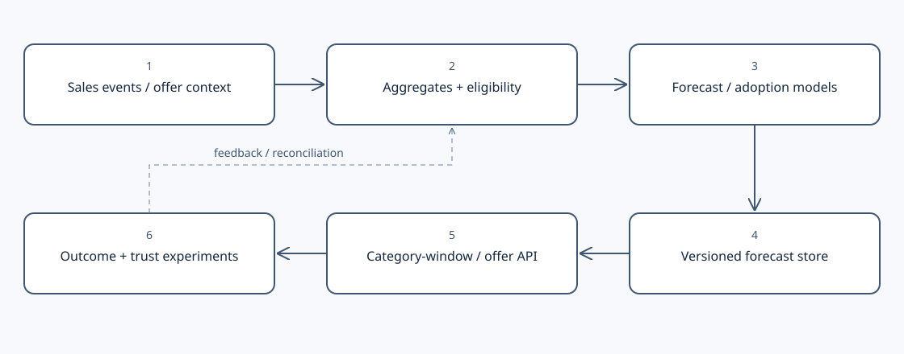

# W188. Premium Product Recommendation System

**Priority group:** Second 100 — important

**Category:** Production ML and product design

**Study position:** 188 of 547

[Group list](../NEXT_100.md) · [All categories](../ALL_CATEGORIES.md) · [Chapter guide](../README.md)

## Question

Design a recommendation or prediction system for Intuit products. One variant recommends premium-product content or offers; a newer staff+ variant predicts the top-selling items in a user-selected category and future time window, with explicit discussion of LLM/agent design, latency estimates, data flow, and caching.

Functional requirements
Recommend premium-product content, offers, or next-best actions to eligible users.
Personalize using customer and product-context signals.
Support feedback loops (impressions, clicks, conversions, dismissals, downstream outcomes).
Keep recommendations explainable for product and compliance review.
Allow experiments measured against conversion and customer-trust metrics.
Staff+ forecasting variant
User picks a product category and a future time window.
Predict the best-selling items in that category for the selected period.
Explain the data flow when items sell (sales events -&gt; features/aggregates).
Provide per-component latency estimates and an end-to-end latency target.
Include a caching strategy for repeated category/window queries and expensive model outputs.
Decide whether a traditional ML/service architecture or an LLM/agent architecture is appropriate.
Notes

A strong answer starts with product objective and measurement, then decomposes the ML system: data sources, feature pipelines, candidate generation or forecasting, ranking, serving, experimentation, monitoring, and human/product guardrails. GenAI is one possible component inside a measurable recommendation product, not the whole system; if the estimated path exceeds interactive latency, move expensive computation offline and cache hot results.

## Worked solution

### Two product variants need different targets

For premium recommendations, assume the objective is incremental useful adoption/retention, with conversion as a near-term metric and complaints, cancellations, affordability and trust as guardrails. Eligibility, entitlements and compliance are hard filters. Features include consented customer needs, product usage, current plan, context and offer attributes; do not infer financial distress as a reason to pressure upgrades. Retrieve eligible offers/content and rank calibrated adoption/value predictions, then diversify/cap contact. Reasons come from supported product facts, e.g. “this feature addresses the workflow you selected,” and are logged for review. A randomized offer/no-offer test estimates incremental value; high propensity to buy is not the same as uplift.

For the staff forecasting variant, define best-selling as expected net units sold during [start,end) in a category, not clicks or gross dollars; if revenue is wanted, model price×units explicitly. Output ranked items, expected units, uncertainty and as_of/model versions. These outcomes are future forecasts, not personalized offer recommendations.

### Sales-to-forecast data flow

Deduplicate SalesEvent(event_id,item,category,quantity,price,event_time) and negative return/cancel adjustments, then maintain event-time hourly/daily aggregates with late-event corrections. Durable sales and item/version records feed a stream/warehouse; features include lagged sales, rolling averages, seasonality, price/promotion, stock, category trend and new-item content. Forecast demand separately from observed sales when stockouts censor demand, or clearly state the target is sales conditional on planned stock. Rolling-origin splits train/evaluate without seeing future promotions unless those plans are actually available at forecast time.

Start with seasonal naive/cohort baselines, then a global count/quantile GBDT or temporal forecasting model shared across items. Pool sparse/new items by content/category; report uncertainty and insufficient-history flags. Evaluate WAPE/MAE, count deviance, quantile coverage and ranking NDCG/top-K recall for future best sellers, segmented by horizon/category/new items. MAPE breaks at zero sales. Compare against mature outcomes after the requested window closes; no offline metric proves that showing forecasts improves business decisions.

### Serving, cache and architectural choice

`GET /forecasts?category=&start=&end=&metric=` reads precomputed item-day predictions and aggregates the requested interval; constrain supported horizon/window granularity. The diagram's forecast branch is sales → aggregates/features → batch model → versioned forecast store → category/window top-K cache. A separate offer branch uses user eligibility/features and ranker. Store Forecast(item,date,as_of,model_version,mean,quantiles) and publish complete generations atomically; incomplete jobs leave the old generation available with freshness displayed.

An illustrative 200 ms interactive target is 10 ms auth/validation, 5 ms cache, 40 ms forecast-store/aggregation, 25 ms ranking/explanation lookup and 120 ms network/headroom. Cache keys include category, interval, metric, permissions, inventory/forecast generation; version keys avoid stale invalidation races. Popular windows precompute top lists, and late sales corrections trigger a new forecast generation rather than silently mutating an old as_of result. Assuming one million items×90 forecast days×4 bytes, means alone take 360 MB per generation, before keys/quantiles/replicas; size retention accordingly.

A traditional numerical service is the primary forecaster. An LLM may parse “best sellers next month” into validated parameters or explain retrieved numbers, but cannot invent sales predictions or bypass access. If an agent calls multiple tools, bound fanout/time and cache by data/spec/model versions; expensive generated explanations run offline or asynchronously. On forecast failure serve the last complete result with its timestamp or a seasonal baseline, never call stale numbers current. Test duplicate sales, late returns, stockout periods, repeated cached queries and a category permission change. A/B-test forecast-assisted workflows or premium offers separately, with trust guardrails and audit logs.

<!-- architecture:W188:start -->

Read the numbered path as Sales events / offer context → Aggregates + eligibility → Forecast / adoption models → Versioned forecast store → Category-window / offer API → Outcome + trust experiments. The dashed return is the feedback or reconciliation path described in the solution; durable state and authorization remain authoritative when work is retried.
<!-- architecture:W188:end -->

### Runnable checks

[Batch behavior checks](../test_review_151_200.py) also validate this page's Python syntax and referenced diagrams. The architecture, capacity and metric reasoning is reviewed as a design; no production load, availability or model-quality result is claimed.

### Further study

- [F082: Design a recommendation system from candidate generation to ranking.](../09_ml_system_design.md#f082)
- [F063: Choose metrics for ranking and recommendation.](../07_evaluation_and_data.md#f063)
