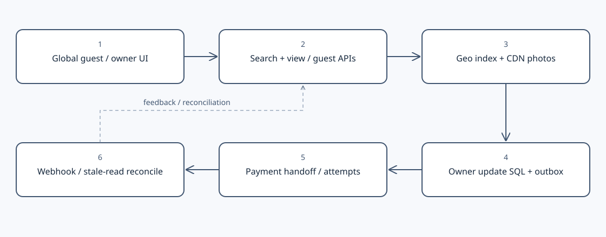

# W189. Property Rental Search System

**Priority group:** Second 100 — important

**Category:** Production ML and product design

**Study position:** 189 of 547

[Group list](../NEXT_100.md) · [All categories](../ALL_CATEGORIES.md) · [Chapter guide](../README.md)

## Question

Redesign a property-rental website for global customers on cloud infrastructure. The prompt names payment, view, guest, search, and update services, with emphasis on fast, secure search and property browsing.

### Requirements

Functional requirements:
Display property details including photos, location, and rent details.
Let international guests search across properties quickly and securely.
Support online payments.
Maintain guest state such as favorites and recently checked records.
Support property updates from the owner / dealer workflow.
Scale / constraints:
Global users need low-latency reads.
Photos and property metadata have different storage and caching needs.
Search should remain responsive as listings grow.
Design decisions to discuss:
split of payment, view, guest, search, and update services
search index freshness vs write complexity
CDN / object storage for photos
authentication and secure payment handoff
observability for failed searches, payment failures, and stale listings
Notes
Interviewer interest can center on search. Prepare filtering by location, rent, availability, and favorites, plus indexing and cache invalidation after listing updates.
Treat payments as a separate service boundary with idempotent payment attempts and clear failure states.
Do not leave a generic box named "process" in the workflow; replace it with concrete read, search, guest-state, update, and payment flows.

## Worked solution

### Concrete service boundaries

The view service returns property details; search handles discovery; guest service owns favorites/recent history; update service validates owner/dealer mutations; payment service owns payment attempts and provider interaction. They can begin as modules sharing a database, but ownership and transactional boundaries remain explicit. Store Property(id,owner,location,capacity,rent,currency,availability,version), Photo(property,digest,object_key,order), Favorite(guest,property), RecentView(guest,property,last_seen), PaymentAttempt(id,booking_or_invoice,key,amount,currency,state,provider_id), and audit records. Clarify whether availability is long-term listing status or date inventory; assume date-range rentals if dates are requested, and never imply search alone reserves them.

`GET /properties/{id}` returns metadata and CDN photo URLs; `POST /search` takes location, rent range/currency, availability, guests and filters; `PUT/DELETE /guests/me/favorites/{property}` is idempotent. `PATCH /properties/{id}` requires owner/dealer authorization and If-Match version. `POST /payments` takes an idempotency key and a server-priced invoice reference, returning pending/succeeded/failed/requires_action. Never accept a client-supplied price as authority.

### Fast search and updates

The diagram's view/photo read path uses regional caches and a CDN over object storage; the search path uses a geo/text/filter index, and the guest path joins user-specific state after public candidate retrieval. Index location/geo cells, rent normalized for filtering with a stated FX timestamp, availability and listing attributes. Exact radius and requested date-range checks follow coarse index retrieval. Favorites-only search first obtains permitted favorite IDs, then intersects indexed candidates; don't cache one guest's favorites in a shared public response.

Owner changes commit property version and outbox in one transaction. Index/caches consume changes idempotently and reject older versions; deleted/unpublished properties get tombstones. Search may lag seconds, but detail and booking/payment revalidate authoritative status, current price/currency and availability. A read-your-write owner view can query the database while the index catches up. Cache immutable photo URLs by content digest; a photo replacement updates only metadata pointers. Purge/restrict unsafe/private media as necessary rather than assuming a long CDN TTL is always acceptable.

### Secure payment and global reliability

Use authenticated sessions, server-side RBAC, input validation, rate limits and scoped signed upload URLs; validate uploaded files before publication. Photos are separate from transactional metadata. Payment uses a hosted/tokenized provider handoff, signed verified webhooks and a state machine: CREATED→PENDING→SUCCEEDED/FAILED, with refund states separate. Unique idempotency keys and provider event IDs prevent duplicate charges/webhook application. Timeout leaves PENDING for reconciliation, not “failed, charge again.” A booking hold, if required, is an authoritative transaction with expiry and no-overlap constraints; a saga compensates a failed charge/expired hold. Never store raw card data in property services.

Scale is unspecified. Assume 20 million listings, 10 photos/listing at 200 KB: 40 TB photo storage before replicas; CDN hit rate dominates origin bandwidth. At assumed 10,000 search QPS and 100 IDs/page, avoid one database round trip per ID; shard indexes by geography and bulk hydrate/cache details. An illustrative 250 ms read budget reserves 70 ms index, 40 ms hydration, 20 ms guest-state join and 120 ms network/headroom. Regional read replicas/caches serve global users while property/payment writes have a clear home authority. On search outage offer cached results with freshness and rechecks; payment uncertainty remains pending. Monitor no-result/error rates, p99 by region, index lag, stale listing complaints, payment success/latency and webhook reconciliation age. Test update/index reordering, favorite races, concurrent booking, duplicate payment request and delayed provider success after a client timeout.

<!-- architecture:W189:start -->

Read the numbered path as Global guest / owner UI → Search + view / guest APIs → Geo index + CDN photos → Owner update SQL + outbox → Payment handoff / attempts → Webhook / stale-read reconcile. The dashed return is the feedback or reconciliation path described in the solution; durable state and authorization remain authoritative when work is retried.
<!-- architecture:W189:end -->

### Runnable checks

[Batch behavior checks](../test_review_151_200.py) also validate this page's Python syntax and referenced diagrams. The architecture, capacity and metric reasoning is reviewed as a design; no production load, availability or model-quality result is claimed.

### Further study

- [F082: Design a recommendation system from candidate generation to ranking.](../09_ml_system_design.md#f082)
- [F063: Choose metrics for ranking and recommendation.](../07_evaluation_and_data.md#f063)
