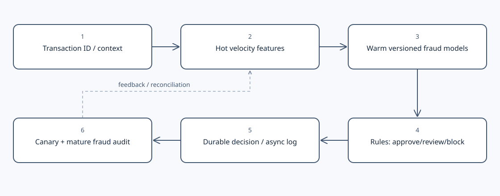

# W190. Real-Time Fraud Detection System

**Priority group:** Second 100 — important

**Category:** Production ML and product design

**Study position:** 190 of 547

[Group list](../NEXT_100.md) · [All categories](../ALL_CATEGORIES.md) · [Chapter guide](../README.md)

## Question

Real-Time Fraud Detection System

Design a real-time fraud evaluation system for millions of daily transactions, 10,000+ requests per second, 50 ms decision latency, and zero-downtime ML model updates. Black Friday-style bursts and transaction success rate are explicit follow-ups.

### Requirements

Design a service that evaluates every transaction in real time and returns one of:

Approve.
Flag for review.
Block.

### Constraints

Millions of transactions per day.
10,000+ requests per second.
50 ms latency budget for the decision path.
ML model updates must happen without downtime.
Promotional spikes such as Black Friday must preserve both throughput and transaction success rate.

Functional components:

Synchronous scoring API.
Feature lookup / feature computation.
Model inference service.
Rules / threshold layer for hard blocks and overrides.
Async logging and audit trail.
Model registry and rollout system.
Notes

A strong design keeps the critical path short:

client -&gt; API gateway -&gt; fraud scorer -&gt; feature cache -&gt; model server -&gt; decision
|-&gt; async event log / monitoring

Key design decisions:

Precompute hot features and store them in a low-latency feature cache; avoid joining large history in the 50 ms path.
Use model versioning with canary / shadow rollout. Keep old and new model versions loaded so rollback is instant.
Separate hard business rules from model score so compliance and risk teams can override safely.
Degrade gracefully under spikes: feature fallback, lower-cost model, queue only non-critical enrichment, fail-open or fail-review depending on risk policy.
Monitor p50 / p95 / p99 latency, approval rate, block rate, false-positive review rate, model drift, and feature freshness.

The trade-off is accuracy vs latency. A deep model with online feature joins may improve recall but break the 50 ms SLA; a two-stage design can use a fast model synchronously and a heavier async model for review routing.

## Worked solution

### Short critical path and throughput

`POST /fraud/evaluate` accepts transaction_id, amount/currency and authenticated account/device/payment context, returning APPROVE, REVIEW or BLOCK plus decision_id and policy/model versions. The 10,000+ RPS target is peak throughput; 10,000 sustained for a day is 864 million requests, much larger than “millions daily,” so distinguish peak from mean. Assume a fivefold Black Friday peak, 50,000 RPS, for a concrete capacity plan. At an assumed 20 ms end-to-end average service time, about 1,000 requests are in flight at that peak before headroom; use measured latency/utilization to size replicas.

The diagram's synchronous path is gateway → fraud scorer → parallel feature cache → in-process or nearby model → rules/decision. A proposed 50 ms budget is 5 ms gateway/auth, 10 ms parallel features, 10 ms inference, 5 ms rules/durable decision and 20 ms network/queue headroom. Specify whether this is p99; assume it is the strict target and measure each stage under peak. No warehouse join, remote LLM or heavy enrichment belongs here. Synchronous durable decision recording may use a low-latency replicated store/outbox; bulk audit analytics remains async.

### Features, policy and immutable decisions

Stream deduplicated events into keyed windows for transaction/device/account velocity, spending deviation, merchant history and known-risk signals. Cache aggregates and timestamps; compute only simple request-local features online. Training reconstructs point-in-time values and uses mature chargeback/investigation labels with forward splits; declined transactions have selective missing outcomes. A calibrated GBDT/small neural model plus a documented rules layer separates hard requirements from risk scores. Thresholds balance fraud dollars, genuine-payment acceptance and limited review capacity.

Store Decision(transaction_id,request_hash,action,score,feature_versions,model_version,rule_version,time) under a unique key. A retry returns that result and conflicting payload is rejected. Scoring does not capture funds: payment processing has its own idempotency/state machine. Velocity counters must deduplicate transaction events so a retry is not an extra attempted purchase. Publish an outbox to audit/review with idempotent consumers; reviewers claim once and overrides are appended, not silent edits to the historical decision.

### Zero-downtime updates and burst behavior

Register signed model artifacts with feature schema and calibration version. Load old/new models simultaneously, warm them, shadow on mirrored inputs, then canary by stable account/transaction assignment and monitor latency plus mature quality. Atomically move the routing pointer and retain the old compatible feature/model package for rollback. Schema changes need backward compatibility or dual feature production; reverting weights alone is insufficient.

Reserve/scale capacity before promotions, batch hot-feature reads, isolate review/enrichment from synchronous scoring and use bounded queues with admission control. On feature timeout use validated stale/missing-feature paths and a cheaper model. For low-risk known customers a documented fallback may approve; high-risk cases may review/block. A universal fail-open increases fraud and a universal fail-closed destroys transaction success. Report fraud-service availability separately from legitimate payment approval, checkout conversion and downstream payment success, which depend on more services. Bound retries with jitter and transaction IDs to prevent a retry storm.

At 50,000 RPS and assumed 2 KB audit record, log ingress is 100 MB/s before replication. Review capacity is also finite: 0.1% routing at sustained peak is 50 reviews/s, infeasible for many teams; cap or prioritize according to explicit policy. Monitor p50/p95/p99, timeout/fallback, feature age, review backlog, approval/block, genuine false declines and mature fraud loss by segment. Tests cover duplicate requests/counters, cache loss, model warmup failure, rollback, audit lag and a fivefold burst with accepted-payment guardrails. The latency and fraud quality claims require those measurements, not merely this architecture.

<!-- architecture:W190:start -->

Read the numbered path as Transaction ID / context → Hot velocity features → Warm versioned fraud models → Rules: approve/review/block → Durable decision / async log → Canary + mature fraud audit. The dashed return is the feedback or reconciliation path described in the solution; durable state and authorization remain authoritative when work is retried.
<!-- architecture:W190:end -->

### Runnable checks

[Batch behavior checks](../test_review_151_200.py) also validate this page's Python syntax and referenced diagrams. The architecture, capacity and metric reasoning is reviewed as a design; no production load, availability or model-quality result is claimed.

### Further study

- [F084: Design fraud or account-takeover detection.](../09_ml_system_design.md#f084)
