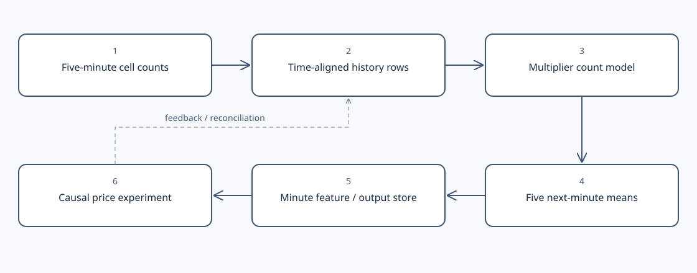

# W191. Ride Request Demand Prediction by Geohash and Premium Multiplier

**Priority group:** Second 100 — important

**Category:** Production ML and product design

**Study position:** 191 of 547

[Group list](../NEXT_100.md) · [All categories](../ALL_CATEGORIES.md) · [Chapter guide](../README.md)

## Question

A ride-hailing platform prices each small area of a city separately. To choose a price it needs a forecast: how many riders will request a ride in the next minute in each area, and how that number would change under each price level it can apply. Design the machine learning system that produces this forecast, and tie every modelling choice to its effect on the marketplace: the balance between riders and drivers, driver supply, and how sensitive riders are to price.

What to deliver
Training input: a history of per-cell, per-minute sessions and requests, plus the price multiplier that was in effect in each cell and minute.
Prediction input: the same two counts for each cell over the last 5 minutes.
Output: for each cell, five numbers: the expected number of ride requests in the next minute under each of the five multipliers.
Design: a written answer to the six questions below.
Rules of the setting
1. The service area is divided into geohash cells, each about 1.2 km by 600 m.
2. For every cell there is a stream of rider-app data. For the most recent 5 minutes you receive two counts:
sessions: the number of app-open sessions in the cell.
requests: the number of ride requests made from the cell.
3. The platform can apply one of five price multipliers to a cell: 0%, 15%, 50%, 70% or 100% extra.

### Examples

A cell saw 40, 42, 51, 47 and 55 sessions and 9, 11, 12, 10 and 14 requests in the five minutes up to 18:04. The system returns five expected request counts for 18:05, one for each multiplier from 0% to 100% extra.
A quiet cell on the edge of the city had no request in the last 5 minutes. It still gets five forecasts, and the design must say where they come from.
Questions the design must answer
1. Training rows and labels: define the prediction target and the training examples: what a row is, what its label is, and how the feature window and the label window line up in time.
2. Features and sparse cells: describe the features, including how cells with little history are handled.
3. Model and loss: choose a model family and a loss, and justify them for count data.
4. Data splits: explain how you split data for training, validation and test without leaking the future.
5. Meaning of the per-multiplier forecasts: explain what the predictions mean when the multiplier was chosen by the platform and not at random, and how you would make the per-multiplier numbers trustworthy.
6. Metrics, serving and monitoring: define offline and online metrics, the serving path, and monitoring.

### Constraints

Feature window: the last 5 minutes. Forecast horizon: the next 1 minute.
A fresh forecast for every cell and every multiplier is needed each minute.

## Worked solution

### Rows, alignment and output

For cell c and cutoff minute t, a feature row contains sessions and requests from t-4 through t inclusive. The label is R(c,t+1), requests in the next minute, and the treatment/input is the multiplier actually used during t+1. Thus the example ending at 18:04 predicts 18:05. Training must include the next-minute multiplier; using only the past multiplier and asking it to mean a future intervention changes the problem. At inference evaluate the same history under a∈{1.00,1.15,1.50,1.70,2.00}, returning five nonnegative expected counts, not five probabilities summing to one.

Features derived from the allowed window include five lag counts for each stream, sums, slopes, volatility, request/session ratios with safe zero denominators and recent conversion. Cell ID/embedding and deterministic time/calendar can be used if supplied/derivable; extra driver, weather or neighborhood counts are proposed extensions, not silently present inputs. A quiet cell is not necessarily zero demand: a global model shares patterns across cells, with shrunk cell effects/backoff to geography/time cohorts; a never-seen cell uses those priors and a wide uncertainty interval.

### Count model and forward validation

Start with last-minute/rolling-mean forecasts plus a pooled multiplier-conditioned Poisson regression or GBDT with Poisson loss. Let λ=exp(f(history,cell,time,a)); loss λ-y log λ plus a y-only constant gives a nonnegative expected count. If variance materially exceeds mean, use a negative-binomial head with learned dispersion. Zero inflation needs evidence; five zeros alone do not prove a structural-zero process. An optional exposure/conversion decomposition predicts next-minute sessions and requests per session, but the given inputs do not identify this independently without assumptions.

Split by increasing cutoff time, fit transforms only on training, and use an embargo where overlapping windows/labels would otherwise cross the split. Hold out whole cells/cities as a cold-geography test separately. Compare Poisson deviance, MAE/WAPE, aggregate count bias, interval coverage and calibration by cell activity/time/multiplier; avoid MAPE at zero. Every-minute serving updates the five-minute window in a keyed stream, then vectorizes five treatments per cell. With assumed 100,000 cells, 500,000 scores/minute is about 8,333/s; freshness and late-event correction matter as much as average throughput.

### Conditional forecasts are not automatically causal

Historical pricing responds to anticipated demand and scarce supply. Therefore E[R|history,A=a] generally differs from E[R(a)|history]; expensive-price periods may show high requests because they occurred during demand surges. The given logs cannot identify all five counterfactuals without exchangeability, consistency, positivity and treatment-interference assumptions. In particular, omitted supply/policy inputs confound pricing, and nearby cells interact through rider movement and driver relocation. Do not invent trustworthy response curves from the two-count history alone.

Run safe geo/time switchback randomized price experiments with logged propensities, supply and market context, washout and spillover-aware clusters. With defensible observed confounders and overlap, propensity weighting/doubly robust treatment models can supplement experimentation; they do not fix hidden confounding. Report unsupported multipliers as uncertain and constrain optimization rather than extrapolating confidently. Price response may reasonably be monotone for comparable demand, but observed conditional counts need not be; imposed monotonicity is an assumption to test.

Serve {cell,forecast_minute,as_of,model_version,λ[5],uncertainty,support_flags}; idempotent minute updates and event-time watermarks reject duplicate counts and expose stale data. Offline curves do not decide price alone: marketplace optimization must also forecast driver supply, matching and wait times, respecting rider elasticity, earnings and regulatory/product limits. Monitor requested/completed rides, rider conversion, wait/cancel, driver utilization/earnings and forecast calibration after labels arrive. Test zero sessions, quiet/new cells, late streams and treatment levels with no experimental support. No numeric five-count forecast can be derived from the example history without fitted parameters/data; any such numbers would be an explicitly labeled demo, not the answer's prediction.

<!-- architecture:W191:start -->

Read the numbered path as Five-minute cell counts → Time-aligned history rows → Multiplier count model → Five next-minute means → Minute feature / output store → Causal price experiment. The dashed return is the feedback or reconciliation path described in the solution; durable state and authorization remain authoritative when work is retried.
<!-- architecture:W191:end -->

### Runnable checks

[Batch behavior checks](../test_review_151_200.py) also validate this page's Python syntax and referenced diagrams. The architecture, capacity and metric reasoning is reviewed as a design; no production load, availability or model-quality result is claimed.

### Further study

- [F056: Fit a baseline on messy tabular data without leakage.](../06_classical_ml.md#f056)
- [F058: How should you split data for reliable model selection?](../06_classical_ml.md#f058)
- [F065: Distinguish data drift, concept drift and label delay.](../07_evaluation_and_data.md#f065)
