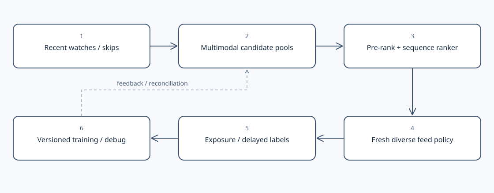

# W192. Short Video Recommendation & Ranking

**Priority group:** Second 100 — important

**Category:** Production ML and product design

**Study position:** 192 of 547

[Group list](../NEXT_100.md) · [All categories](../ALL_CATEGORIES.md) · [Chapter guide](../README.md)

## Question

Design a short-video recommendation or ranking system for Spotlight / Lens-style products, covering retrieval, ranking, short-term interest, cold start, delayed labels, and multimodal features.

Functional requirements
1. Generate a personalized feed of fresh short videos or lenses per user.
2. Capture short-term interest from recent watches, skips, likes, shares, hides, and follows.
3. Support retrieval and ranking when only a minority of videos have text descriptions.
4. Handle cold start for new users and new items.
5. Train and serve models with enough observability to debug ranking regressions.
Scale / constraints
Large catalog, high request rate, strict latency budget for feed vending.
Most useful labels are delayed or biased.
Content is multimodal: frames, audio, captions, creator, engagement, safety.
Design decisions
Candidate generation: two-tower embedding retrieval, ANN index, graph/creator co-engagement, trending pools.
Ranking: lightweight online ranker vs heavier batch features; multi-task objectives.
Freshness and exploration; bias handling (popularity, position, delayed labels, feedback loops).

## Worked solution

### Short-term intent and multimodal discovery

Optimize satisfying watch/creation experiences and repeat use, using capped watch duration, duration-adjusted completion, shares and hides as training signals. Lens experiences may target meaningful lens use/creation instead of passive video watch; select the product contract before combining labels. Guard safety, reports, fatigue and creator diversity. A rapid skip is a prompt short-term signal; a share or later return can arrive much later, so use event-time sequence features and mature outcome windows.

Each impression logs actual visibility/playback, user/video/version, position, candidate source and model version. Features include the user's most recent watch/skip/like/share/hide/follow sequence, longer-term interests and recent repeat exposure. Encode video frames, audio/music, ASR/OCR where available, creator and quality/safety metadata. Most items lacking text remain retrievable through visual/audio embeddings; treating absent captions as empty semantic content would discard valuable items. Precompute item encoders offline and update new uploads incrementally.

### Candidate pools and ranker

The diagram's retrieval union includes two-tower ANN, co-watch/creator graph, followed creators, fresh/trending and bounded exploration. Deduplicate and apply region/age/safety eligibility, pre-rank thousands to hundreds, then a multi-task ranker combines candidate embeddings with the latest user sequence and context. Predict watch-time distribution, completion conditional on duration, share/follow and hide probabilities; mask unavailable delayed labels rather than treating them as zero. Re-rank to avoid duplicate creators/topics, maintain freshness and protect safety. A fixed global popularity list is a fallback, not personalization.

Cold users get declared preferences, language/context and diverse safe content; the first few skips/watches rapidly update session state. Cold videos/lenses use multimodal content, creator priors and controlled exposure, not imaginary engagement. Calibrate engagement heads on held-out natural-prevalence data, especially if training negatives are subsampled. Popularity and position bias need logged exposure/propensity and randomized slots; unseen items are not observed negatives.

### Serving, feedback and evidence

Assume a 150 ms p99 feed budget: 20 ms recent-history/features, 30 ms parallel retrieval, 15 ms filtering/pre-rank, 45 ms final rank and 40 ms re-rank/network. Scale is unspecified; with 20,000 QPS×200 final candidates, four million pair scores/s motivates item-feature caches, batch scoring and regional indexes. Cache a short continuation but refresh user intent and removals; cursor state includes feed/model version and seen IDs. On sequence-store failure use long-term content affinity; on ranker failure use safe fresh/popular pools, with fallback logging.

Use forward-time tests and duplicate-content/creator cold-start holdouts. Evaluate recall, NDCG on qualified watches, calibration, label maturity and negative-event/safety slices. User A/B tests track meaningful engagement and retention with predefined guardrails/duration; creator/social spillovers and novelty require extra analysis. Observe short-term utility separately from long-term health, since optimizing immediate duration can create feedback loops.

Store versioned models, embedding/index manifests, feature schemas and audit lineage. Canary model/index pairs and retain compatible rollback. Monitor per-stage p99, feature age, retrieval-source yield, modality missingness, exposure completeness, maturity-adjusted quality and subgroup regressions. Debug a ranking change by replaying a request with frozen candidates/features to separate retrieval loss, feature drift, model score changes and re-ranking policy. Test delayed shares, missing text, sequence reordering, removed cached items and new-creator exposure rather than relying on one aggregate offline metric.

<!-- architecture:W192:start -->

Read the numbered path as Recent watches / skips → Multimodal candidate pools → Pre-rank + sequence ranker → Fresh diverse feed policy → Exposure / delayed labels → Versioned training / debug. The dashed return is the feedback or reconciliation path described in the solution; durable state and authorization remain authoritative when work is retried.
<!-- architecture:W192:end -->

### Runnable checks

[Batch behavior checks](../test_review_151_200.py) also validate this page's Python syntax and referenced diagrams. The architecture, capacity and metric reasoning is reviewed as a design; no production load, availability or model-quality result is claimed.

### Further study

- [F184: Design personalized short-video ranking.](../19_product_ml_case_studies.md#f184)
- [F082: Design a recommendation system from candidate generation to ranking.](../09_ml_system_design.md#f082)
