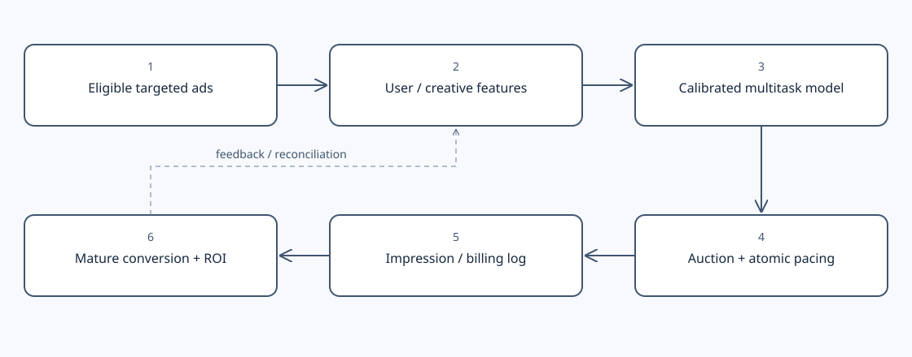

# W193. Snap Ads Ranking

**Priority group:** Second 100 — important

**Category:** Production ML and product design

**Study position:** 193 of 547

[Group list](../NEXT_100.md) · [All categories](../ALL_CATEGORIES.md) · [Chapter guide](../README.md)

## Question

Design an ads ranking system with feature construction, multi-task objectives, delayed labels, calibration, and business constraints.

Functional requirements
1. Rank candidate ads for a user request using relevance, predicted engagement, advertiser objective, and policy/quality constraints.
2. Build features from user history, ad creative, advertiser, context, and recent behavior.
3. Train models for multiple engagement levels such as click, conversion, hide, long view, or downstream value.
4. Handle delayed and sparse labels, especially conversions.
5. Provide online metrics, offline metrics, and debugging tools for regressions.
Scale / constraints
Ranking happens under a tight online latency budget.
Labels are biased by position, auction exposure, targeting, and delayed conversion windows.
Business objectives combine user experience, advertiser ROI, revenue, and marketplace health.
Design decisions
Retrieval / candidate generation vs final ranking.
Single-task CTR vs multi-task model for several engagement levels.
Weighted logistic regression or deep ranking model; calibration and auction compatibility; exploration, cold-start ads, and budget pacing.

## Worked solution

### Candidates, predictions and auction-compatible value

Retrieve ads eligible for the user/request from targeting indexes, embedding relevance and advertiser objective pools. Filter policy, age/region, campaign state, budget and creative quality before ranking. The output score must match the auction's payment objective: for a CPC bid b, expected revenue per impression is b·p(click); eCPM is 1,000 times that. A CPA bid requires p(conversion per impression), not raw pCTR. User harm/quality constraints and advertiser ROI limit revenue optimization; do not simply add CTR, hide probability and dollars on incompatible scales.

Features include recent/long-term user interests, creative image/video/text embeddings, landing page/product, advertiser historical quality, bid/objective, context/placement/device and recent ad frequency. Use smoothed historical aggregates with age/sample counts and point-in-time joins. New ads/advertisers use content and cohort priors plus limited exploration, with policy/quality screening before exposure.

### Multi-task model and labels

A shared feature encoder with separate calibrated heads predicts click, long view, hide and conversion/value. Use binary cross-entropy on observed task labels, masks for immature conversion windows and suitable regression/distribution loss for value. A click→conversion factorization can model pCVR conditional on click, but evaluation/selection effects matter; view-through conversions need a separate attribution contract. Baseline weighted logistic regression is interpretable and cheap; a deep cross/multi-task ranker captures creative-user interactions at more inference/training cost. Test negative transfer between tasks rather than assuming sharing helps.

Impression records include auction candidate/exposure/position, bid, model/feature versions, propensity and creative version. Join click and attributed conversion events after maturity; a day-old nonconversion may be censored under a seven-day window. Delayed-feedback/survival correction or mature-window training can handle this, while monitoring changing label delay. Correct negative subsampling/prior shift before probability calibration. Calibrate held-out predictions by objective/placement using Platt/isotonic or temperature methods with adequate support; bid×miscalibrated pCTR misallocates auctions even if AUC is high.

### Serving and marketplace state

The diagram is eligible retrieval → feature/model scoring → quality/auction/pacing → impression logging. Budget reservation and pacing are authoritative conditional updates, with unique auction/impression IDs; two serving replicas cannot overspend a campaign by independently trusting a cached budget. Exposure/click/billing events deduplicate separately. Idempotent retry returns the original auction result where possible, and unknown billing outcomes reconcile rather than charging twice. Keep budget/policy failures distinct from model failures; a validated simple scorer can replace an unavailable deep model while preserving eligibility and caps.

Assume 50,000 requests/s and 200 ranked ads: ten million pair scores/s. An illustrative 100 ms budget allocates 20 ms retrieval, 20 ms batch features, 30 ms model, 10 ms auction/budget and 20 ms network/headroom. Precompute creative features, version model/index, warm canaries and keep rollback compatible. Offline evaluate log loss, PR/AUC for diagnostics, calibration, expected-value ranking and mature conversion/ROI by slice. User-randomized tests assess revenue, advertiser outcomes and user retention/hide/complaint rates; auction/budget interference may require campaign/geo cluster or marketplace experiments. Predefine duration/guardrails, monitor sample-ratio mismatch, position/popularity feedback and advertiser concentration. Debug regressions using fixed-request replay plus budget/targeting/pacing traces, not model scores alone.

<!-- architecture:W193:start -->

Read the numbered path as Eligible targeted ads → User / creative features → Calibrated multitask model → Auction + atomic pacing → Impression / billing log → Mature conversion + ROI. The dashed return is the feedback or reconciliation path described in the solution; durable state and authorization remain authoritative when work is retried.
<!-- architecture:W193:end -->

### Runnable checks

[Batch behavior checks](../test_review_151_200.py) also validate this page's Python syntax and referenced diagrams. The architecture, capacity and metric reasoning is reviewed as a design; no production load, availability or model-quality result is claimed.

### Further study

- [F082: Design a recommendation system from candidate generation to ranking.](../09_ml_system_design.md#f082)
- [F063: Choose metrics for ranking and recommendation.](../07_evaluation_and_data.md#f063)
