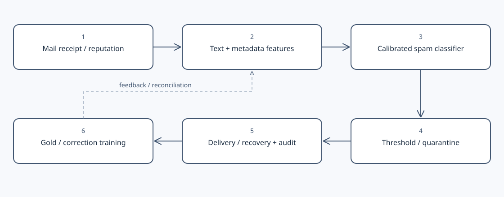

# W194. Spam Email Detection: Signals, Model, and Metrics

**Priority group:** Second 100 — important

**Category:** Production ML and product design

**Study position:** 194 of 547

[Group list](../NEXT_100.md) · [All categories](../ALL_CATEGORIES.md) · [Chapter guide](../README.md)

<span class="practice-page"></span>

## Question

Open-ended ML design plus light coding. Given a large corpus of past emails, design a system that identifies spam.

You are expected to:
1. Ask clarifying questions to scope the problem.
2. Propose spam signals/features and a classification approach.
3. Define accuracy metrics — precision, recall, F1, false-positive rate — and reason explicitly about the trade-off between catching more spam vs. blocking real mail.
4. Sketch class-level code for the system.

There is no single correct answer; the interviewer is evaluating how you decompose an ambiguous problem and handle trade-offs.

## Worked solution

### Clarify the spam decision

Ask whether the product tags, quarantines or rejects mail; whether phishing is a separate class; which languages/latency/volume matter; what labels exist; and how costly a missed real message is. Assume receipt-time spam quarantine, with user recovery, a 100 ms service budget and no permanent deletion. High precision is essential because false positives hide legitimate mail. A two-threshold design delivers low risk, quarantines high risk and flags intermediate risk without blocking delivery if policy allows.

Use sender/domain reputation, authentication results, sending-rate patterns, URL/domain reputation, subject/body text, HTML/link mismatch, attachment metadata and recipient-specific history available at receipt. Avoid executing attachments or fetching arbitrary links in the scoring request. Start with TF-IDF plus logistic regression/naive Bayes; a lightweight text encoder plus reputation features is a stronger option after a matched-latency comparison. Split by time and duplicate campaign/sender groups, not random nearly identical messages. Labels combine carefully audited user reports, recovered false positives and expert gold data, with provenance and safeguards against malicious reporting.

### Metrics and threshold example

With TP spam caught, FP legitimate quarantined, FN spam missed and TN legitimate delivered:

$$Precision=TP/(TP+FP),\quad Recall=TP/(TP+FN),$$
$$F1=2TP/(2TP+FP+FN),\quad FPR=FP/(FP+TN).$$

Define undefined denominators explicitly in reporting. For an illustrative corpus of 10,000 emails with 1,000 spam, suppose TP=900, FP=90, FN=100, TN=8,910. Precision is 90.91%, recall 90%, F1≈90.45% and FPR=1%. Accuracy is 98.1%, but 90 real messages are still hidden. Lowering the threshold can catch more spam while increasing this harm; choose the operating point from review/recovery costs and precision/FPR targets, not accuracy alone. Calibrate scores on held-out natural-prevalence data after resampling.

### Class-level implementation sketch

The following is executable without a model library. Its injected model must return a calibrated probability; the small demo model in the tests is a fixture, not a trained spam detector.

```python
from dataclasses import dataclass
from typing import Callable


@dataclass(frozen=True)
class Email:
    message_id: str
    subject: str
    body: str
    sender_reputation: float
    authentication_failed: bool


class SpamDetector:
    def __init__(self, model: Callable[[dict], float], threshold=0.99):
        if not 0 <= threshold <= 1:
            raise ValueError("threshold must lie in [0,1]")
        self.model, self.threshold = model, threshold

    def features(self, email):
        return {
            "text": email.subject + "\n" + email.body,
            "sender_reputation": email.sender_reputation,
            "authentication_failed": email.authentication_failed,
        }

    def classify(self, email):
        p = float(self.model(self.features(email)))
        if not 0 <= p <= 1:
            raise ValueError("model must return a finite probability")
        return {
            "message_id": email.message_id,
            "spam_probability": p,
            "action": "QUARANTINE" if p >= self.threshold else "DELIVER",
        }
```

A production receipt service deduplicates by mailbox/message receipt ID, records model/feature/threshold versions and uses an outbox to apply the delivery action idempotently. Message-ID headers alone are attacker-controlled and not a sufficient receipt key. The diagram's classifier feeds a quarantine/recovery boundary; user corrections are reviewed label events, not immediate unrestricted model updates. Scale is missing: assuming 5,000 messages/s×20 ms average model time implies 100 concurrent inferences before headroom. Store encrypted raw mail with strict retention/access, cache reputations and use a validated fallback during model outages. Monitor precision/recall on mature audited samples, campaign/language drift, complaint/recovery rate and latency. Tests cover threshold equality, invalid probabilities and the metric example; real predictive accuracy requires the absent corpus and labels.

<!-- architecture:W194:start -->


Read the numbered path as Mail receipt / reputation → Text + metadata features → Calibrated spam classifier → Threshold / quarantine → Delivery / recovery + audit → Gold / correction training. The dashed return is the feedback or reconciliation path described in the solution; durable state and authorization remain authoritative when work is retried.
<!-- architecture:W194:end -->

### Runnable checks

[Executable W194 implementation](../review_w194_implementation.py). [Batch behavior checks](../test_review_151_200.py) exercise Threshold equality/delivery; Invalid probability/threshold handling; Exact confusion-matrix metric arithmetic.

### Further study

- [F054: Why can high accuracy hide failure on imbalanced data?](../06_classical_ml.md#f054)
- [F056: Fit a baseline on messy tabular data without leakage.](../06_classical_ml.md#f056)
- [F068: Check calibration and choose a decision threshold.](../07_evaluation_and_data.md#f068)
