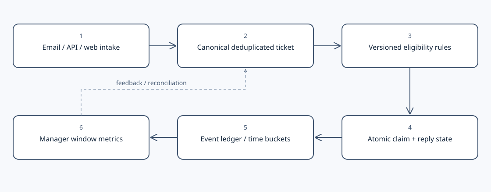

# W195. Support Ticket Routing & Claiming System

**Priority group:** Second 100 — important

**Category:** Production ML and product design

**Study position:** 195 of 547

[Group list](../NEXT_100.md) · [All categories](../ALL_CATEGORIES.md) · [Chapter guide](../README.md)

<span class="practice-page"></span>

## Question

Design an internal support system where tickets can be submitted via email, a public API, and a web contact form; each agent sees and claims tickets matching routing rules (e.g. language, location); and managers can view metrics such as average first-response time and average close time over a chosen window. The graded decisions are normalizing multi-channel ingestion into one ticket model, a rules-based routing/claim path that avoids double-claim races, and a metrics pipeline that aggregates over rolling time windows without scanning full history.

### Requirements

Functional
Accept ticket submission from three channels — email, public API, web contact form — and normalize into a single canonical ticket model.
Route tickets to agents by configurable rules (language, location, similar attributes); an agent views and claims eligible tickets.
A claimed ticket is owned by exactly one agent — no double-claim.
Managers query metrics over a time window: average first-response time and average close (resolution) time.
Non-functional / decisions to surface
Concurrency-safe claiming when multiple agents race for the same ticket.
A rules engine reconfigurable without redeploying.
Metric aggregation over arbitrary time ranges that does not scan full ticket history per query.

## Worked solution

### Canonical intake and configurable routing

Email adapters authenticate inbound webhooks, API clients authenticate requests and the web form uses abuse controls. All normalize to Ticket(id,external_source,external_id,requester,subject,body,language,location,created_at,state,owner,version,routing_version,first_response_at,closed_at). Unique (source,external_id) or a client idempotency key deduplicates intake; an email retry must not open another ticket. Thread replies use verified conversation tokens/provider thread mapping, not subject alone. Attachments go to scanned object storage with references in ticket metadata.

`POST /tickets`, `GET /tickets?eligible_for=me&cursor=...`, `POST /tickets/{id}:claim`, `/respond`, `/close`, and `GET /metrics?from=&to=&team=` form the API. Store versioned routing rules in a configuration database with validated predicates, precedence, destinations and effective time. An admin UI publishes a tested rule version without deployment; record which version made each assignment. Default/unmatched tickets go to triage. Listing eligible work can use a read model indexed by language/location/queue, but the claim operation must revalidate current rules, ticket state and agent skills/availability.

### Exactly one current owner

The diagram's routing queue proposes eligible tickets; only an atomic database claim establishes ownership. In one transaction lock the ticket, load authoritative eligibility and run the equivalent of:

```sql
UPDATE ticket SET owner = :agent, state = 'CLAIMED', version = version + 1
WHERE id = :ticket AND owner IS NULL AND state = 'OPEN' AND version = :seen_version
RETURNING id;
```

Return 409 if no row changes; the actual implementation includes authorization/rule checks in the same consistency boundary. A repeated claim by the same agent with the same request key returns the original result. Transfers/releases append events and use owner/version checks. A permanent owner assignment does not need an automatically expiring lease; if leases are chosen, expiry/renewal and takeover must fence the former owner's replies. Store response outbox and ticket timestamps transactionally so two channels cannot count/send the first response twice. Human replies, bot acknowledgments and internal notes are distinguished; assume first_response_at means the first public human response.

### Rolling metrics without history scans

Define both duration and cohort membership. Assume first-response metrics include tickets whose first response occurred in [from,to), and resolution metrics include final closes in that interval; creation-cohort metrics are a separate report because recent open tickets are censored. Duration is response/close timestamp minus created_at, measured in wall-clock seconds unless business-hours calendars are explicitly requested. Specify reopen policy; assume close metrics use final resolution after a defined reopen window and apply corrections if reopening invalidates it.

Emit idempotent metric-contribution records keyed by ticket,metric,event_version with event time, team, count=1 and duration_sum. Stream workers update minute buckets (team,metric,minute,sum_duration,count), maintaining a contribution ledger so duplicate/reordered events cannot double count and later corrections subtract the old contribution before adding the new one. Averages are total sum/total count, never an average of bucket averages. Query arbitrary ranges using preaggregated full buckets plus indexed raw contributions for the two partial boundary minutes; combine hourly/daily rollups for long windows. This scans at most bounded edge data plus rollups, not full ticket history. Report no completed observations separately from a zero duration.

Example: one minute has two responses totaling 20 minutes and another has eight totaling 40. The combined mean is 60/10=6 minutes, not (10+5)/2=7.5. Late email events correct their event-time buckets; expose data_as_of so managers know freshness. Scale is unspecified: one million tickets/day is 11.6/s average; a tenfold burst is 116/s before replies. Index state/queue/time, partition event/bucket history and keep the claim database strongly consistent. An analytics outage delays metrics but never blocks intake/claims; an ownership-database outage blocks new claims safely. Test simultaneous claims, stale rules, duplicate intake, duplicate metric events, reopen correction, exact time boundaries and unequal bucket sizes. Monitor ingest lag, claim conflicts, unrouteable tickets, oldest unowned age and metric freshness.

<!-- architecture:W195:start -->


Read the numbered path as Email / API / web intake → Canonical deduplicated ticket → Versioned eligibility rules → Atomic claim + reply state → Event ledger / time buckets → Manager window metrics. The dashed return is the feedback or reconciliation path described in the solution; durable state and authorization remain authoritative when work is retried.
<!-- architecture:W195:end -->

### Runnable checks

[Batch behavior checks](../test_review_151_200.py) exercise Two-thread SQLite conditional-claim race has one winner; Idempotent/versioned metric ledger, correction, weighted mean and half-open boundary.

### Further study

- [F187: Design a support-ticket routing model.](../19_product_ml_case_studies.md#f187)
