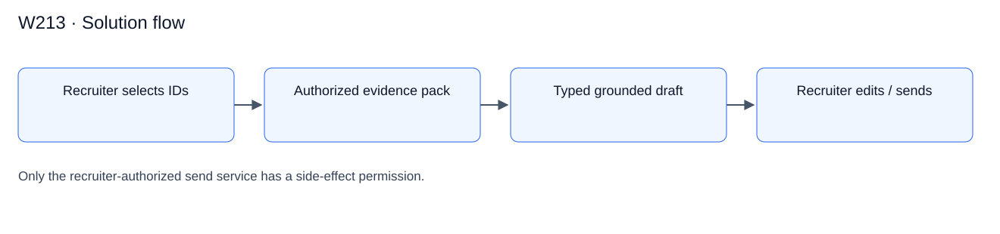

# W213. AI Personalized Recruiter Message Generation

**Priority group:** Third 100 — broader practice

**Category:** RAG, agents and application security

**Study position:** 213 of 547

[Group list](../THIRD_100.md) · [All categories](../ALL_CATEGORIES.md) · [Chapter guide](../README.md)

## Question

Design an end-to-end system that helps recruiters generate personalized candidate outreach (an InMail draft). It pulls the candidate profile and recent activity, the open role, and the recruiter's past outreach style, then produces a draft the recruiter edits and sends. Telemetry feeds response / no-response signals back.

Non-functional: draft in under a few seconds; factually grounded in profile + job; stylistically aligned with the recruiter; guardrails against fabricated experience and privacy violations.

Recurring sub-prompts: tool registration, RAG, fine-tuning vs prompting, human-in-the-loop, and offline + online evaluation.

## Worked solution

### Grounded drafts with a human send boundary

Assume 100,000 recruiters, 10 drafts/day each and a 10× peak: about 12 average and 120 peak drafts/s. Target p95 under three seconds for a short draft; tune output length and measure the actual provider before promising it. Scope to drafts in version one; sending is a separate recruiter-authorized action.

Store `Draft(id, tenant, recruiter, candidate, role_version, source_versions, prompt_version, model_version, text, status)`, permissioned candidate/activity records, recruiter-approved style examples and feedback events. `POST /drafts` accepts candidate/role IDs and an idempotency key, not arbitrary privileged profile URLs. `PATCH /drafts/{id}` records edits with a revision; `POST /drafts/{id}/send` requires an authenticated explicit action and stable message ID. Tenant and recruiter checks apply to every source lookup.

The flow is client → auth/quota → parallel profile/job/style retrieval → evidence pack → model → schema/support checks → editable draft. The arrows are data flow; the model has no sending permission. Register read-only typed tools such as `get_profile(candidate_id)` and `get_role(role_id)` with server-enforced access, timeouts and field allowlists. Retrieved profile text is untrusted; it cannot register tools or override policy. Limit recent activity and avoid sensitive inferred attributes. Style retrieval uses the recruiter's approved messages and strips recipient-specific facts.

An evidence pack might say `P12: candidate maintained a Kafka pipeline` and `J7: role requires streaming infrastructure`. A permitted draft is “Your Kafka pipeline work seems relevant to this role.” “You led a 20-person team” is unsupported and must be removed or rejected. Require structured claims with source IDs, then check entailment/support, prohibited content and length. Schema validation alone cannot detect fabricated experience. With no relevant evidence, produce a short neutral draft and explain the missing personalization.

Start with prompting plus retrieval: profile and job facts change too often to fine-tune into weights. Consider tuning only for stable style/format after collecting consented edit data and showing a held-out benefit. Split evaluation by recruiter and candidate to avoid memorized style examples. Offline measure unsupported-claim rate, source precision, privacy violations, style preference and draft latency/cost. Online randomize at recruiter or campaign level, measure accepted drafts, edit distance, response and complaint rates with a sufficient response window. No response is censored/noisy feedback, not proof a candidate disliked the wording; control role quality and selection effects.

Cache role/style context by version, cap token budgets and isolate tenants' spend. If a profile source times out, return a clearly less-personalized draft or ask the recruiter; never invent. Retain only authorized data, propagate deletion to drafts/caches, audit reads and sends, and prevent a retry after a network timeout from sending twice.

### Follow the diagram

Read the arrows from left to right: Recruiter selects IDs → Authorized evidence pack → Typed grounded draft → Recruiter edits / sends. Only the recruiter-authorized send service has a side-effect permission.

### Further study

- [F071: Design a minimal retrieval-augmented question-answering system.](../08_rag_and_agents.md#f071)
- [F077: Design tool schemas and validate LLM outputs.](../08_rag_and_agents.md#f077)
- [F088: Design an LLM evaluation and annotation platform.](../09_ml_system_design.md#f088)
