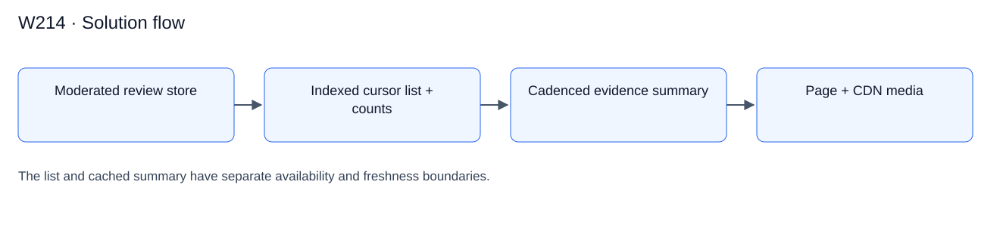

# W214. Design a Customer Review Page with AI Summarization

**Priority group:** Third 100 — broader practice

**Category:** RAG, agents and application security

**Study position:** 214 of 547

[Group list](../THIRD_100.md) · [All categories](../ALL_CATEGORIES.md) · [Chapter guide](../README.md)

## Question

(EM-track system design.) Design a customer-facing review page for a food-delivery app.

### Requirements

Display reviews for a restaurant / item with rating distribution and multimedia (photos, video).
Searchable / filterable by date, rating, with-photo, helpful, language.
An AI-summary section that distills the review corpus into a short highlights + lowlights summary, refreshed on a cadence.
Pagination / infinite scroll on the review list.

This is an EM round: the interviewer grades how you scope the problem and which sub-systems you delegate, plus product and cost trade-offs, more than raw infra depth.

## Worked solution

### Scope and divide the review page

Start with restaurant/item reviews and explicit language/rating/photo/date filters; defer personalized ranking and automatic translation until the core page is trustworthy. Assume 10 million reviews, 1 million daily readers, 20 page requests/reader and 10× peak: roughly 230 average and 2,300 peak reads/s. At 2 KB of text/metadata per review, raw review rows occupy about 20 GB; media lives separately in object storage and a CDN.

The request flow is app → API gateway → review query service → relational store/search index, with image/video URLs served by CDN. The summary flow is review-change events → moderation → summary job → versioned summary store → page API. These are two independent paths: a summary failure must not block the review list. Assign separate owners to review/query+index, media/moderation, summary/evaluation, and frontend/experimentation; an EM coordinates shared IDs, SLAs and a staged launch.

Use `Review(id, restaurant_id, item_id, user_id, rating, text, language, created_at, moderation_state, version)`; `Media(id, review_id, type, object_key, scan_state)`; `HelpfulVote(review_id,user_id)` with a unique key; and `Summary(entity_id, corpus_watermark, model_version, highlights, lowlights, evidence_ids, status)`. `GET /restaurants/{id}/reviews?rating=...&language=...&cursor=...` returns reviews, a next cursor and rating counts. Cursor pagination uses a stable `(created_at,id)` order for newest; helpful sort needs an epoch/snapshot or accepts rank drift. Offset pagination becomes slow and skips/duplicates rows during concurrent writes.

Maintain rating aggregates from idempotent review-version events and reconcile periodically. Make the summary refresh cadence explicit, such as hourly for active restaurants and daily otherwise. Select a representative, language-aware sample with per-author caps; map reviews to supported themes, then reduce to short highlights/lowlights with evidence IDs and counts. Show “based on X reviews, updated at Y”; do not let a tiny vocal sample speak for the full corpus. New restaurants with too few reviews get no AI summary. Do not regenerate on each page view: at 100,000 active entities/day and an assumed $0.002/job, summaries cost about $200/day before retries, rather than paying per read.

Moderation/deletion must remove text and media from the list promptly. Mark affected summaries stale and regenerate or hide them; serving a cached summary after deleting its sole evidence is a privacy/correctness bug. A generation timeout leaves the previous still-valid summary with its timestamp. Offline evaluate factual support, theme coverage, sentiment balance and multilingual quality; online track usefulness, list engagement, complaints, latency and summary cost. Launch the basic page first, then summary for a small cohort with a kill switch and named quality owner.

### Follow the diagram

Read the arrows from left to right: Moderated review store → Indexed cursor list + counts → Cadenced evidence summary → Page + CDN media. The list and cached summary have separate availability and freshness boundaries.

### Further study

- [F071: Design a minimal retrieval-augmented question-answering system.](../08_rag_and_agents.md#f071)
- [F077: Design tool schemas and validate LLM outputs.](../08_rag_and_agents.md#f077)
- [F088: Design an LLM evaluation and annotation platform.](../09_ml_system_design.md#f088)
