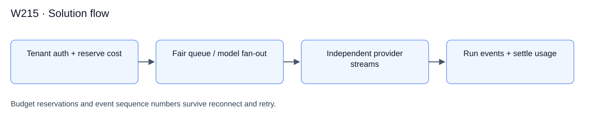

# W215. Design an AI Prompt Playground

**Priority group:** Third 100 — broader practice

**Category:** RAG, agents and application security

**Study position:** 215 of 547

[Group list](../THIRD_100.md) · [All categories](../ALL_CATEGORIES.md) · [Chapter guide](../README.md)

## Question

Design an AI prompt playground — a multi-tenant web tool where users author prompts, run them against one or more LLMs, compare outputs side by side, and save and version their work.

In your design, address:

the request flow to model providers and streaming responses back to the UI,
managing API keys, per-tenant rate limits, and cost tracking,
storing prompts, runs, and history; versioning and sharing,
side-by-side multi-model comparison,
the key trade-offs.

The crux to nail: multi-tenant cost / rate-limit isolation alongside responsive streaming of many concurrent runs.

## Worked solution

### Treat each comparison as separately metered runs

Assume 10,000 active tenants, 100,000 comparisons/day, three models/comparison and a 20× peak: about 70 peak provider runs/s. At an assumed 1,000 input and 300 output tokens/run and $2/$8 per million input/output tokens, expected model cost is $4.40 per thousand runs or $1,320/day for 300,000 runs. These are sizing prices, not provider quotes; actual rates are versioned configuration.

Store `Workspace(tenant, members)`, immutable `PromptVersion(id,parent,template,variables,author)`, `Comparison(id,prompt_version,dataset_version)`, `Run(id,comparison,model,params,status,provider_request_id,usage,cost)` and `RunEvent(run_id,seq,type,payload)`. Sharing grants workspace roles or a scoped read link; all row/object queries enforce tenant ownership. An edited prompt creates a new version, so historical outputs remain reproducible.

`POST /comparisons` validates the template and selected models, reserves a worst-case token budget atomically against tenant spend, creates one run per model, and returns IDs. `GET /runs/{id}/events?after=seq` streams SSE events; `POST /runs/{id}/cancel` stops further work best-effort. Provider adapters translate models' request and stream formats into `token/usage/error/done` events. A worker queue fans out models independently; the UI aligns outputs by run, not by token arrival. One slow model cannot hold the others' streams open indefinitely. Persist sequence numbers for reconnect; do not restart a chargeable generation merely because the browser disconnected.

API keys belong in an encrypted secrets service with tenant-bound access, rotation and redaction. The browser never receives provider credentials. Enforce request rate, concurrent-run limits, token-rate limits and dollar budgets per tenant, plus each provider's global limits. Admission reserves estimated maximum cost; completion settles against actual usage and releases unused reservation. Crash recovery reconciles uncertain charges before releasing them, preventing a tenant from bypassing budget through retries.

Use bounded tenant queues and weighted fair scheduling; one large comparison must not starve others. At 70 runs/s and mean 8 seconds generation, expect roughly 560 live streams; load-test connection limits, backpressure and persistence overhead. Buffer small event batches, cap slow-client buffers and allow reconnect from durable history. Retry pre-generation transient failures with jitter; once tokens have streamed, expose partial failure rather than silently appending a second answer. Provider idempotency, where available, helps but is not universal.

Key trade-offs are durable event replay versus storage/write cost, strict budget reservation versus lower utilization, and immediate cancellation versus provider limitations. Track per-tenant queue time, first token, completion, errors, provider throttles and billed-versus-estimated usage. A useful failure drill is one provider timing out after charging: the other outputs remain usable and the run is marked uncertain until reconciled, with no cross-tenant budget impact.

### Follow the diagram

Read the arrows from left to right: Tenant auth + reserve cost → Fair queue / model fan-out → Independent provider streams → Run events + settle usage. Budget reservations and event sequence numbers survive reconnect and retry.

### Further study

- [F067: Build an LLM evaluation harness.](../07_evaluation_and_data.md#f067)
- [F077: Design tool schemas and validate LLM outputs.](../08_rag_and_agents.md#f077)
- [F090: Design a rate-limited LLM classification pipeline.](../09_ml_system_design.md#f090)
